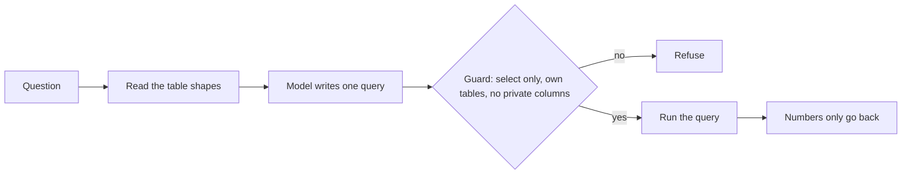

# Query any schema through a tool, never raw rows

Job: answer territory sales questions without leaking prescriber data.

## The story in one picture



## Why this matters

Sales leads ask about numbers. Which territory sold least last month? The answer lives in a table.

One easy way is to paste the table into the prompt. That puts private data in front of a model. It also breaks as soon as a second workspace keeps its numbers in a different shape.

So the agent gets a tool. The tool shows the table shapes, takes one query, and returns only numbers. A **guard** checks every query before it runs.

## What you will have at the end

- A tool that lists the tables of one workspace.
- A guard that refuses private columns, other workspaces and writes.
- An agent that answers a weekly question and a monthly question the same way.
- Spans that hold the query and a row count, never a row.

## See it fail first

Why does the agent need a tool for numbers instead of a table pasted into the prompt? Look at the naive prompt from the first module. It holds every prescriber and every email.

For example, ask which territory sold least CardioZ in June. The model has no way to add up weeks. It also sees a doctor's email it never needed.

## Step 1: read the table shapes

Each workspace keeps its tables in its own **schema**. That is a named folder of tables. Pharma A keeps weekly rows. Pharma B keeps monthly rows with different column names.

The tool asks the database what is in the schema. The model then writes a query for the shape it sees. The prescriber table lives outside both schemas, so it never shows up.

### packages/core/src/bi.ts

```ts
export async function inspectSchema(owner: string, tags: Tags): Promise<TableShape[]> {
  return traced("bi.inspect_schema", tags, async (setAttributes) => {
    const found = await rows<{ table_name: string; column_name: string }>(
      `SELECT table_name, column_name FROM information_schema.columns
       WHERE table_schema = $1 ORDER BY table_name, ordinal_position`,
      [owner],
    );
    const shapes: TableShape[] = [];
    for (const item of found) {
      const name = `${owner}.${item.table_name}`;
      const last = shapes[shapes.length - 1];
      if (last !== undefined && last.table === name) last.columns.push(item.column_name);
      else shapes.push({ table: name, columns: [item.column_name] });
    }
    setAttributes({ tables: shapes.length });
    return shapes;
  });
}
```

## Step 2: guard the query

The model writes the query, so code must check it. The guard allows one select statement. Each table must belong to this workspace. No private column word may appear.

An **aggregate** is one number that sums up many rows. The tool returns aggregates, not people.

### packages/core/src/bi.ts

```ts
const TABLE_WORD = /\b(?:from|join)\s+([a-z0-9_.]+)/gi;
const PERSONAL_WORD = /\b(email|npi|name|prescribers?)\b/i;

export function guardQuery(sql: string, owner: string): string | undefined {
  if (!/^\s*select\b/i.test(sql)) return "only select queries are allowed";
  if (sql.trim().replace(/;$/, "").includes(";")) return "only one statement is allowed";
  if (PERSONAL_WORD.test(sql)) return "personal data columns are not available";
  const tables = [...sql.matchAll(TABLE_WORD)].map((match) => match[1].toLowerCase());
  if (tables.length === 0) return "the query reads no table";
  const outside = tables.find((table) => !table.startsWith(`${owner}.`));
  if (outside !== undefined) return `the table ${outside} is outside this workspace`;
  return undefined;
}
```

## Step 3: run it and return numbers

The tool builds the prompt from the table shapes. It then runs the checked query with a row limit. The span records the query and the row count. It never records a row.

### packages/core/src/bi.ts

```ts
export function schemaPrompt(question: string, shapes: TableShape[]): string {
  const tables = shapes.map((shape) => `${shape.table}(${shape.columns.join(", ")})`);
  const rules = "Write one Postgres select query that answers the question. Use only these tables.";
  return [rules, tables.join("\n"), `Question: ${question}`].join("\n\n");
}

function sentenceOf(result: Record<string, unknown>[]): string {
  if (result.length === 0) return "The query found no rows.";
  const lines = result.map((row) => {
    const pairs = Object.entries(row).map(([name, value]) => `${name}: ${value}`);
    return pairs.join(", ");
  });
  return lines.join("\n");
}

export async function answerData(
  question: string,
  tenantId: string,
  tags: Tags,
  writeQuery: WriteQuery,
): Promise<AgentResult> {
  const owner = schemaOf(tenantId);
  const shapes = await inspectSchema(owner, tags);
  const sql = (await writeQuery(schemaPrompt(question, shapes))).trim();
  const problem = guardQuery(sql, owner);
  if (problem !== undefined) return refusal(`I cannot run that query: ${problem}.`);
  const found = await traced("bi.query", tags, async (setAttributes) => {
    const limited = `SELECT * FROM (${sql.replace(/;$/, "")}) AS answer LIMIT ${MAX_ROWS}`;
    const result = await rows<Record<string, unknown>>(limited);
    setAttributes({ sql, row_count: result.length });
    return result;
  });
  return { route: "answer", text: sentenceOf(found), citations: [owner] };
}
```

## Step 4: verify

```bash
bun run verify analytics-mcp
```

Expect: six green badges and the line "Every check passed."

## Try it yourself

Block the query `SELECT MIN(email) FROM ...` in a new way. For example, ask the guard to refuse any column that ends in `_id`. Then add a check for it.

## Stuck?

| You see                                       | Why                                                          | Fix                                                                   |
| --------------------------------------------- | ------------------------------------------------------------ | --------------------------------------------------------------------- |
| A query for emails was run.                   | The guard does not look for private column words.            | In guardQuery, refuse a query that names email, npi or a name column. |
| Another workspace was readable.               | The guard does not check which schema each table belongs to. | In guardQuery, allow only tables of this workspace.                   |
| The prescriber table is visible to the agent. | The shape list was not limited to the workspace schema.      | In inspectSchema, read the columns of the workspace schema only.      |
| A write was allowed.                          | The guard does not require a select query.                   | In guardQuery, allow only select, and only one statement.             |

If you are still stuck, start from a clean copy of this step.

```bash
bun run goto analytics-mcp
```

Expect: a message that you are now on the analytics-mcp checkpoint, with a list of things to do.

## New words

- **schema**: A named folder of tables. Each workspace keeps its tables in its own schema.
- **aggregate**: One number that sums up many rows, such as a total or an average.
- **guard**: Code that checks a query before it runs. It refuses anything unsafe.
