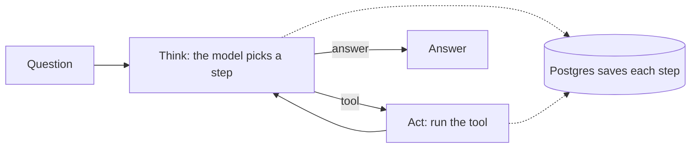

# Run the same agent as a graph that survives a restart

Job: finish a half-done answer after the server dies.

## The story in one picture



## Why this matters

A real server restarts after every deploy. A plain loop keeps its work in memory. When the process dies, the work is gone.

In this module you draw the same three-hop agent as a **graph**. That is a set of boxes joined by arrows. After each box, Postgres saves the state. A new process can read it and carry on.

## What you will have at the end

- A graph with a think box and an act box.
- A Postgres saver that keeps each step under a thread id.
- A **thread** that a new process can resume.
- A **recursion limit** that stops a loop with no end.

## See it fail first

What happens to a half-done answer when the server dies? Run the loop from the last module. Kill the process after its first tool call.

For example, ask how much faster NeuroCalm users fell asleep. Start the loop again. It begins at the question and repeats the first tool call. Nothing was saved.

## Step 1: build the graph

The think box asks the model for the next step. The act box runs one tool. An arrow leads from act back to think, so the model sees every result.

### packages/core/src/agent-graph.ts

```ts
export function buildAgentGraph(checkpointer: BaseCheckpointSaver | undefined, decide: Decide) {
  return new StateGraph(State)
    .addNode("think", async (state) => {
      const step = await decide(state.trail);
      const text = "answer" in step ? step.answer : `${step.tool} ${step.input}`;
      return { trail: [{ who: "model" as const, text }], next: step };
    })
    .addNode("act", (state) => {
      const step = state.next;
      if (step === undefined || "answer" in step) return {};
      return { trail: [{ who: "tool" as const, text: runTool(step.tool, step.input) }] };
    })
    .addEdge(START, "think")
    .addConditionalEdges("think", (state) => (state.next && "tool" in state.next ? "act" : END))
    .addEdge("act", "think")
    .compile({ checkpointer });
}
```

## Step 2: save every step in Postgres

A **thread** is one run of the agent, saved under one id. The saver writes each step to Postgres before the next step starts. The **recursion limit** is the most steps one run may take. It stops a cycle.

### packages/core/src/agent-graph.ts

```ts
export async function openCheckpointer(): Promise<PostgresSaver> {
  const saver = PostgresSaver.fromConnString(DATABASE_URL);
  await saver.setup();
  return saver;
}
```

### packages/core/src/agent-graph.ts

```ts
async function drive(graph: AgentGraph, input: object | null, threadId: string) {
  // Sync means each step is in Postgres before the next one starts, so a kill loses nothing.
  const config = {
    configurable: { thread_id: threadId },
    recursionLimit: RECURSION_LIMIT,
    durability: "sync" as const,
  };
  try {
    const state = await graph.invoke(input, config);
    return finish(state.trail, state.next);
  } catch (error) {
    if (!(error instanceof GraphRecursionError)) throw error;
    const saved = await graph.getState(config);
    return finish(saved.values.trail ?? [], undefined);
  }
}
```

## Step 3: resume after a kill

A new process opens the same thread id and passes null as the input. Null means: do not start over. The graph reads the last saved step and goes on.

### packages/core/src/agent-graph.ts

```ts
// Passing null means: do not start over, carry on from the last saved step of this thread.
export function resumeAgent(graph: AgentGraph, threadId: string) {
  return drive(graph, null, threadId);
}
```

## Step 4: verify

```bash
bun run verify langgraph-agent
```

Expect: four green badges and the line "Every check passed."

The kill check needs Postgres. Start it first.

```bash
bun run up
```

Expect: a message that Postgres is ready. Without it, the check prints a line that starts with NOT RUN.

## Try it yourself

Add a tool that lists every brand. For example, let the model call it before it picks a study. Then add a check for it.

## Stuck?

| You see                                          | Why                                                  | Fix                                                                  |
| ------------------------------------------------ | ---------------------------------------------------- | -------------------------------------------------------------------- |
| The graph did not reach an answer.               | The act node does not lead back to the think node.   | Add an edge from act to think.                                       |
| The new process did not finish the saved thread. | No step was saved, or the thread id changed.         | Compile with the Postgres checkpointer and reuse the same thread id. |
| A cycle ended with an answer.                    | The cycle check ran a model that finished by itself. | Use a model step that never answers, then check the limit stops it.  |

If you are still stuck, start from a clean copy of this step.

```bash
bun run goto langgraph-agent
```

Expect: a message that you are now on the langgraph-agent checkpoint, with a list of things to do.

## New words

- **graph**: Boxes joined by arrows. Each box is one step, and each arrow says what runs next.
- **thread**: One run of the agent, saved under one id. Use the same id to carry on later.
- **recursion limit**: The most steps one run may take. It stops a loop that never ends.
