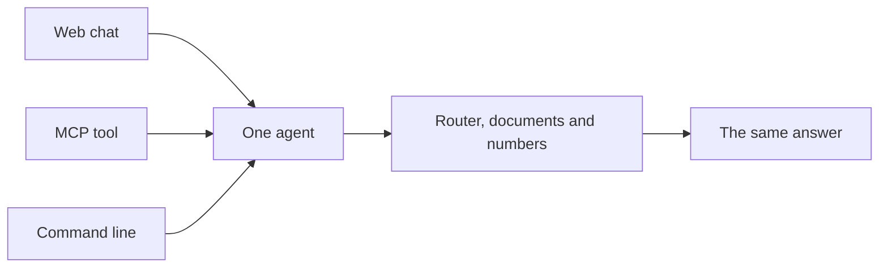

# Serve one agent on the web, MCP and the command line

Job: let the team reach the agent where they already work.

## The story in one picture



## Why this matters

People do not all work in one place. A field team likes a browser. An analyst may use a chat tool. An engineer lives in a terminal.

Each place is a **surface**. If every surface has its own logic, the answers drift apart. Then nobody knows which answer to trust.

So we build one agent and three thin doors. Each door only changes the format. The answer always comes from the agent.

## What you will have at the end

- A web chat that streams the answer as an event.
- An **MCP** tool that a chat tool can call.
- A command line that asks one question.
- Proof that all three give the same answer.

## See it fail first

What happens when the team wants the same agent in a browser, a chat tool and a terminal? Today the agent only runs from a script. Nobody else can reach it.

For example, ask which territory led OncoX new prescriptions from July to September. A script can answer. A browser tab and a chat tool cannot.

## Step 1: build the web chat

The browser sends a question. The server calls the agent and sends the result back as one **server-sent event**. That is a message the server pushes over an open request.

Until a later module adds sign-in, everyone acts as one dev user. The chat reads the tenant from the request and falls back to pharma-a.

### packages/core/src/surfaces.ts

```ts
export async function chatResponse(request: Request, agent: Agent): Promise<Response> {
  const body = (await request.json()) as ChatBody;
  const question = textOf(body.question);
  if (question === "") return new Response("Send a question.", { status: 400 });
  const result = await agent(question, tenantOf(body.tenant));
  const event = `event: answer\ndata: ${JSON.stringify(result)}\n\n`;
  return new Response(event, { headers: { "content-type": "text/event-stream" } });
}
```

## Step 2: build the MCP door

**MCP** is a shared way for chat tools to call your tools. The door answers three methods. It says what it is, lists its one tool, and runs the tool. Any other method gets a clear error.

### packages/core/src/surfaces.ts

```ts
function toolList(): unknown[] {
  const properties = { question: { type: "string" }, tenant: { type: "string" } };
  const inputSchema = { type: "object", properties, required: ["question"] };
  return [{ name: TOOL_NAME, description: "Ask the medical affairs team.", inputSchema }];
}

async function callTool(call: ToolCall | undefined, agent: Agent): Promise<unknown> {
  if (call === undefined || call.arguments === undefined) {
    return { isError: true, content: [{ type: "text", text: "Send a question." }] };
  }
  const question = textOf(call.arguments.question);
  if (question === "")
    return { isError: true, content: [{ type: "text", text: "Send a question." }] };
  const result = await agent(question, tenantOf(call.arguments.tenant));
  return { content: [{ type: "text", text: result.text }] };
}

export async function mcpReply(message: McpMessage, agent: Agent): Promise<McpReply | undefined> {
  if (message.id === undefined) return undefined;
  const reply: McpReply = { jsonrpc: "2.0", id: message.id };
  if (message.method === "initialize") {
    const serverInfo = { name: "hcp-showcase", version: "1.0.0" };
    reply.result = { protocolVersion: PROTOCOL_VERSION, capabilities: { tools: {} }, serverInfo };
  } else if (message.method === "tools/list") {
    reply.result = { tools: toolList() };
  } else if (message.method === "tools/call") {
    reply.result = await callTool(message.params, agent);
  } else {
    reply.error = { code: METHOD_NOT_FOUND, message: "Method not found" };
  }
  return reply;
}
```

## Step 3: build the command line

The command line reads a flag, calls the same agent, and prints the text. With no question it tells you what to add.

### packages/core/src/surfaces.ts

```ts
function flagValue(args: string[], flag: string): string {
  const position = args.indexOf(flag);
  if (position === -1 || position + 1 >= args.length) return "";
  return args[position + 1];
}

export async function cliText(args: string[], agent: Agent): Promise<string> {
  const question = flagValue(args, "--question");
  if (question === "") return "Add --question with your question.";
  const result = await agent(question, tenantOf(flagValue(args, "--tenant")));
  return result.text;
}
```

## Step 4: verify

```bash
bun run verify surfaces
```

Expect: six green badges and the line "Every check passed."

## Try it yourself

Start the web door and ask from the terminal. For example, run the two commands in order.

```bash
bun run serve
```

Expect: a line that says the team is on a local address.

```bash
bun run ask --question "Which territory led OncoX new prescriptions from July to September?"
```

Expect: one line with a territory and a total. It needs a model key, or a recorded reply.

## Stuck?

| You see                                    | Why                                                                  | Fix                                                                                |
| ------------------------------------------ | -------------------------------------------------------------------- | ---------------------------------------------------------------------------------- |
| The web chat took an empty question.       | The chat door does not check the question before it calls the agent. | In chatResponse, return status 400 when the question is empty.                     |
| The tool list is missing ask_team.         | The MCP door does not list its tool.                                 | In mcpReply, answer tools/list with the ask_team tool.                             |
| An unknown method did not return an error. | The MCP door answers every method the same way.                      | In mcpReply, return error code -32601 for a method it does not know.               |
| The web and MCP answers differ.            | One door changes the text before it sends it.                        | Make each door return result.text from the same agent call, with no extra wording. |
| The board page has no form.                | The page at the root path is missing.                                | In route, return the board page for GET /.                                         |

If you are still stuck, start from a clean copy of this step.

```bash
bun run goto surfaces
```

Expect: a message that you are now on the surfaces checkpoint, with a list of things to do.

## New words

- **surface**: A place where people reach the agent, such as a web page or a command line.
- **MCP**: A shared way for chat tools to call your tools.
- **server-sent event**: A message the server pushes to a web page over one open request.
