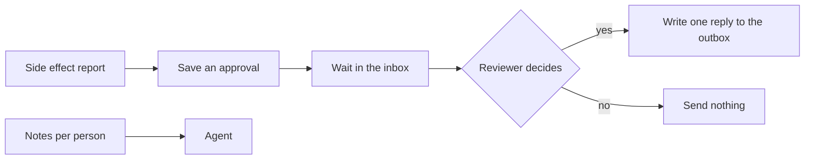

# Pause for a human and remember per user

Job: hold every side effect report for the safety team, and keep notes for each person.

## The story in one picture



## Why this matters

A customer may write a side effect report inside a friendly email. The law says a safety person must read it. A fast reply from the agent can break that rule.

So the agent saves the report as an **approval** and stops. A named reviewer says yes or no later. The wait lives in the database, so a restart loses nothing.

The agent also keeps **memory**. It saves a short note about one person, for that person only.

## What you will have at the end

- An approval table with a waiting inbox for each reviewer.
- A `decide` function that works once and only for the approver.
- An **outbox** that holds each reply that was approved.
- Notes that stay with one person inside one company.

## See it fail first

What happens when a customer reports a side effect and the agent just replies? Right now it answers at once. No safety person ever sees the report.

For example, carol sends a note about a rash after CardioZ. The agent answers her and the safety team never hears of it.

## Step 1: save the approval

Each approval is one row with a status. It starts as pending.

### packages/core/src/approvals.ts

```ts
export async function requestApproval(requester: string, question: string): Promise<number> {
  await setupTables();
  const [row] = await rows<{ id: number }>(
    "INSERT INTO approvals (requester, topic, question) VALUES ($1, $2, $3) RETURNING id",
    [requester, TOPIC, question],
  );
  return row.id;
}
```

## Step 2: show the inbox

A reviewer sees only the topics they hold a grant for. The grant comes from the same table that module 07 used.

### packages/core/src/approvals.ts

```ts
export async function pendingFor(approver: string): Promise<Approval[]> {
  await setupTables();
  return rows<Approval>(
    `SELECT * FROM approvals a WHERE a.status = 'pending' AND EXISTS (
       SELECT 1 FROM grants g
       WHERE g.person = $1 AND g.relation = 'approves' AND g.object = a.topic)
     ORDER BY a.id`,
    [approver],
  );
}
```

## Step 3: decide once

The whole decision runs in one transaction. It reads a pending row, checks the grant, then writes the status and the reply together. A second try finds no pending row and stops.

### packages/core/src/approvals.ts

```ts
// One decision, once. Only a person who holds the approves grant may make it.
export async function decide(id: number, approver: string, approved: boolean): Promise<Status> {
  return inTransaction(async (run) => {
    const found = await run("SELECT * FROM approvals WHERE id = $1 AND status = 'pending'", [id]);
    if (found.rows.length === 0) throw new Error(`Approval ${id} is not waiting.`);
    const approval = found.rows[0] as Approval;
    const grant =
      "SELECT 1 FROM grants WHERE person = $1 AND relation = 'approves' AND object = $2";
    const allowed = await run(grant, [approver, approval.topic]);
    if (allowed.rows.length === 0) throw new Error(`${approver} may not decide ${approval.topic}.`);
    const status = approved ? "approved" : "rejected";
    await run("UPDATE approvals SET status = $2, decided_by = $3 WHERE id = $1", [
      id,
      status,
      approver,
    ]);
    if (approved) {
      const body = `Reply sent for: ${approval.question}`;
      await run("INSERT INTO outbox VALUES ($1, $2, $3)", [id, body, approver]);
    }
    return status;
  });
}
```

## Step 4: keep notes per person

Each note is saved with the company and the person. A teammate and another company both get nothing back.

### packages/core/src/approvals.ts

```ts
// Notes stay with one person.
export async function remember(person: string, note: string): Promise<void> {
  const owner = personNamed(person);
  await setupTables();
  await rows("INSERT INTO memories (tenant, person, note) VALUES ($1, $2, $3)", [
    owner.tenant,
    owner.name,
    note,
  ]);
}

export async function recall(person: string): Promise<string[]> {
  const owner = personNamed(person);
  await setupTables();
  const found = await rows<{ note: string }>(
    "SELECT note FROM memories WHERE tenant = $1 AND person = $2 ORDER BY created",
    [owner.tenant, owner.name],
  );
  return found.map((item) => item.note);
}
```

## Step 5: stop the agent and wait

The router picks a route first. If the route needs a human, the agent saves an approval. It tells the person the approval is waiting.

### packages/core/src/team.ts

```ts
// A reply that needs a human waits as an approval. Nothing is sent until someone decides.
async function pauseForHuman(result: AgentResult, person: Person, question: string) {
  if (result.route !== "escalate" && result.route !== "approve") return result;
  const id = await requestApproval(person.name, question);
  return { route: result.route, text: `${result.text} Approval ${id} is waiting.`, citations: [] };
}
```

## Step 6: verify

```bash
bun run verify approvals-memory
```

Expect: six green badges and the line "Every check passed."

## Try it yourself

Ask the agent to remember a fact as alice, then read it back. For example, run the check that keeps memory per person.

```bash
bun run verify approvals-memory
```

Expect: the badge "Memory stays with its owner and company" is green.

## Stuck?

| You see                                      | Why                                                            | Fix                                                                                  |
| -------------------------------------------- | -------------------------------------------------------------- | ------------------------------------------------------------------------------------ |
| A model ran before a human saw the report.   | The agent answers a safety report before it saves an approval. | In pauseForHuman, save the approval and return the waiting message.                  |
| A person without the approves grant decided. | decide does not look for the approves grant.                   | In decide, look up the grant for this person and topic and throw when it is missing. |
| The reply was sent twice.                    | decide acts on a row that was already decided.                 | In decide, select only rows whose status is pending.                                 |
| A teammate read Alice's note.                | recall reads every note in the company.                        | In recall, filter by the company and by the person.                                  |

If you are still stuck, start from a clean copy of this step.

```bash
bun run goto approvals-memory
```

Expect: a message that you are now on the approvals-memory checkpoint, with a list of things to do.

## New words

- **approval**: A saved request that waits until a named person says yes or no.
- **outbox**: A table that holds each reply that was approved and sent.
- **memory**: Notes the agent keeps about one person, saved in the database.
