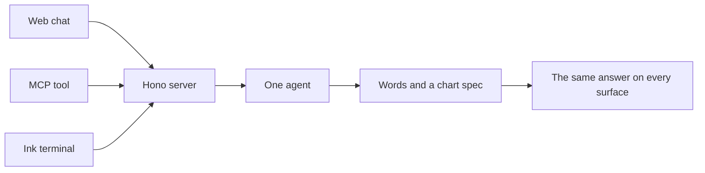

# Serve one agent on the web, MCP and the command line

Job: let the team reach the agent where they already work.

## The story in one picture



## Why this matters

People do not all work in one place. A field team likes a browser. An analyst may use a chat tool. An engineer lives in a terminal.

Each place is a **surface**. If every surface has its own logic, the answers drift apart. Then nobody knows which answer to trust.

So we build one agent behind one server. Each surface only changes the format. The words and the chart always come from the agent.

## What you will have at the end

- A Hono server that streams the answer, one word at a time.
- An **MCP** tool that a chat tool can call.
- A web page that draws the chart with json-render.
- A terminal chat that draws the same chart with Ink.
- Proof that all three give the same answer.

## See it fail first

What happens when the team wants one agent and its chart on the web and in a terminal? Today the agent only runs from a script. The chart has nowhere to show.

For example, ask which territory led OncoX new prescriptions from July to September. A script can print a number. A browser tab and a chat tool cannot reach it.

## Step 1: stream the reply as events

The server sends the reply as **server-sent events**. That is a message the server pushes over one open request. It sends one event for each word, then the chart, then the end marker.

The words go through `@ai-sdk/langchain`. It turns model chunks into text parts, so the web page can show words as they arrive.

### packages/core/src/surfaces.ts

```ts
// Break the text into words that keep their trailing space, and send each as a model chunk.
async function* wordChunks(text: string): AsyncGenerator<AIMessageChunk> {
  for (const word of text.split(/(?<=\s)/)) yield new AIMessageChunk({ content: word });
}

// The AI SDK turns LangChain chunks into text-delta parts. We keep only the words.
export async function* wordsOf(text: string): AsyncGenerator<string> {
  const parts = toUIMessageStream(wordChunks(text));
  for await (const part of parts) {
    if (part.type === "text-delta") yield part.delta;
  }
}
```

Expect: no output yet. These two functions only run when the server calls them.

## Step 2: serve the routes with Hono

The Hono app has five routes. One streams the chat, one resumes a paused thread, and one lists approvals that wait. One is a sign-in stub, and one is the MCP door.

Until the access-control module, the caller names the person. That is for local use only.

### packages/core/src/server.ts

```ts
function addChatRoutes(app: Hono, deps: Deps): void {
  app.post("/v1/chat/completions", async (context) => {
    const body = await bodyOf(context);
    const question = questionOf(body);
    if (question === "") return context.json({ error: "Send a question." }, 400);
    return streamReply(context, await deps.agent(question, personOf(context, body)));
  });
}
```

Expect: no output yet. The server starts in the last step.

## Step 3: add the MCP door

**MCP** is a shared way for chat tools to call your tools. This door uses Streamable HTTP at the path /mcp. It lists one tool named ask_team and runs it.

The Goose config in config/goose.yaml points at the same path.

### packages/core/src/server.ts

```ts
function mcpServer(deps: Deps): McpServer {
  const server = new McpServer({ name: "hcp-showcase", version: "1.0.0" });
  const inputSchema = { question: z.string().min(1), person: z.string().optional() };
  const description = "Ask the medical affairs team. The reply may carry a chart.";
  server.registerTool(TOOL_NAME, { description, inputSchema }, async ({ question, person }) => {
    const reply = await deps.agent(question, person ?? DEFAULT_PERSON);
    const content = [{ type: "text" as const, text: reply.text }];
    if (reply.chart !== undefined) {
      content.push({ type: "text" as const, text: JSON.stringify(reply.chart) });
    }
    return { content };
  });
  return server;
}
```

Expect: no output yet. A chat tool calls this door once the server runs.

## Step 4: draw the chart on the web and in the terminal

The chart is one json-render spec. The web page draws it with the shadcn parts. The terminal draws it with Ink, with colour, bars and a table.

### packages/core/src/web.tsx

```tsx
export function ChartView(props: { spec: Spec }) {
  return (
    <JSONUIProvider registry={registry}>
      <Renderer spec={props.spec} registry={registry} />
    </JSONUIProvider>
  );
}
```

Expect: no output yet. The checks draw this page in the next step.

## Step 5: verify

```bash
bun run verify surfaces
```

Expect: seven green badges and the line "Every check passed."

## Try it yourself

Start the server and ask from the terminal. For example, run the two commands in order. They need a model key, or a recorded reply.

```bash
bun run serve
```

Expect: a line that says the team is on a local address.

```bash
bun run chat --question "Which territory led OncoX new prescriptions from July to September?"
```

Expect: words that stream in, then coloured bars and a table.

## Stuck?

| You see                                         | Why                                                           | Fix                                                          |
| ----------------------------------------------- | ------------------------------------------------------------- | ------------------------------------------------------------ |
| The stream sent one event, so nothing streamed. | The server waited for the whole reply and sent it at the end. | In chatEvents, send one event for each word.                 |
| The MCP answer differs from the web answer.     | One door changes the text before it sends it.                 | Return reply.text from the same agent call on every surface. |
| The tool list is missing ask_team.              | The MCP door does not register its tool.                      | In mcpServer, register the ask_team tool.                    |
| The terminal frame changed:                     | The terminal draws the bars or the table in a new way.        | In ReplyView, draw one bar for each Progress part.           |

If you are still stuck, start from a clean copy of this step.

```bash
bun run goto surfaces
```

Expect: a message that you are now on the surfaces checkpoint, with a list of things to do.

## New words

- **surface**: A place where people reach the agent, such as a web page or a command line.
- **MCP**: A shared way for chat tools to call your tools.
- **server-sent event**: A message the server pushes to a web page over one open request.
