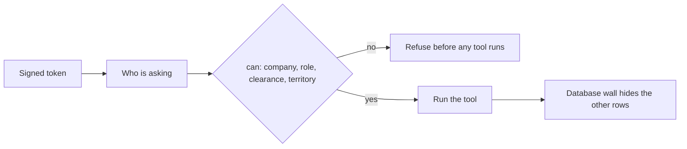

# Decide who may see what, by role, attribute and relationship

Job: keep each pharma company and each role inside its own lane.

## The story in one picture



## Why this matters

Two pharma companies share one agent. A field rep and a safety officer share it too. They must not see the same things.

A good rule has three parts. The first is the **role**, such as field rep. The second is an attribute, such as clearance. The third is a relationship, such as the territories a rep covers.

We write the rule once in code and once in the database. The code says no first. The database says no again if the code is ever wrong.

## What you will have at the end

- A `can()` function that checks company, clearance and territory.
- A rule for which tools each role may use.
- A **row-level security** wall in the database.
- Signed **tokens**, so a request cannot lie about who is asking.

## See it fail first

What stops a person from another company from reading your company's label? Right now, nothing does. The agent trusts the name in the request.

For example, ask for the OncoX label as bob. Bob works at the other company, but the agent answers anyway.

## Step 1: write the rules in code

A person may read a document when three things hold. The brand belongs to their company. Their **clearance** is high enough for that kind of document. A field rep must also cover a territory that carries the brand.

That last rule takes two hops. A person covers a territory, and the territory carries a brand.

### packages/core/src/access.ts

```ts
function carriesBrand(territory: string, brand: string): boolean {
  for (const grant of GRANTS) {
    if (grant.person === territory && grant.relation === "carries" && grant.object === brand)
      return true;
  }
  return false;
}

// Look at the areas this person covers.
function coversBrand(person: Person, brand: string): boolean {
  for (const grant of GRANTS) {
    if (grant.person !== person.name || grant.relation !== "covers") continue;
    if (grant.object === ALL_TERRITORIES || carriesBrand(grant.object, brand)) return true;
  }
  return false;
}

export function can(person: Person, resource: Resource): Verdict {
  if (ownerOf(resource.brand) !== person.tenant) {
    return { allowed: false, reason: "That belongs to another company." };
  }
  if (person.clearance < clearanceOf(resource.type)) {
    return { allowed: false, reason: "Your clearance is too low for that document." };
  }
  if (person.role === "field-rep" && !coversBrand(person, resource.brand)) {
    return { allowed: false, reason: "Your territories do not carry that brand." };
  }
  return { allowed: true, reason: "allowed" };
}

export function canUse(person: Person, tool: Tool): Verdict {
  for (const [role, tools] of ROLE_TOOLS) {
    if (role === person.role && tools.includes(tool)) return { allowed: true, reason: "allowed" };
  }
  return { allowed: false, reason: `Your role cannot use the ${tool} tool.` };
}
```

## Step 2: repeat the rule in the database

The database builds its rule from the same lists. So the code and the database cannot drift apart. The agent reads documents as a reader role, and the policy hides the rows.

### packages/core/src/access.ts

```ts
function caseOf(column: string, pairs: [string, string | number][], other: string): string {
  const lines = pairs.map(([name, value]) => `WHEN '${name}' THEN ${value}`);
  return `CASE ${column} ${lines.join(" ")} ELSE ${other} END`;
}

// The same rule as can(), for the database. It reads the same lists, so the two cannot drift.
export function wallFunction(): string {
  const owner = caseOf(
    "doc_brand",
    BRANDS.map((brand) => [brand.name, `'${brand.tenant}'`]),
    "''",
  );
  const needed = caseOf("doc_type", CLEARANCE, "3");
  return `CREATE OR REPLACE FUNCTION app_can_see(who text, doc_brand text, doc_type text)
RETURNS boolean LANGUAGE sql STABLE SECURITY DEFINER AS $$
  SELECT EXISTS (SELECT 1 FROM people p WHERE p.name = who
    AND p.tenant = ${owner}
    AND p.clearance >= ${needed}
    AND (p.role <> 'field-rep' OR EXISTS (
      SELECT 1 FROM grants covers
      WHERE covers.person = p.name AND covers.relation = 'covers'
        AND (covers.object = '${ALL_TERRITORIES}' OR EXISTS (
          SELECT 1 FROM grants carries WHERE carries.person = covers.object
            AND carries.relation = 'carries' AND carries.object = doc_brand)))))
$$`;
}

const WALL_SETUP = `DO $$ BEGIN
  IF NOT EXISTS (SELECT FROM pg_roles WHERE rolname = 'app_reader') THEN
    CREATE ROLE app_reader;
  END IF;
END $$;
ALTER TABLE documents ENABLE ROW LEVEL SECURITY;
DROP POLICY IF EXISTS wall ON documents;
CREATE POLICY wall ON documents FOR SELECT TO app_reader
  USING (app_can_see(current_setting('app.person', true), brand, type));
GRANT SELECT ON documents TO app_reader`;

export async function applyWalls(): Promise<void> {
  await rows(wallFunction());
  await rows(WALL_SETUP);
}

// This query runs as the reader role. The policy picks the rows.
export async function readUnderWall(
  person: string,
  brand: string,
  country: string,
): Promise<StoredDocument[]> {
  return inTransaction(async (run) => {
    await run("SET LOCAL ROLE app_reader");
    await run("SELECT set_config('app.person', $1, true)", [person]);
    const found = await run(
      `SELECT slug, brand, country, body FROM documents
       WHERE is_active AND brand = $1 AND country = $2`,
      [brand, country],
    );
    return found.rows as StoredDocument[];
  });
}
```

## Step 3: ask before any tool runs

The team agent asks `can()` before it calls a tool or a model. A refused person never reaches either one.

### packages/core/src/team.ts

```ts
// The wall comes before the work: a refused person never reaches a tool or a model.
function permit(person: Person, question: string): Verdict {
  const tool = isDataQuestion(question) ? "bi" : "documents";
  const use = canUse(person, tool);
  if (!use.allowed) return use;
  const brand = brandIn(question);
  if (brand === undefined) return use;
  return can(person, { brand, type: typeIn(question) });
}
```

## Step 4: sign people in

A **token** is a signed note that says who is asking. The door reads it and ignores any name in the request body. A forged or missing token gets a 401.

This sign-in has no password, so it is for local use only. A real product would check a password or a single sign-on here.

### packages/core/src/surfaces.ts

```ts
function knownPerson(name: string): boolean {
  return PEOPLE.some((person) => person.name === name);
}

export async function signToken(person: string): Promise<string> {
  return new SignJWT({})
    .setProtectedHeader({ alg: "HS256" })
    .setSubject(person)
    .setExpirationTime("2h")
    .sign(SECRET);
}

// Reads the signed token from the request. A missing, forged or expired token gives nobody.
export async function personFrom(request: Request): Promise<string | undefined> {
  const header = request.headers.get("authorization");
  if (header === null || !header.startsWith("Bearer ")) return undefined;
  try {
    const { payload } = await jwtVerify(header.slice("Bearer ".length), SECRET);
    if (payload.sub === undefined || !knownPerson(payload.sub)) return undefined;
    return payload.sub;
  } catch {
    return undefined;
  }
}

// A local sign-in with no password. A real product checks a password or a single sign-on here.
export async function loginResponse(request: Request): Promise<Response> {
  const body = (await request.json()) as ChatBody;
  const person = textOf(body.person);
  if (!knownPerson(person)) return new Response("Nobody has that name.", { status: 404 });
  return Response.json({ token: await signToken(person) });
}
```

## Step 5: check a password and sign a cookie

The older sign-in in Step 4 takes a name and nothing else. Now a person must prove who they are. `Bun.password` checks the password against a stored hash. A **hash** is a scrambled copy of a password that cannot be turned back.

After a good sign-in, the code signs a **session cookie** with `jose`. The browser sends the cookie on each request. A cookie that someone changed fails the signature check, so it gives nobody.

The demo passwords are public and for local use only. A real product reads hashes from its own store.

### packages/core/src/access.ts

```ts
// The local demo password for each person. A real product never keeps a rule like this.
export function demoPassword(name: string): string {
  return `buildcamp-${name}`;
}

const SESSION_KEY = new TextEncoder().encode(
  process.env.AUTH_SECRET ?? "dev-secret-for-local-use-only",
);
const COOKIE_NAME = "session";
const HASH_OPTIONS = { algorithm: "argon2id", memoryCost: 4096, timeCost: 2 } as const;
const hashes = new Map<string, string>();

async function hashFor(name: string): Promise<string> {
  const known = hashes.get(name);
  if (known !== undefined) return known;
  const made = await Bun.password.hash(demoPassword(name), HASH_OPTIONS);
  hashes.set(name, made);
  return made;
}

// Returns the signed session cookie, or nothing when the name or password is wrong.
export async function signIn(name: string, password: string): Promise<string | undefined> {
  const person = PEOPLE.find((item) => item.name === name);
  // An unknown name still costs one hash check, so the answer takes the same time.
  const stored = await hashFor(person === undefined ? PEOPLE[0].name : person.name);
  const right = await Bun.password.verify(password, stored);
  if (person === undefined || !right) return undefined;
  const token = await new SignJWT({})
    .setProtectedHeader({ alg: "HS256" })
    .setSubject(person.name)
    .setExpirationTime("2h")
    .sign(SESSION_KEY);
  return `${COOKIE_NAME}=${token}; HttpOnly; SameSite=Lax; Path=/`;
}

// Reads the person from a Cookie header. A forged, changed or expired cookie gives nobody.
export async function personFromCookie(header: string | null): Promise<Person | undefined> {
  if (header === null) return undefined;
  const pair = header.split(";").find((part) => part.trim().startsWith(`${COOKIE_NAME}=`));
  if (pair === undefined) return undefined;
  try {
    const token = pair.trim().slice(COOKIE_NAME.length + 1);
    const { payload } = await jwtVerify(token, SESSION_KEY, { algorithms: ["HS256"] });
    return PEOPLE.find((item) => item.name === payload.sub);
  } catch {
    return undefined;
  }
}
```

## Step 6: give each company a database role

The `can()` function is the first wall and row-level security is the second. The report tool needs a third. Each company gets its own database role. That role may read only its own data schema.

The report runs in a read-only transaction. The command SET LOCAL ROLE switches to the company's role for that transaction only. If a query names the other company's schema, Postgres refuses it.

### packages/core/src/access.ts

```ts
// One database role for each company. The role can read only that company's data schema.
function roleOf(tenant: string): string {
  return `tenant_${tenant.replace("-", "_")}`;
}

function schemaFor(tenant: string): string {
  return tenant.replace("-", "_");
}

export async function applyTenantRoles(): Promise<void> {
  for (const tenant of new Set(BRANDS.map((brand) => brand.tenant))) {
    const role = roleOf(tenant);
    const schema = schemaFor(tenant);
    await rows(`DO $$ BEGIN
      IF NOT EXISTS (SELECT FROM pg_roles WHERE rolname = '${role}') THEN
        CREATE ROLE ${role};
      END IF;
    END $$`);
    await rows(`GRANT ${role} TO CURRENT_USER`);
    await rows(`GRANT USAGE ON SCHEMA ${schema} TO ${role}`);
    await rows(`GRANT SELECT ON ALL TABLES IN SCHEMA ${schema} TO ${role}`);
  }
}

// The read-only report transaction. SET LOCAL ROLE makes Postgres refuse the other company's data.
export async function reportAs(tenant: string, sql: string): Promise<Record<string, unknown>[]> {
  return inTransaction(async (run) => {
    await run("SET TRANSACTION READ ONLY");
    await run(`SET LOCAL ROLE ${roleOf(tenant)}`);
    await run(`SET LOCAL search_path = ${schemaFor(tenant)}`);
    return (await run(sql)).rows as Record<string, unknown>[];
  });
}
```

## Step 7: verify

```bash
bun run verify access-control
```

Expect: nine green badges and the line "Every check passed."

## Try it yourself

Sign in as carol and ask for a sales report. For example, run the two commands in order.

```bash
bun run serve
```

Expect: a line that says the team is on a local address.

```bash
curl -s -X POST localhost:3000/chat -d '{"question":"Run a sales report for all territories."}'
```

Expect: a "Sign in first." message, because the request has no token.

## Stuck?

| You see                                        | Why                                                                    | Fix                                                                              |
| ---------------------------------------------- | ---------------------------------------------------------------------- | -------------------------------------------------------------------------------- |
| A person from another company was not refused. | permit does not compare the brand's company with the person's company. | In permit, call can() with the brand in the question and refuse when it says no. |
| A field rep ran a report.                      | canUse lets every role use the report tool.                            | In ROLE_TOOLS, give a field rep the documents tool only.                         |
| A low clearance read a safety letter.          | can() skips the clearance check.                                       | In can(), refuse when the person's clearance is below the document's.            |
| A forged token got through.                    | personFrom does not verify the signature.                              | In personFrom, verify the token with jwtVerify and use its subject.              |

If you are still stuck, start from a clean copy of this step.

```bash
bun run goto access-control
```

Expect: a message that you are now on the access-control checkpoint, with a list of things to do.

## New words

- **clearance**: A level on a person that says how private a document they may read.
- **row-level security**: A database rule that hides rows from a person who may not see them.
- **token**: A signed note that says who is asking. A forged note fails the check.
