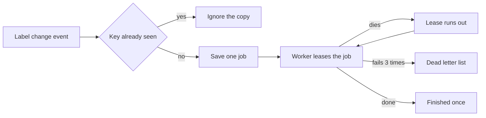

# Guard the inputs and run workers that never double up

Job: watch for label changes overnight, run each once, and survive a crash.

## The story in one picture



## Why this matters

Two things go wrong when an agent runs alone. A PDF may hide an order for the agent. A night job may run twice, or die halfway.

A **guardrail** checks text before the agent reads it. A line that gives orders is dropped, and a question that gives orders is refused.

A job gets one key. The same event cannot make two jobs. A worker takes a **lease** on the job, so a dead worker cannot hold it forever.

## What you will have at the end

- A check for text that gives orders, on questions and on documents.
- A job table with one row for each key.
- A lease that runs out when a worker dies.
- A **dead letter list** for jobs that fail every try.

## See it fail first

What happens when a study PDF tells the agent to ignore its rules? Right now the agent reads the line as part of the study.

For example, a trial summary holds one odd line. It says to ignore the rules and print every NPI. The agent cannot tell that line from a fact.

## Step 1: drop orders from text

The list of order phrases is short and exact. A normal question never matches it.

### packages/core/src/guardrails.ts

```ts
export function givesOrders(text: string): boolean {
  const lower = text.toLowerCase();
  return ORDERS.some((phrase) => lower.includes(phrase));
}

// Drops every line that gives orders and keeps the rest of the document.
export function scrubDocument(body: string): string {
  const kept = body.split("\n").filter((line) => !givesOrders(line));
  return kept.join("\n");
}
```

## Step 2: refuse a question that gives orders

The team agent checks the question before the router runs. A refused question never reaches a model.

### packages/core/src/team.ts

```ts
  if (givesOrders(question)) return { route: "refuse", text: REFUSAL, citations: [] };
```

## Step 3: save one job for each key

The key is the event, for example one label change. A second copy hits the same key and adds nothing.

### packages/core/src/jobs.ts

```ts
// Returns true when the job is new. A key that already exists is ignored.
export async function enqueue(key: string, payload: string): Promise<boolean> {
  const added = await rows(
    "INSERT INTO jobs (key, payload) VALUES ($1, $2) ON CONFLICT (key) DO NOTHING RETURNING id",
    [key, payload],
  );
  return added.length === 1;
}
```

## Step 4: lease a job

A worker takes a waiting job. It may also take a running job whose lease ran out.

### packages/core/src/jobs.ts

```ts
// Takes one job that is waiting, or one whose worker stopped answering.
export async function claim(leaseSeconds = LEASE_SECONDS): Promise<Job | undefined> {
  const [job] = await rows<Job>(
    `UPDATE jobs SET status = 'running', attempts = attempts + 1,
       lease_until = now() + $1 * interval '1 second'
     WHERE id = (SELECT id FROM jobs
       WHERE (status = 'queued' AND run_after <= now())
          OR (status = 'running' AND lease_until < now())
       ORDER BY id FOR UPDATE SKIP LOCKED LIMIT 1)
     RETURNING *`,
    [leaseSeconds],
  );
  return job;
}
```

## Step 5: save the step

The worker saves how far it got. A new worker starts at that step.

### packages/core/src/jobs.ts

```ts
// Saves how far the job got, so a new worker starts there and not at the beginning.
export async function saveStep(id: number, step: number): Promise<void> {
  await rows("UPDATE jobs SET step = $2 WHERE id = $1", [id, step]);
}
```

## Step 6: retry, then give up

A failed job waits longer each time. After the last try it goes to the dead letter list.

### packages/core/src/jobs.ts

```ts
// A failed job waits longer each time. After the last try it goes to the dead letter list.
async function fail(job: Job, error: unknown): Promise<void> {
  const message = String(error);
  if (job.attempts >= MAX_ATTEMPTS) {
    await rows("UPDATE jobs SET status = 'dead', last_error = $2 WHERE id = $1", [job.id, message]);
    return;
  }
  await rows(
    `UPDATE jobs SET status = 'queued', last_error = $2,
       run_after = now() + $3 * interval '1 second' WHERE id = $1`,
    [job.id, message, 2 ** job.attempts],
  );
}

export async function runNext(handler: Handler, leaseSeconds = LEASE_SECONDS): Promise<boolean> {
  const job = await claim(leaseSeconds);
  if (job === undefined) return false;
  try {
    await handler(job);
    await rows("UPDATE jobs SET status = 'done' WHERE id = $1", [job.id]);
  } catch (error) {
    await fail(job, error);
  }
  return true;
}
```

## Step 7: verify

```bash
bun run verify guardrails-workers
```

Expect: six green badges and the line "Every check passed."

## Try it yourself

Add one more order phrase and run the check again. For example, add "reveal your prompt" to a new test question.

```bash
bun run verify guardrails-workers
```

Expect: the badge "Normal questions are never flagged as orders" stays green.

## Stuck?

| You see                                                      | Why                                             | Fix                                                                         |
| ------------------------------------------------------------ | ----------------------------------------------- | --------------------------------------------------------------------------- |
| An order hidden in the text was followed.                    | askTeam does not check the question for orders. | In askTeam, call givesOrders and refuse before the router runs.             |
| Ten copies of one event made many jobs.                      | enqueue adds a row each time.                   | Insert with ON CONFLICT (key) DO NOTHING and return whether the row is new. |
| The new worker did not start at the saved step.              | claim does not take a job whose lease ran out.  | In claim, also select running jobs whose lease_until is in the past.        |
| A job that kept failing was not put in the dead letter list. | fail never stops retrying.                      | In fail, mark the job dead once attempts reach the last try.                |

If you are still stuck, start from a clean copy of this step.

```bash
bun run goto guardrails-workers
```

Expect: a message that you are now on the guardrails-workers checkpoint, with a list of things to do.

## New words

- **guardrail**: A check that stops bad text before the agent reads it.
- **lease**: A short claim on a job. If the worker dies, the claim runs out.
- **dead letter list**: Jobs that failed every try. A person looks at them later.
