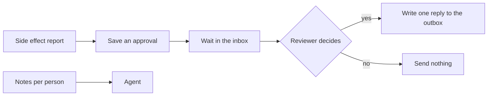

# Pause for a human and remember per user

Job: hold every side effect report for the safety team, and keep notes for each person.

## The story in one picture



## Why this matters

A customer may write a side effect report inside a friendly email. The law says a safety person must read it. A fast reply from the agent can break that rule.

So the agent saves the report as an **approval** and stops. A named reviewer says yes or no later. The wait lives in Postgres, so a restart loses nothing.

The agent also keeps **memory**. It saves a short note about one person, for that person only.

## What you will have at the end

- A `pending_approvals` inbox table with a waiting inbox for each reviewer.
- A LangGraph run that stops at `interrupt()` and resumes after a restart.
- An **ApprovalCard** that the web and the CLI both draw from one spec.
- An **outbox** that holds each reply that was approved.
- Notes in a `PostgresStore` that stay with one person inside one company.

## See it fail first

What happens when a customer reports a side effect and the agent just replies? Right now it answers at once. No safety person ever sees the report. If the reviewer closes the tab, a pending decision is lost.

For example, carol sends a note about a rash after CardioZ. The agent answers her and the safety team never hears of it.

## Step 1: pause the run

The graph has two nodes. The first node calls `interrupt()`. LangGraph saves the whole run in Postgres and stops. The second node runs only after a person resumes the run.

### packages/core/src/approvals.ts

```ts
const ReviewState = Annotation.Root({
  approvalId: Annotation<number>(),
  question: Annotation<string>(),
  decision: Annotation<Decision | null>(),
});

// The node that waits. interrupt() saves the run in Postgres and stops until a person resumes it.
async function waitForPerson(state: typeof ReviewState.State) {
  const payload = { approvalId: state.approvalId, question: state.question };
  const decision = interrupt(payload) as Decision;
  return { decision };
}

// One decision, once. The row changes only if it is still pending, and a reply goes out only on yes.
async function sendReply(state: typeof ReviewState.State) {
  const decision = state.decision as Decision;
  await inTransaction(async (run) => {
    const status = decision.approved ? "approved" : "rejected";
    const changed = await run(
      "UPDATE pending_approvals SET status = $2, decided_by = $3 WHERE id = $1 AND status = 'pending'",
      [state.approvalId, status, decision.approver],
    );
    if (changed.rowCount === 0 || !decision.approved) return;
    const body = `Reply sent for: ${state.question}`;
    await run("INSERT INTO outbox VALUES ($1, $2, $3)", [
      state.approvalId,
      body,
      decision.approver,
    ]);
  });
  return {};
}
```

## Step 2: save the approval

Each approval is one row in the inbox. It starts as pending. Starting the run is what makes it stop at the interrupt.

### packages/core/src/approvals.ts

```ts
// Saves the report in the inbox, then starts a run that stops at interrupt().
export async function requestApproval(requester: string, question: string): Promise<number> {
  const { graph } = await running();
  const thread = randomUUID();
  const [row] = await rows<{ id: number }>(
    "INSERT INTO pending_approvals (requester, topic, question, thread_id) VALUES ($1, $2, $3, $4) RETURNING id",
    [requester, TOPIC, question, thread],
  );
  await graph.invoke(
    { approvalId: row.id, question, decision: null },
    { configurable: { thread_id: thread } },
  );
  return row.id;
}
```

## Step 3: show the inbox

A reviewer sees only the topics they hold a grant for. The grant comes from the same table that module 09 used.

### packages/core/src/approvals.ts

```ts
export async function pendingFor(approver: string): Promise<Approval[]> {
  await running();
  return rows<Approval>(
    `SELECT * FROM pending_approvals a WHERE a.status = 'pending' AND EXISTS (
       SELECT 1 FROM grants g
       WHERE g.person = $1 AND g.relation = 'approves' AND g.object = a.topic)
     ORDER BY a.id`,
    [approver],
  );
}

// The same inbox as cards. The web draws each card. The CLI prints it with cardText.
export async function cardsFor(approver: string): Promise<Spec[]> {
  return (await pendingFor(approver)).map(approvalCard);
}
```

## Step 4: decide once

Only a person with the approves grant may decide. Only a pending row can be decided. The decision resumes the saved run, so the reply goes out after a restart too.

### packages/core/src/approvals.ts

```ts
// Only a person who holds the approves grant may decide, and only a pending row can be decided.
export async function decide(id: number, approver: string, approved: boolean): Promise<Status> {
  const { graph } = await running();
  const found = await rows<Approval>(
    "SELECT * FROM pending_approvals WHERE id = $1 AND status = 'pending'",
    [id],
  );
  if (found.length === 0) throw new Error(`Approval ${id} is not waiting.`);
  const grant = await rows(
    "SELECT 1 FROM grants WHERE person = $1 AND relation = 'approves' AND object = $2",
    [approver, found[0].topic],
  );
  if (grant.length === 0) throw new Error(`${approver} may not decide ${found[0].topic}.`);
  const resume = new Command<Decision, Record<string, unknown>, "wait" | "send">({
    resume: { approved, approver },
  });
  await graph.invoke(resume, { configurable: { thread_id: found[0].thread_id } });
  return approved ? "approved" : "rejected";
}
```

## Step 5: press the card or use the CLI

The ApprovalCard is a json-render spec with an Approve and a Reject button. The web draws it with shadcn parts. The CLI prints the same spec as text. Both end in the same `decide` call.

### packages/core/src/approvals.ts

```ts
// A button press on the card. The web calls this when a reviewer clicks Approve or Reject.
export async function pressCard(spec: Spec, button: string, approver: string): Promise<Status> {
  const binding = spec.elements[button]?.on?.press;
  const params = (Array.isArray(binding) ? binding[0] : binding)?.params;
  if (params === undefined) throw new Error(`The card has no button named ${button}.`);
  return decide(Number(params.id), approver, params.approved === true);
}

// The CLI: "list <person>", "approve <id> <person>" or "reject <id> <person>". It returns text.
export async function approvalsCli(argv: string[]): Promise<string> {
  const [command, first, second] = argv;
  if (command === "list")
    return (await cardsFor(first)).map(cardText).join("\n\n") || "Inbox is empty.";
  if (command !== "approve" && command !== "reject") throw new Error(`Unknown command: ${command}`);
  const status = await decide(Number(first), second, command === "approve");
  return `Approval ${first} is ${status}.`;
}
```

## Step 6: keep notes per person

Each note is saved in the store under the company, then the person. A teammate and another company both get nothing back.

### packages/core/src/approvals.ts

```ts
// Notes stay with one person. The namespace is the company, then the person.
export async function remember(person: string, note: string): Promise<void> {
  const owner = personNamed(person);
  const { store } = await running();
  await store.put([owner.tenant, owner.name], randomUUID(), { note, at: Date.now() });
}

export async function recallFor(tenant: string, person: string): Promise<string[]> {
  const { store } = await running();
  const found = await store.search([tenant, person], { limit: 100 });
  const sorted = found.sort((a, b) => Number(a.value.at) - Number(b.value.at));
  return sorted.map((item) => String(item.value.note));
}

export async function recall(person: string): Promise<string[]> {
  const owner = personNamed(person);
  return recallFor(owner.tenant, owner.name);
}
```

## Step 7: verify

```bash
bun run verify approvals-memory
```

Expect: every badge is green and the line "Every check passed."

## Try it yourself

Ask the agent to remember a fact as alice, then read it back. For example, run the check that keeps memory per person.

```bash
bun run verify approvals-memory
```

Expect: the badge "Memory stays with its owner and company" is green.

## Stuck?

| You see                                      | Why                                                                  | Fix                                                                                  |
| -------------------------------------------- | -------------------------------------------------------------------- | ------------------------------------------------------------------------------------ |
| A model ran before a human saw the report.   | The graph never stops, so the agent answers a safety report at once. | In waitForPerson, call interrupt so the run stops until a person decides.            |
| A person without the approves grant decided. | decide does not look for the approves grant.                         | In decide, look up the grant for this person and topic and throw when it is missing. |
| The reply was sent twice.                    | decide acts on a row that was already decided.                       | In decide, select only rows whose status is pending.                                 |
| A teammate read Alice's note.                | recall reads every note in the company.                              | In recallFor, search the store under the company and then the person.                |

If you are still stuck, start from a clean copy of this step.

```bash
bun run goto approvals-memory
```

Expect: a message that you are now on the approvals-memory checkpoint, with a list of things to do.

## New words

- **approval**: A saved request that waits until a named person says yes or no.
- **outbox**: A table that holds each reply that was approved and sent.
- **memory**: Notes the agent keeps about one person, saved in the database.
