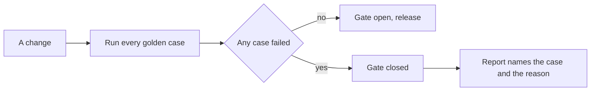

# Gate every release on a golden set

Job: stop a one line change from bringing back the old label.

## The story in one picture



## Why this matters

Every module so far made a few cases pass. A new change can undo one of them without a sound. A stale dose in front of a doctor is the worst case.

The **release gate** runs every golden case before a release. One failed case closes the gate. The report names the case and the reason.

The gate tests rules, so we run it with a **stand-in model**. The stand-in quotes every document it is shown. A **regression** then shows up as a wrong quote, not as model luck.

## What you will have at the end

- A `gate` function that closes on any failed case.
- A report that names each case and its reason.
- A command that runs the whole set, with real models when you add a key.
- A proof that the old label coming back is caught.

## See it fail first

What stops a one line change from bringing back the old label? Right now, nothing does. The set exists, but no step runs all of it.

For example, someone marks the first DermaClear label as active again. Both doses are now live, and the agent may quote the old one.

## Step 1: close the gate on any failure

The gate reads each grade next to its case. It keeps the name and the reasons of every failed case.

### packages/core/src/gate.ts

```ts
export function gate(set: GoldenSet, grades: Grade[]): GateResult {
  const failures: string[] = [];
  grades.forEach((grade, position) => {
    if (grade.ok) return;
    failures.push(`${set.cases[position].name}: ${grade.reasons.join(", ")}`);
  });
  const passed = grades.length - failures.length;
  return { open: failures.length === 0, passed, total: grades.length, failures };
}
```

## Step 2: write the report

An open gate prints one line. A closed gate prints that line, then one line for each failed case.

### packages/core/src/gate.ts

```ts
export function gateText(result: GateResult): string {
  const score = `${result.passed}/${result.total} golden cases passed.`;
  if (result.open) return `${score} The gate is open.`;
  return [`${score} The gate is closed.`, ...result.failures].join("\n");
}
```

## Step 3: run the whole set from one command

The command exits with 1 when the gate is closed, so a release job stops there. Add `--live` to use real models.

### scripts/eval.ts

```ts
// bun run eval hcp runs the whole golden set and exits with 1 when the gate is closed.
// Add --live to use real models. Without it, the agent uses the recorded replies.
import { runGolden } from "../apps/hcp-showcase/src/scoreboard";
import { provider } from "../config/models";
import { HCP_GOLDEN } from "../data/catalog/golden-hcp";
import { closeDatabase } from "../packages/core/src/db";
import { gate, gateText } from "../packages/core/src/gate";
import { liveAgent } from "../packages/core/src/team";

const live = process.argv.includes("--live");
if (live && provider() === "replay") {
  console.error("Add a model key and set LLM_PROVIDER first, or run without --live.");
  process.exit(2);
}

const grades = await runGolden(liveAgent(), HCP_GOLDEN);
const result = gate(HCP_GOLDEN, grades);
console.log(gateText(result));
await closeDatabase();
process.exit(result.open ? 0 : 1);
```

## Step 4: verify

```bash
bun run verify release-gate
```

Expect: four green badges and the line "Every check passed."

## Try it yourself

Bring the old label back and watch the gate close. For example, run the command that asks for the whole set.

```bash
bun run eval hcp
```

Expect: a score line and the line "The gate is open." when every case passes, or a closed gate that names a case.

## Stuck?

| You see                                           | Why                                                 | Fix                                                                              |
| ------------------------------------------------- | --------------------------------------------------- | -------------------------------------------------------------------------------- |
| A failed case did not close the gate.             | gate does not count the failures.                   | In gate, set open to true only when the failure list is empty.                   |
| The report lacks the name.                        | gate does not write the case name for each failure. | In gate, start each failure line with the case name from the set.                |
| The old label came back and the gate stayed open. | The set no longer holds the stale dose case.        | Keep regression-caught in the golden set and run the whole set before a release. |
| One failure out of many left the gate open.       | gate treats a high pass rate as a pass.             | Open the gate only when every case passed.                                       |

If you are still stuck, start from a clean copy of this step.

```bash
bun run goto release-gate
```

Expect: a message that you are now on the release-gate checkpoint, with a list of things to do.

## New words

- **release gate**: A check that must pass before a release goes out.
- **regression**: A fault that comes back after it was fixed.
- **stand-in model**: A fake model that copies the papers it reads. It tests the rules.
