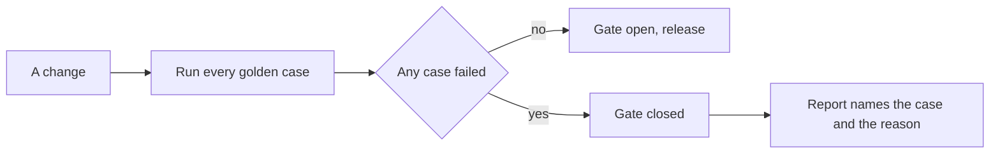

# Gate every release on a golden set

Job: stop a one line change from bringing back the old label.

## The story in one picture



## Why this matters

Every module so far made a few cases pass. A new change can undo one of them without a sound. A stale dose in front of a doctor is the worst case.

The **release gate** runs every golden case before a release. One failed case closes the gate. The report names the case and the reason.

The gate tests rules, so we run it with a **stand-in model**. The stand-in quotes every document it is shown. A **regression** then shows up as a wrong quote, not as model luck.

## What you will have at the end

- A `gate` function that closes on any failed case.
- A report that names each case and its reason.
- A command that runs the whole set, with real models when you add a key.
- A Phoenix experiment for every run.
- A CI job that stops a release when the gate closes.
- A proof that the old label coming back is caught.

## See it fail first

What stops a one line change from bringing back the old label? Right now, nothing does. The set exists, but no step runs all of it.

For example, someone marks the first DermaClear label as active again. Both doses are now live, and the agent may quote the old one.

## Step 1: close the gate on any failure

The gate reads each grade next to its case. It keeps the name and the reasons of every failed case.

### packages/core/src/gate.ts

```ts
export function gate(set: GoldenSet, grades: Grade[]): GateResult {
  const failures: string[] = [];
  set.cases.forEach((golden, position) => {
    const grade = grades[position];
    const label = golden.name;
    if (grade === undefined) failures.push(`${label}: the case did not run`);
    else if (!grade.ok) failures.push(`${label}: ${grade.reasons.join(", ")}`);
  });
  const passed = set.cases.length - failures.length;
  return { open: failures.length === 0, passed, total: set.cases.length, failures };
}
```

## Step 2: write the report

An open gate prints one line. A closed gate prints that line, then one line for each failed case.

### packages/core/src/gate.ts

```ts
export function gateText(result: GateResult): string {
  const score = `${result.passed}/${result.total} golden cases passed.`;
  if (result.open) return `${score} The gate is open.`;
  return [`${score} The gate is closed.`, ...result.failures].join("\n");
}
```

## Step 3: send each run to Phoenix

Phoenix is the trace viewer. It also keeps **experiments**, which are scored runs of a dataset. One run of the gate becomes one experiment.

The payload holds one dataset row for each golden case. The score and the gate state sit in the metadata.

### packages/core/src/gate.ts

```ts
// What Phoenix gets: a row for each golden case, and the score.
export function experimentPayload(
  set: GoldenSet,
  grades: Grade[],
  note: RunNote,
): ExperimentPayload {
  const result = gate(set, grades);
  const byName: Record<string, Grade> = {};
  set.cases.forEach((golden, position) => {
    byName[golden.name] = grades[position] ?? { ok: false, reasons: ["the case did not run"] };
  });
  return {
    datasetName: `golden-${set.track}`,
    description: `The ${set.cases.length} golden cases for the ${set.track} track.`,
    examples: set.cases.map((golden) => ({
      input: { name: golden.name, question: golden.question, persona: golden.persona },
      output: { intent: golden.intent, truth: golden.truth },
    })),
    experimentName: `release-gate-${note.mode}-${note.label}`,
    metadata: {
      mode: note.mode,
      passed: result.passed,
      total: result.total,
      open: result.open,
      costUsd: note.costUsd,
    },
    grades: byName,
  };
}

// Make the dataset in Phoenix, then run one experiment. Give back its id.
export async function recordExperiment(payload: ExperimentPayload): Promise<string> {
  const client = createClient({ options: { baseUrl: PHOENIX_URL } });
  const { datasetId } = await createDataset({
    client,
    name: payload.datasetName,
    description: payload.description,
    examples: payload.examples,
  });
  const done = await runExperiment({
    client,
    dataset: { datasetId },
    experimentName: payload.experimentName,
    experimentMetadata: payload.metadata,
    task: (example) => payload.grades[String(example.input.name)] ?? { ok: false },
    evaluators: [
      asEvaluator({
        name: "golden-case",
        kind: "CODE",
        evaluate: async ({ output }) => {
          const grade = output as Grade;
          if (grade.ok) return { score: 1, label: "pass" };
          return { score: 0, label: "fail" };
        },
      }),
    ],
  });
  return done.id;
}
```

The next function sends the payload. It uses `@arizeai/phoenix-client` to make the dataset and then run the experiment.

### packages/core/src/gate.ts

```ts
// Make the dataset in Phoenix, then run one experiment. Give back its id.
export async function recordExperiment(payload: ExperimentPayload): Promise<string> {
  const client = createClient({ options: { baseUrl: PHOENIX_URL } });
  const { datasetId } = await createDataset({
    client,
    name: payload.datasetName,
    description: payload.description,
    examples: payload.examples,
  });
  const done = await runExperiment({
    client,
    dataset: { datasetId },
    experimentName: payload.experimentName,
    experimentMetadata: payload.metadata,
    task: (example) => payload.grades[String(example.input.name)] ?? { ok: false },
    evaluators: [
      asEvaluator({
        name: "golden-case",
        kind: "CODE",
        evaluate: async ({ output }) => {
          const grade = output as Grade;
          return { score: grade.ok ? 1 : 0, label: grade.ok ? "pass" : "fail" };
        },
      }),
    ],
  });
  return done.id;
}
```

## Step 4: run the whole set from one command

The command exits with 1 when the gate is closed, so a release job stops there. A replay run uses the recorded replies. Add `--live` to use real models. A live run writes the score and the cost to `.state/release-notes.md`.

### packages/core/src/gate.ts

```ts
// The lines a person reads in the release notes after a live run.
export function releaseNotes(result: GateResult, note: RunNote): string {
  const verdict = result.open ? "open" : "closed";
  return [
    `# Release gate (${note.mode})`,
    "",
    `Score: ${result.passed} of ${result.total} golden cases.`,
    `Gate: ${verdict}.`,
    `Cost: ${note.costUsd.toFixed(4)} US dollars.`,
    ...result.failures.map((line) => `Failed: ${line}`),
    "",
  ].join("\n");
}
```

### scripts/eval.ts

```ts
// bun run eval hcp runs the whole golden set and exits with 1 when the gate is closed.
// The gate opens only at 24 of 24. Each run is also recorded in Phoenix as an experiment.
// Without --live, the agent uses the recorded replies. With --live, it calls the gateway,
// and the score and the cost go to .state/release-notes.md.
import { mkdirSync, writeFileSync } from "node:fs";
import { join } from "node:path";
import { provider } from "../config/models";
import { HCP_GOLDEN } from "../data/catalog/golden-hcp";
import { personNamed } from "../data/catalog/people";
import { recall } from "../packages/core/src/approvals";
import { ask } from "../packages/core/src/ask";
import { closeDatabase } from "../packages/core/src/db";
import {
  experimentPayload,
  gate,
  gateText,
  type RunNote,
  recordExperiment,
  releaseNotes,
} from "../packages/core/src/gate";
import { NoRecording } from "../packages/core/src/replay";
import { askTeam, type Models } from "../packages/core/src/team";
import { grade } from "../src/grade";
import { quotingModels } from "../src/offline";
import { ROOT } from "./root";

const live = process.argv.includes("--live");
if (live && provider() === "replay") {
  console.error("Add a model key and set LLM_PROVIDER first, or run without --live.");
  process.exit(2);
}

let costUsd = 0;

// Each model call goes through the one door. In replay, a prompt with no recording falls back
// to the stand-in model for documents. A numbers question has no stand-in and fails the case.
function modelsFor(memory: string, tenantId: string): Models {
  const tags = { tenantId, agentName: "team" };
  const call = async (prompt: string) => {
    const reply = await ask("smart", memory + prompt, tags);
    if (reply.costUsd > 0) costUsd += reply.costUsd;
    return reply.text;
  };
  return {
    generate: async (prompt) => {
      try {
        return await call(prompt);
      } catch (error) {
        if (live || !(error instanceof NoRecording)) throw error;
        return quotingModels().generate(prompt);
      }
    },
    writeQuery: call,
  };
}

async function runCase(golden: (typeof HCP_GOLDEN.cases)[number]) {
  try {
    const person = personNamed(golden.persona);
    const notes = await recall(person.name);
    const memory = notes.length === 0 ? "" : `Notes about this person: ${notes.join(" ")}\n`;
    const result = await askTeam(golden.question, person.name, modelsFor(memory, person.tenant));
    return grade(golden, result);
  } catch (error) {
    return { ok: false, reasons: [`the case stopped: ${(error as Error).message}`] };
  }
}

const grades = [];
for (const golden of HCP_GOLDEN.cases) grades.push(await runCase(golden));
const result = gate(HCP_GOLDEN, grades);
console.log(gateText(result));

const note: RunNote = {
  mode: live ? "live" : "replay",
  costUsd,
  label: new Date().toISOString().slice(0, 19).replaceAll(":", "-"),
};
try {
  const id = await recordExperiment(experimentPayload(HCP_GOLDEN, grades, note));
  console.log(`Experiment ${id} recorded in Phoenix.`);
} catch (error) {
  console.error(`Phoenix did not record the experiment: ${(error as Error).message}`);
}
if (live) {
  const file = join(ROOT, ".state", "release-notes.md");
  mkdirSync(join(ROOT, ".state"), { recursive: true });
  writeFileSync(file, releaseNotes(result, note));
  console.log(`Score and cost written to ${file}.`);
}
await closeDatabase();
process.exit(result.open ? 0 : 1);
```

## Step 5: stop a bad release in CI

The file `.github/workflows/gate.yml` runs the replay gate on every push. A closed gate fails the job. The job runs only when the recorded replies exist in `config/replay/answers.json`.

## Step 6: verify

```bash
bun run verify release-gate
```

Expect: six green badges and the line "Every check passed."

## Try it yourself

Bring the old label back and watch the gate close. For example, run the command that asks for the whole set.

```bash
bun run eval hcp
```

Expect: a score line and the line "The gate is open." when every case passes, or a closed gate that names a case.

## Stuck?

| You see                                           | Why                                                 | Fix                                                                              |
| ------------------------------------------------- | --------------------------------------------------- | -------------------------------------------------------------------------------- |
| A failed case did not close the gate.             | gate does not count the failures.                   | In gate, set open to true only when the failure list is empty.                   |
| The report lacks the name.                        | gate does not write the case name for each failure. | In gate, start each failure line with the case name from the set.                |
| The old label came back and the gate stayed open. | The set no longer holds the stale dose case.        | Keep regression-caught in the golden set and run the whole set before a release. |
| One failure out of many left the gate open.       | gate treats a high pass rate as a pass.             | Open the gate only when every case passed.                                       |

If you are still stuck, start from a clean copy of this step.

```bash
bun run goto release-gate
```

Expect: a message that you are now on the release-gate checkpoint, with a list of things to do.

## New words

- **release gate**: A check that must pass before a release goes out.
- **regression**: A fault that comes back after it was fixed.
- **stand-in model**: A fake model that copies the papers it reads. It tests the rules.
