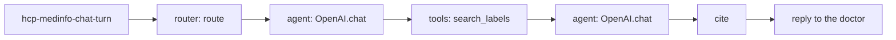

# Follow one question through the desk

This page follows one real question from the chat box to the answer. Every payload below was
copied from one Langfuse trace, cut short where it runs long. Open any trace in your own Langfuse
and you see the same steps with the same names.

The asker is Chidi Okafor, a Pharma B doctor in the US. The chat already holds one turn: a
CardioNex question, which the desk refused because CardioNex is Pharma A's medicine. Then Chidi
asks:

```text
What is the recommended NeuroVex dose for diabetic peripheral neuropathy?
```

## The steps in the trace



| Span | Type | What it does |
| --- | --- | --- |
| `hcp-medinfo-chat-turn` | agent | The whole turn, from the message in to the reply out |
| `router` and its `route` call | chain, generation | Sorts the message into one tier |
| `agent` and its `OpenAI.chat` call | span, generation | The model picks tools, then writes the answer |
| `tools` and `search_labels` | span, tool | Searches the labels the asker may read |
| `embed` | embedding | Turns the search words into a vector for pgvector |
| `cite` | span | Checks that every citation names a section that was found |

## 1. The router sorts only the new message

The router gets the earlier turn as context and the new message on its own. A refused turn
before it does not make this message refused.

```text
Earlier turns, for context only:
Doctor: What is the CardioNex dose for a patient with eGFR 24 mL/min who is not on dialysis?
(the desk replied INSUFFICIENT_CONTEXT)

Message to sort:
Doctor: What is the recommended NeuroVex dose for diabetic peripheral neuropathy?
```

The `route` call answers with one tier and a reason:

```json
{"tier": "answer", "reason": "The question asks for a dose for an approved adult indication, with no patient-specific dosing action requested.", "asks_for_advice": false}
```

`answer` sends the message on to the agent. `stop`, `safety` and `review` would each take
another path, which lesson 13 builds.

## 2. The agent gets a prompt made for this doctor

The system prompt is one template in `src/server/desk-prompt.ts`, filled in for the person who
signed in. Chidi's copy starts like this:

```text
You are the HCP Medical Information Agent for Pharma B.
Doctors and pharmacists ask you about Pharma B's medicines: NeuroVex.
Today is 2026-11-23. The asker is in US. NeuroVex has a label in force in US.
```

It never names CardioNex, so the model has no Pharma A medicine to mix in. Its citation example
is `[neurovex-uspi-v1, 2.1]`, a section Chidi could really be given.

The first `OpenAI.chat` call writes no text. It asks for one tool:

```json
{"name": "search_labels", "arguments": {"query": "NeuroVex recommended dose for diabetic peripheral neuropathy"}}
```

## 3. Search reads only what Chidi may read

The server adds who is asking before the search runs. The model cannot change these fields.

```json
{"query": "NeuroVex recommended dose for diabetic peripheral neuropathy", "asker": {"tenantId": "pharma_b", "country": "US"}, "today": "2026-11-23"}
```

Search returns Pharma B sections in force in the US, each with its score:

| Section | Title | Score |
| --- | --- | --- |
| `neurovex-uspi-v1 2.1` | Recommended Dosage | 0.809 |
| `neurovex-trial-summary 2.1` | Design | 0.700 |
| `neurovex-uspi-v1 1.1` | Indications and Usage | 0.645 |
| `neurovex-uspi-v1 2.2` | Dose Increase and Maximum Dose | 0.623 |

Each result carries its text, its status and its date. So the model can see why it may use it:

```json
{"doc_id": "neurovex-uspi-v1", "section": "2.2", "title": "Dose Increase and Maximum Dose", "status": "active", "effective_date": "2026-05-01", "country": "US", "score": 0.623, "text": "- The dose is not titrated. Start at 50mg twice daily and stay there.\n\n- The maximum daily dose is 100mg. ..."}
```

## 4. The agent answers from what it found

The second `OpenAI.chat` call sees the search results and writes the answer:

```text
For adults with diabetic peripheral neuropathy, the recommended starting and maintenance dose is
50 mg orally twice daily, with or without food. The dose is not titrated; the maximum daily dose
is 100 mg. [neurovex-uspi-v1, 2.1] [neurovex-uspi-v1, 2.2]
```

Both facts come from the two sections it cites.

## 5. The citation check runs before the doctor sees it

`cite` gets the answer and every section found in this turn and the turn before:

```json
{"sections": ["neurovex-uspi-v1 2.3", "neurovex-uspi-v1 8.6", "neurovex-uspi-v1 8.5", "neurovex-uspi-v1 10", "neurovex-uspi-v1 2.1", "neurovex-trial-summary 2.1", "neurovex-uspi-v1 1.1", "neurovex-uspi-v1 2.2"]}
```

```json
{"outcome": "passed", "problems": [], "afterRewrite": []}
```

`passed` means every bracket names a section that was found, so the answer goes out as written.

Say a bracket named a section nobody found. Then `problems` would say which one, and the agent
would rewrite once. `afterRewrite` would hold what was still wrong. An answer that still fails is held
back. Lesson 21 builds this check.

## Try it yourself

1. Sign in to the app as `chidi.okafor@pharma-b.example.com` and ask the same question.
2. Open Langfuse, go to Tracing, and open the newest `hcp-medinfo-chat-turn`.
3. Click each span in the tree. Compare its input and output with the steps above.
4. Ask about CardioNex next, and watch `search_labels` find no Pharma A section.

`npm run demo:check` plays this chat with the other demo chats, ten turns in all, on the real
model. It fails on any wrong answer.

## The same path as a drawing

`npm run flows:capture` asks three questions through the running app. Two come from a Pharma A
doctor: the eGFR 24 dose and the child dose. The third is the eGFR 24 dose from a Pharma B doctor.

The script reads each turn's trace back from Langfuse. It writes one file per question to
`docs/flows/main`, with the hops in order. Each hop names the part that made the call and the part
it called. It keeps short cuts of what went in and what came out.

The buildcamp drawings in lwp-canvas are made from these files. So the drawing shows the same spans
you just clicked through.
