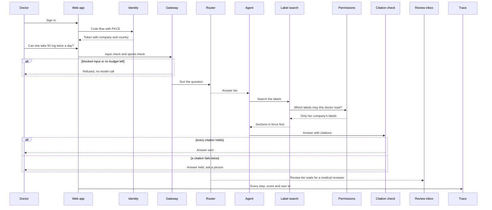
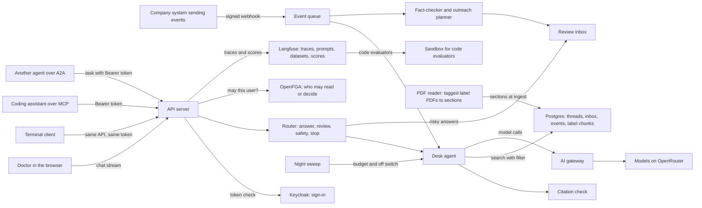
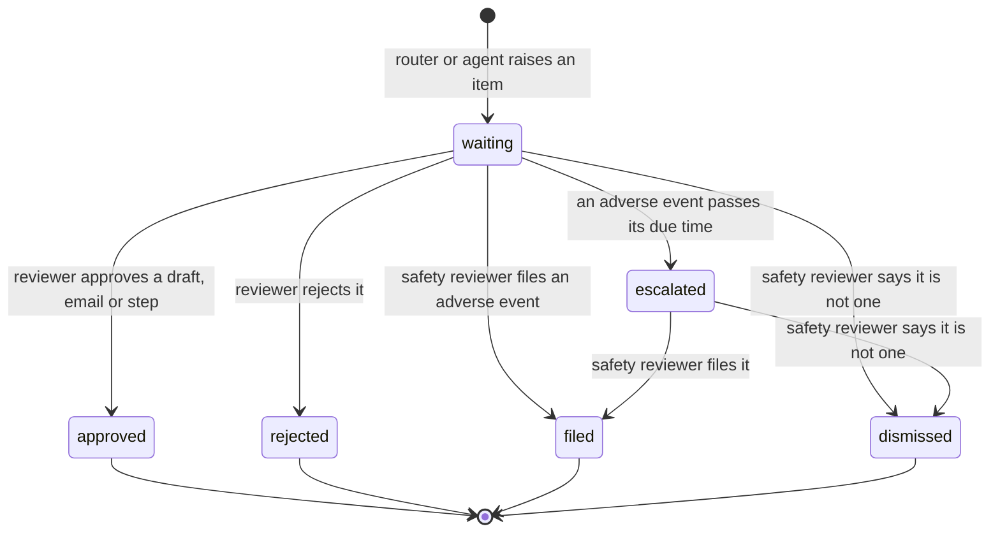

# Agentic AI buildcamp walkthrough

## The problem

A doctor has a patient in the room and one question. "Can she take CardioNex at 50 mg twice a day?" Today she calls the drug company's medical desk. A person finds the label, checks the dose and calls back. That can take a day.

An AI agent can answer in seconds. But a wrong answer here can hurt a patient. For example, an agent that reads an expired draft gives a dose that was never approved. It sounds just as sure as a right one.

So the question is not "can a model answer?". It is "can we prove each answer is safe before it goes out?". This course builds that proof, one part at a time, on a real desk.

## What you build

You build the medical information desk for two drug companies, Pharma A and Pharma B. They share one system, and neither may see the other's data.

- **The desk,** an agent that answers doctors from approved label text, with citations.
- **A trace of every step,** so you can see what the agent read and why it answered.
- **A test set and a scoreboard,** so a change is measured before it ships.
- **Sign-in and permissions,** so each person sees only their own company's labels.
- **A router and a review inbox,** so a risky answer waits for a person.
- **Two staff agents,** a fact-checker for sales emails and an outreach planner.
- **Agents that call agents, react to events and run at night,** each inside limits code enforces.
- **A release gate,** so a prompt that fails the tests never reaches doctors.
- **A search over the real label PDFs,** and a check of every citation before an answer is sent.

| Case | What breaks | How the system holds |
| --- | --- | --- |
| A question about a dose | The agent cites an expired draft | The citation check rewrites or holds the answer |
| A doctor at Pharma B asks about a Pharma A drug | Another company's label leaks | Search only scores labels the doctor may read |
| A patient has a side effect | A safety report is lost in chat | It goes to the safety reviewer with a 24 hour clock |
| A new prompt makes answers worse | Doctors get the worse answers | The release gate blocks the push |
| The night agent loops | Spend runs away | It stops at its budget, and anyone can pause it |

## How it works

Every request goes through the same parts in the same order. Code decides what is allowed, and the model only writes text inside those limits. Every step is traced, so any answer can be explained later.

### The flow

This follows one doctor's question from sign-in to the answer, as the system runs after the last lesson.

The step people doubt is the permission check. It happens inside the search query, not after it. So a label the doctor may not read is never a candidate, and the model never sees it.

### Where it sits

This is the whole system. Each arrow says what crosses it.

### The states

A risky answer, a flagged email or a proposed step waits in the review inbox. A reviewer moves it to one final state, and that decision is a score on its trace.

A reviewer from another company cannot move an item. The permission check refuses before the status changes.

### Concepts

Each word below has one short meaning. The lessons link here.

**Checkpoint.** A saved state of the code at the start of a lesson. You can jump to any lesson by checking out its checkpoint.

**Local stack.** All the services the course needs, running on your own laptop. Nothing you test leaves your machine.

**Agent.** A model that can call tools in a loop until it has an answer. Code decides which tools it may call.

**Tool.** A function the model may ask to run, like a label search. Code runs it and hands back the result.

**Label.** The approved text that says how a drug may be used. It is the only source the desk may answer from.

**Trace.** The record of one request, from the question to the answer. It shows every step the agent took.

**Span.** One step inside a trace, like a search or a model call. It has a start, an end, what went in and what came out.

**Prompt version.** One saved copy of the agent's instructions. Each change makes a new version, so you can go back.

**Prompt label.** A name like production that points at one prompt version. The app asks for the label, not a version number.

**Fallback.** What the app uses when its first choice is not there. The desk keeps a prompt in code for when the store is down.

**Error analysis.** Reading real answers one by one and writing down what went wrong. It shows which failures happen most.

**Open coding.** Writing a short free note on each bad answer, before you pick any groups. The groups come from the notes.

**Failure category.** A named group of failures that share one cause. You count them to decide what to fix first.

**Eval case.** One question with the answer we expect. It is the smallest test of what the agent does.

**Dataset.** A set of eval cases kept in one place. Every change is run against the same set.

**Expected behavior.** The move the agent should make, such as answer, ask for more, or send it on. A right fact with the wrong move still fails.

**Experiment.** One run of the agent over a whole dataset. Each case gets scores you can compare later.

**Evaluator.** Code that scores one answer, like a check for the right reply. It runs the same way every time.

**Scoreboard.** A table with one row per run and one column per group of cases. It shows if a change helped.

**Baseline.** The run you compare a change against. Without one, a score has nothing to beat.

**Pass rate.** The share of cases that passed in a run. It only means something on the same cases each time.

**Improvement loop.** Trace, find failures, add cases, change, measure, then ship. Each turn makes the agent a bit better.

**LLM judge.** A model that grades another model's answer against a rubric. It helps where code cannot check the meaning.

**Calibration.** Checking a judge against answers people already graded. You trust the judge only if it agrees with them.

**Agreement.** How often the judge and a person give the same grade, beyond chance. The course needs 0.6 or more.

**Gateway.** The one door every model call goes through. It holds the keys, the limits and the record of each call.

**Budget.** The most a service may spend on model calls in a day. Past it, the gateway refuses the call.

**Input check.** A rule that reads the question before any model sees it. A blocked question costs nothing.

**Token.** A signed note from the sign-in service that says who you are. The server trusts the note, not what the browser says.

**Tenant.** One company that shares the system with others. Its data must never reach another one.

**Permission check.** Asking a separate service if this person may do this to that thing. Code asks before it acts.

**MCP.** An open way for an AI app to find and call tools on a server. It lets a coding assistant use the desk's search.

**Sandbox.** A closed box that runs code with no network and tight limits. Code from outside runs there, never on the server.

**Skill.** A short written procedure an assistant follows for one job. It tells the assistant which tools to call and in what order.

**Router.** A first model call that sorts each message into a tier. Code then does the job that tier needs.

**Risk tier.** How much harm a reply could do, from answer to review, safety and stop. Higher tiers need a person.

**Pause and resume.** The agent stops and saves its place until a person decides. A restart does not lose the place.

**Review inbox.** The list of items waiting for a person to decide. Each decision is kept with who made it.

**Approved claim.** A sentence the company may say about a drug in one country. A sales email may only use these, word for word.

**Fact check.** Code that marks each sentence of an email as approved or not. The model only suggests better wording.

**Opt-out.** A doctor's choice to get no more emails. Code checks it before any step is planned.

**Agent card.** A public page that says what an agent can do and how to sign in. Other agents read it to pick a skill.

**Agent task.** One job one agent asks another to do, with a state you can check. It ends done, waiting on input, or refused.

**Handoff.** One agent passing work to another, with the same trace. The second agent checks the caller's token too.

**Signed event.** A message from another system, signed with a shared secret. A bad sign means it is refused.

**Idempotency.** Doing the same event twice has the same effect as once. A repeat is counted, not run again.

**Job queue.** A list of work saved in the database, done in order by a worker. A crash does not lose a job.

**Dead letter.** Where a job goes after it fails too often. A person looks at it there.

**Scope.** What an agent is allowed to touch. The night agent may read and propose, and decide nothing.

**Spend limit.** The most an agent may spend in one day, read before every step. If spend cannot be read, it stops.

**Off switch.** A setting any reviewer can flip to stop an agent. It is read before every step.

**Release gate.** A test run that must pass before a change goes live. Red blocks the push.

**Promote.** Move the production label onto a new prompt version. The gate does it only when every case passes.

**Browser sign-in.** The terminal opens your browser to sign in, then gets a token back. It never sees your password.

**Keychain.** The place your computer keeps secrets, locked to your login. The terminal client keeps its token there.

**Stream.** An answer sent in small parts as it is written. The chat page and the terminal read the same stream.

**Chunk.** One piece of a document stored for search. Here it is a passage of at most 300 words from one numbered section.

**Embedding.** A list of numbers that stands for the meaning of a text. Texts with close meanings get close numbers.

**Vector search.** Finding the chunks whose numbers are closest to the question's numbers. It finds meaning, not just the same words.

**Hybrid search.** Two searches, one by meaning (vectors) and one by words (BM25), with their lists merged. Each finds what the other misses.

**Rerank.** A second, slower look at the top results of a search. Here a model grades each one by whether it answers the question.

**Citation.** A pointer from a fact to the place it came from, like a label section. A doctor can check it.

**In force.** A label that applies today. An expired draft or an old version is not in force.

**Citation check.** Code that tests every citation and number in an answer before it is sent. It makes no model call.

**Held answer.** A fixed reply sent when an answer fails its check twice. It tells the doctor to ask a person.

**Query check.** Code that reads the model's SQL before it runs. It lets through one SELECT on one table, with a short list of functions.

**Database login.** A separate user name for each company that the agent's queries run as. It can read one table and nothing else.

**Row rule.** A rule inside the database that hides every row not owned by the login. It holds even if the SQL asks for those rows.

**Small group.** A total built from fewer than 11 prescribers. It is left out, so no number points at one doctor.

**Repro set.** A script that plays chats that broke, on the real model. It fails until each one is fixed.

**Run record.** The steps behind one answer: how it was sorted, what was looked up, what the check found.

## The lessons

The [lesson list](../README.md#lessons) gives each lesson's checkpoint and the question it answers.

## What to watch for

### A rule in a prompt

A prompt rule is a request, and the model follows it most of the time. For example, "cite every fact" still let 13 of 405 answers through with a bad citation. When a rule protects a patient or a company, move it into code and test the code.

### A check after the fact

Filtering results after the search means the model may already have seen them. The desk filters inside the search query and inside the permission check. Nothing leaks, even for one call.

### A score with no baseline

A pass rate on its own says little. Compare every run with the last one on the same cases. Add a case for each new failure.

## Where to go next

- [Follow one question through the desk](./one-question.md): one real trace, span by span.
- The case study the course is built from: `case-studies/enterprise-agentic-hcp-system.md` in the dataset repo.
- [OpenTelemetry GenAI conventions](https://opentelemetry.io/docs/specs/semconv/gen-ai/), the shape the traces follow.
- [OAuth 2.0 for native apps (RFC 8252)](https://www.rfc-editor.org/rfc/rfc8252) and [protected resource metadata (RFC 9728)](https://www.rfc-editor.org/rfc/rfc9728), behind the sign-in.
- [Model Context Protocol](https://modelcontextprotocol.io/) and [Agent2Agent](https://a2a-protocol.org/), the two open protocols.
- [Standard Webhooks](https://www.standardwebhooks.com/), the event signatures.
