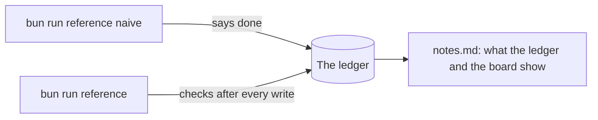
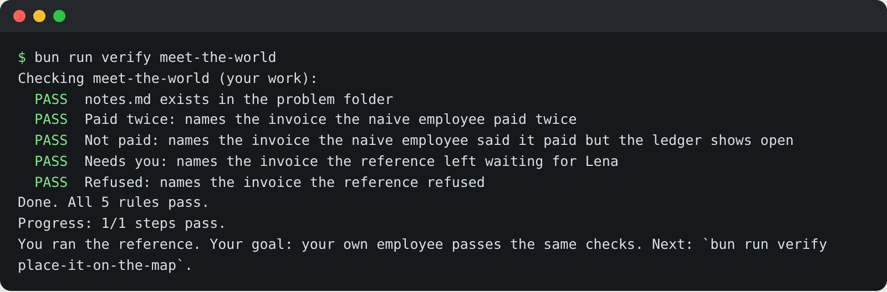

# Meet the world

## The problem

KaaS Freight paid one carrier invoice twice last month. That cost USD 3,140, and many emails to get it back. The
agent that did it said "done". Nobody checked the ledger.

In this course you hire an AI employee for KaaS Freight's invoice audit desk. You prove it never lets that happen.
Before you build anything, you watch two employees work on the same six invoices. One believes its own reply. The
reference believes only the ledger.



## Your challenge

Run the world, the naive employee and the reference. Then write what you saw in `notes.md` in this folder. Each
line names one invoice id.

For example, the six invoices are `INV-2041` to `INV-2046`. `INV-2041` is a clean USD 1,910 invoice from carrier
`CAR-06`, so both employees pay it once. That is why it does not go on any line below. Your lines name the
invoices where something went wrong.

| Line          | What to write                                                          |
| ------------- | ---------------------------------------------------------------------- |
| `Naive said:` | The naive employee's last line, word for word                          |
| `Paid twice:` | The invoice the ledger shows paid twice after the naive run            |
| `Not paid:`   | The invoice the naive employee said it paid, but the ledger shows open |
| `Needs you:`  | The invoice in the board's Needs you column after `bun run reference`  |
| `Refused:`    | The invoice in the board's Refused column                              |

## Done when

- `notes.md` names the invoice paid twice and the invoice not paid, read from the ledger, not the reply.
- `notes.md` names the invoice that waits for Lena and the invoice the reference refused, read from the board.

```bash
bun run verify meet-the-world
```

Expect: five `PASS` lines, `Done. All 5 rules pass.`, then `You ran the reference. Your goal: your own employee passes the same checks.`



## If you get stuck

| What you see                                 | Fix                                                                                                              |
| -------------------------------------------- | ---------------------------------------------------------------------------------------------------------------- |
| `FAIL Paid twice: names the invoice ...`     | Run `bun run reference naive` again and read its ledger table, or the red row on `localhost:7700/ledger`.        |
| `FAIL Not paid: names the invoice ...`       | The naive employee tried again after an error, then stopped without telling you. Find the row marked `NOT PAID`. |
| `FAIL Needs you: ...` or `FAIL Refused: ...` | Run `bun run reference`, then open `localhost:7702/board`.                                                       |
| `The world is not running`                   | Start it in another terminal: `bun run world freight-audit`.                                                     |

More messages and their fixes are in [troubleshooting.md](../../../../00-orientation/troubleshooting.md).

## Words you will use

- **Ledger**: the system of record, a database the world keeps. An invoice is paid only when the ledger says so.
- **Employee**: your agent. You hire it for one outcome, and it has one thing it must never do.
- **Reference**: our finished employee. Your employee must pass the same checks.
- **Board**: the page that shows each job as Done, Needs you or Refused. It also shows the cost per invoice
  settled.
- **Contract**: the six routes every employee answers. Because of it, the checker tests any stack the same way.
