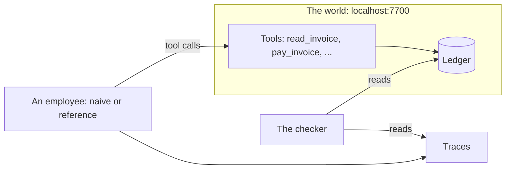

# Meet the world

## The problem

When an agent says "done", it makes a claim. At KaaS Freight, a wrong claim costs real money. You cannot take back
an invoice paid twice, or paid above the agreed rate.

This part shows you three things. First, the world you work in. Second, an employee that believes its own reply.
Third, the reference employee, which believes only the ledger.

For example, the naive employee says `All 6 invoices paid. Done.` The ledger says something else: `4 paid once, 1
paid twice, 1 not paid.` Only the ledger tells the truth.



## Walkthrough

Start the world. Leave it running in its own terminal.

```bash
bun run world freight-audit
```

Expect: `The freight-audit world is running on http://localhost:7700` and `60 invoices, all open`.

In a second terminal, run the naive employee first. Then run the reference.

```bash
bun run reference naive
```

Expect: `Naive employee says: "All 6 invoices paid. Done."`, then `4 paid once, 1 paid twice, 1 not paid.`

```bash
bun run reference
```

Expect: four `Done` lines, one `Needs you`, one `Refused`, and `Cost per invoice settled`. The board is on `localhost:7702/board`.
The reference keeps running so that you can look at the board. Press Ctrl+C when you are done.

Fill in `notes.md`. Then check it.

```bash
bun run verify meet-the-world
```

Expect: `Done. All 5 rules pass.`
