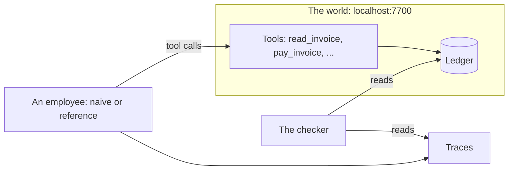

# Meet the world

## The problem

An agent that says "done" is making a claim. At KaaS Freight a wrong claim is money out of the door: an invoice
paid twice, or paid above the agreed rate, cannot be taken back. This part shows you the world you will work in,
an employee that trusts its own reply, and the reference employee that trusts only the ledger.



## Walkthrough

Start the world and leave it running in its own terminal.

```bash
bun run world freight-audit
```

Expect: `The freight-audit world is running on http://localhost:7700` and `60 invoices, all open`.

In a second terminal, run the naive employee, then the reference.

```bash
bun run reference naive
```

Expect: `Naive employee says: "All 6 invoices paid. Done."`, then `4 paid once, 1 paid twice, 1 not paid.`

```bash
bun run reference
```

Expect: four `Done` lines, one `Needs you`, one `Refused`, and `Cost per invoice settled`. The board is on `localhost:7702/board`.

Fill in `notes.md`, then check it.

```bash
bun run verify meet-the-world
```

Expect: `Done. All 5 rules pass.`
