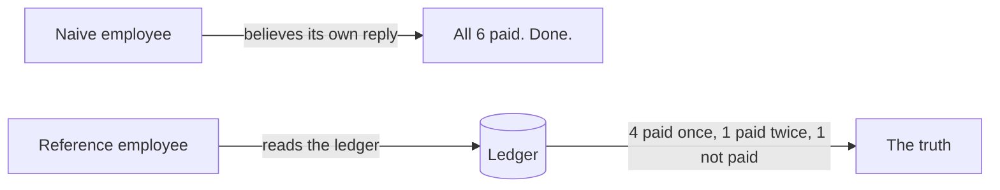

# Meet the world

## After this part you can

- Start the freight-audit world.
- Tell a naive employee from the reference one.
- Read the ledger to see what really happened.

## You leave with

A `notes.md` that says what the ledger and the board show.

## The problem

When an agent says "done", it makes a claim. At KaaS Freight, a wrong claim costs real money. You cannot take back an
invoice paid twice, or paid above the agreed rate.

This part shows you three things. First, the world you work in. Second, an employee that believes its own reply. Third,
the reference employee, which believes only the ledger.

For example, the naive employee says `All 6 invoices paid. Done.` The ledger says something else. It shows 4 paid once, 1
paid twice, 1 not paid. Only the ledger tells the truth.



Notice: The reply says all six are paid. The ledger shows one paid twice and one not paid.

## Steps

| Step                                                  | What you do                                         | Minutes |
| ----------------------------------------------------- | --------------------------------------------------- | ------- |
| [meet-the-world](01-meet-the-world/problem/README.md) | Run the world, the naive employee and the reference | 20      |

## Walkthrough

Start the world. Leave it running in its own terminal.

```bash
bun run world freight-audit
```

Expect: `The freight-audit world is running on http://localhost:7700` and "60 invoices, all open".

In a second terminal, run the naive employee first. Then run the reference.

```bash
bun run reference naive
```

Expect: `Naive employee says: "All 6 invoices paid. Done."`, then 4 paid once, 1 paid twice, 1 not paid.

```bash
bun run reference
```

Expect: four `Done` lines, one `Needs you`, one `Refused`, and "Cost per invoice settled". The board is on
`localhost:7702/board`. The reference keeps running so that you can look at the board. Press Ctrl+C when you are done.

Fill in `notes.md`. Then check it.

```bash
bun run verify meet-the-world
```

Expect: `Done. All 5 rules pass.`

## Watch and read

| Kind  | Title                                     | Who made it                              | Why                                                                | Link                                                                   |
| ----- | ----------------------------------------- | ---------------------------------------- | ------------------------------------------------------------------ | ---------------------------------------------------------------------- |
| video | How We Build Effective Agents             | Barry Zhang, Anthropic                   | The maker of the method says when an agent is worth its cost.      | https://www.youtube.com/watch?v=D7_ipDqhtwk                            |
| read  | Demystifying evals for AI agents          | Anthropic engineering                    | Judge an agent by the state it leaves behind, not by what it says. | https://www.anthropic.com/engineering/demystifying-evals-for-ai-agents |
| video | Building the future of agents with Claude | Anthropic                                | Anthropic staff show how they think about agents and their limits. | https://www.youtube.com/watch?v=XuvKFsktX0Q                            |
| read  | Building effective agents                 | Erik Schluntz and Barry Zhang, Anthropic | Start simple and add parts only when you must.                     | https://www.anthropic.com/engineering/building-effective-agents        |

## Project

Fill in `notes.md` with what the ledger and the board show. Then run `bun run verify meet-the-world`.
