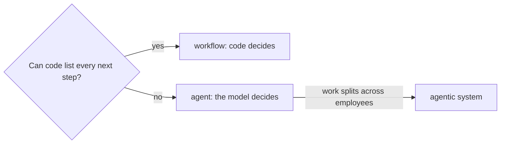

# Place it on the map

## The problem

KaaS Freight paid one load twice and lost USD 3,140. Before you build the clerk, decide what kind it is.
Can code list every next step? Then build a workflow. Does each case need a different next step? Then the model
decides, and code guards the lines it must not cross.

For example, `INV-2041` is clean, so you pay it. `INV-2028` bills detention, so you look for a signed delay. So
the clerk is an agent.

Allianz built Project Nemo for food spoilage claims under AUD 500. Seven agents pass the claim along, and a person
makes the final payout decision. Allianz reports an 80% cut in processing and settlement time. That is an agentic
system with a human on the last write.



## Your challenge

Fill in `map.md` for your employee. It has these sections:

- `## Problem`: who pays, and a cost with a number.
- `## Choice`: the first line is `workflow`, `agent` or `agentic system`.
- `## Why`: with the line `Who decides the next step: code` or `the model`.
- `## Starts by`: optional.

| Employee                                    | What to place                                                    |
| ------------------------------------------- | ---------------------------------------------------------------- |
| Freight clerk (KaaS Freight)                | Matching invoices to rate confirmations and proofs of delivery   |
| Spoiled food claims handler (home insurer)  | Claims after a power cut; a lapsed policy needs a claims officer |
| Work order writer (rural power co-op)       | Repair orders; crews only on lines marked de-energised           |
| Referral coordinator (family clinic)        | Specialist bookings that follow a doctor's order                 |
| Grant screener (charity foundation)         | Applications against the board's limit                           |
| Cover lesson planner (primary school)       | Cover lessons from the approved list                             |
| Supplier terms negotiator (grocery chain)   | Supplier terms inside the buyer's limits                         |
| Shift hiring coordinator (restaurant group) | Shift offers after the manager signs off                         |
| Damage assessor (equipment hire firm)       | Deposit charges backed by photos                                 |
| Milk pickup planner (dairy co-op)           | Pickup routes inside each driver's legal limit                   |
| Your own job                                | One task you repeat, and what a mistake in it costs              |

## Done when

- `map.md` has Problem, Choice and Why.
- The Problem names a cost with a number.
- The Choice and `Who decides the next step` agree: workflow with code, agent or agentic system with the model.

```bash
bun run verify place-it-on-the-map
```

Expect: `Done. All 6 rules pass.`

The freight sample is in [solution/map.md](../solution/map.md).

## If you get stuck

| What you see                                                         | Fix                                                     |
| -------------------------------------------------------------------- | ------------------------------------------------------- |
| `FAIL the Problem names a cost with a number`                        | Add the money, count or time lost, as a digit.          |
| `FAIL the first line of Choice is workflow, agent or agentic system` | Put only that word on the first line under `## Choice`. |
| `FAIL the Choice and the decider agree`                              | If code picks every next step, the choice is workflow.  |

## Words you will use

- **Workflow**: code picks every next step. The model may fill in a field.
- **Agent**: the model picks the next tool to call.
- **Agentic system**: several agents hand work to each other.
- **Starts by**: what starts a job: a person, an event, a schedule or another agent.

Sources: [Allianz, Project Nemo](https://www.allianz.com/en/mediacenter/news/articles/251103-when-the-storm-clears-so-should-the-claim-queue.html), read 2026-11-12.
