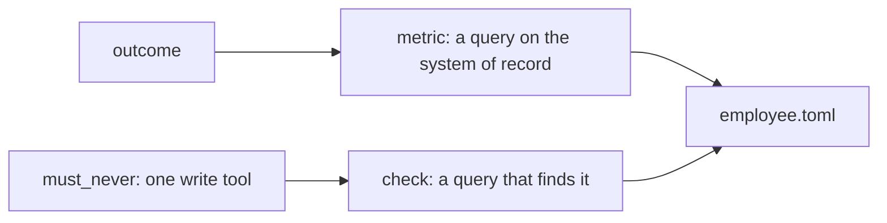

# Write the hire letter

## The problem

"Help the clerks with invoices" cannot be checked. Nobody can tell whether the clerk did its job, or whether it paid
a load twice. A hire letter names one outcome, one number you can query, and one thing it must never do, with a
query that would catch it.

Chipotle's hiring assistant, Ava Cado, chats with candidates and books interviews, but offers go only to candidates
a manager picks. Chipotle says the time from application to start fell by about two thirds. The outcome is a
person starting; the must-never is an offer with no manager.



## Your challenge

Fill in `employee.toml` in this folder. Later steps read it, so keep it here.

Shape of `[hire]`, the same block as in `reference/CONTRACT.md`: `name`, `outcome`, `starts_by` (a list of person,
event, schedule or agent), `lives` (one job, one case or always on), `[hire.metric]` with `name` and `query`,
`[hire.must_never]` with `rule`, `write` (a tool name like `pay_invoice`) and `check` (a SELECT that returns the
bad rows).

| Employee | Must never |
|---|---|
| Freight clerk | Pay the same load twice |
| Spoiled food claims handler | Decline a claim without a claims officer |
| Work order writer | Send a crew to a line not marked de-energised |
| Referral coordinator | Book without the doctor's order |
| Grant screener | Award above the board's limit |
| Cover lesson planner | Use material not on the approved list |
| Supplier terms negotiator | Agree terms outside the buyer's limits |
| Shift hiring coordinator | Make an offer without the manager's sign-off |
| Damage assessor | Charge a deposit without photo evidence |
| Milk pickup planner | Send a driver over their legal driving limit |
| Your own job | The one mistake that costs real money or trust |

## Done when

- Every field in `[hire]` is filled, with no `TODO` left.
- `metric.query` and `must_never.check` are SELECT queries on your system of record.

```bash
bun run verify write-the-hire-letter
```

Expect: `Done. All 6 rules pass.`

The freight sample is in [solution/employee.toml](../solution/employee.toml).

## If you get stuck

| What you see | Fix |
|---|---|
| `FAIL the metric has a name and a query on the system of record` | A feeling like "clerks are happier" is not a metric. Count rows. |
| `FAIL must_never names a write tool and a query that finds it` | Name the tool in snake_case and write the SELECT that would list a breach. |

## Words you will use

- **Outcome**: the result in the world the employee is hired for.
- **Metric**: a number you get by running a query, not by asking someone.
- **Must-never**: the one write the employee may never make, plus the query that would catch it.
- **System of record**: the database that holds the truth, such as the ledger.

Sources: [Chipotle newsroom, 19 Feb 2025](https://newsroom.chipotle.com/2025-02-19-CHIPOTLE-AIMS-TO-HIRE-FUTURE-BILLION-DOLLAR-BUSINESS-LEADERS-IN-NEW-BURRITO-SEASON-HIRING-PUSH), read 2026-11-12.
