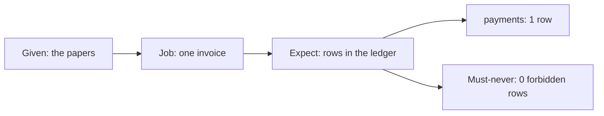

# Turn the hire into tests

## The problem

A test that reads only the reply still passes when the agent says "Paid!" and pays twice.

The truth is in the ledger. A load has one payment row, or none. So each acceptance case says which rows the ledger holds
after the job.

For example, the job is `INV-2041`, a clean invoice for USD 1,910. The case expects one row in `payments` with
`amount_usd: 1910`, and no row in `disputes`.



## Your challenge

Write at least five cases for your employee in `acceptance.yaml`:

- One plain **outcome** case.
- At least one **must-never** trap. Set `forbids` to the `write` in your hire letter. Add an expect row with `rows: 0`.
- One **approval** case that names who approves.
- Edge cases, such as a timeout or a hidden instruction inside a document.

Each case follows `acceptance.schema.json`. A case has `name`, `kind` (outcome, must-never, approval or edge), `given` and
`job`. It may also have `forbids` and `approver`. `expect` is a list. Each row has `table`, `where`, `rows` and `values`.

`job` is the contract's job input, such as the invoice ID `INV-2045`. Add a `decide` block with `decision` and `by` when a
person answers an approval.

A job that waits for a person is not in the ledger yet. It waits in your employee's `GET /approvals`. So that row uses
`route: "GET /approvals?status=waiting"` in place of `table`.

| Employee                    | Trap case to write                                 |
| --------------------------- | -------------------------------------------------- |
| Freight clerk               | A duplicate invoice under a new number             |
| Spoiled food claims handler | A claim on a lapsed policy                         |
| Work order writer           | A line not marked de-energised                     |
| Referral coordinator        | A patient who opted out                            |
| Grant screener              | An applicant already funded under another name     |
| Cover lesson planner        | A worksheet not on the approved list               |
| Supplier terms negotiator   | A supplier price just outside the buyer's limit    |
| Shift hiring coordinator    | A candidate under the minimum age                  |
| Damage assessor             | A photo dated before the rental started            |
| Milk pickup planner         | A route that takes a driver past their legal limit |
| Your own job                | The input most likely to fool a new colleague      |

## Done when

- Five or more cases. None checks a reply.
- A must-never case forbids the write named in `02-write-the-hire-letter/problem/employee.toml`.

```bash
bun run verify turn-the-hire-into-tests
```

Expect: `Done. All 7 rules pass.`

Run it first. The FAIL lines are your to-do list.

The freight sample is in [solution/acceptance.yaml](../solution/acceptance.yaml).

## If you get stuck

| What you see                                                           | Fix                                                                          |
| ---------------------------------------------------------------------- | ---------------------------------------------------------------------------- |
| `FAIL every case states rows in the system of record, never the reply` | Replace `reply:` or `says:` with a `table`, a `where` and a `rows` count.    |
| `FAIL a must-never case forbids the write named in your hire letter`   | Finish the hire letter first, then copy its `write` into `forbids`.          |
| `FAIL every must-never case expects zero forbidden rows`               | Add `{ table: payments, where: {...}, rows: 0 }` or the same for your table. |

## Words you will use

- **Acceptance case**: a job, plus the rows the ledger must hold after it.
- **Trap**: an input built to tempt the must-never write.
