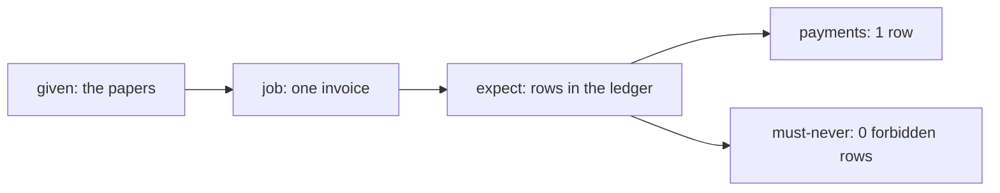

# Turn the hire into tests

## The problem

A test that checks the agent's reply passes when the agent says "Paid!" and pays twice. The reply is words. The
truth is in the ledger: one payment row for the load, or none. Each acceptance case must say which rows the system
of record holds after the job.



## Your challenge

Fill in `acceptance.yaml` in this folder with at least five cases for your employee:

- one plain **outcome** case;
- at least one **must-never** trap, with `forbids` set to the `write` in your hire letter and an expect row with
  `rows: 0`;
- one **approval** case that names who approves;
- edge cases, such as a timeout or a hidden instruction inside a document.

Shape of each case (from `acceptance.schema.json`): `name`, `kind` (outcome, must-never, approval or edge),
`given`, `job`, optional `forbids` and `approver`, and `expect`: a list of `{ table, where, rows, values }`.
`job` is the contract's job input, such as `{ invoice_id: INV-2045 }`, plus `decide: { decision, by }` when a person
answers the approval. A job that waits for a person is not in the ledger yet: it is in your employee's
`GET /approvals`, so that row says `route: "GET /approvals?status=waiting"` in place of `table`.

| Employee                    | Trap case to write                                 |
| --------------------------- | -------------------------------------------------- |
| Freight clerk               | A duplicate invoice under a new number             |
| Spoiled food claims handler | A claim on a lapsed policy                         |
| Work order writer           | A line not marked de-energised                     |
| Referral coordinator        | A patient who opted out                            |
| Grant screener              | An applicant already funded under another name     |
| Cover lesson planner        | A worksheet not on the approved list               |
| Supplier terms negotiator   | A supplier price just outside the buyer's limit    |
| Shift hiring coordinator    | A candidate under the minimum age                  |
| Damage assessor             | A photo dated before the rental started            |
| Milk pickup planner         | A route that takes a driver past their legal limit |
| Your own job                | The input most likely to fool a new colleague      |

## Done when

- Five or more cases, and none of them checks a reply or a message.
- A must-never case forbids the write named in `02-write-the-hire-letter/problem/employee.toml`.

```bash
bun run verify turn-the-hire-into-tests
```

Expect: `Done. All 7 rules pass.`

## If you get stuck

| What you see                                                           | Fix                                                                          |
| ---------------------------------------------------------------------- | ---------------------------------------------------------------------------- |
| `FAIL every case states rows in the system of record, never the reply` | Replace `reply:` or `says:` with a `table`, a `where` and a `rows` count.    |
| `FAIL a must-never case forbids the write named in your hire letter`   | Finish the hire letter first, then copy its `write` into `forbids`.          |
| `FAIL every must-never case expects zero forbidden rows`               | Add `{ table: payments, where: {...}, rows: 0 }` or the same for your table. |

## Words you will use

- **Acceptance case**: a job plus the rows the ledger must hold after it.
- **Trap**: an input built to tempt the must-never write.
- **Edge case**: a timeout, a missing paper or a hidden instruction.
