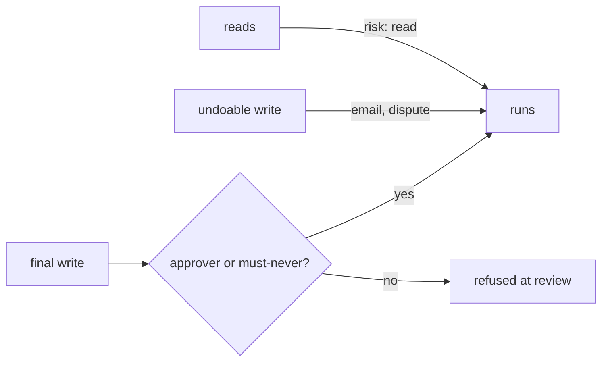

# List tools and permissions

## The problem

An agent can do only what its tools let it do. If `pay_invoice` has no approver, a hidden line in a PDF can move
money. A tenant is one customer's data. If a search reads every tenant, the freight clerk can see KaaS Dairy's
loads. So list every tool before Build writes one, with its risk and who approves it.

For example, `pay_invoice` is a final write. Ravi Shah approves payments up to USD 5,000, and Lena Ortiz approves
anything above. So `INV-2045`, at USD 6,200, must wait for Lena. `read_invoice` only reads, so it needs no approver.

Ramp's policy agent reviews expenses. Ramp's engineers set it up so the agent handles more than 65% of approvals.
When it is unsure, it sends the expense to a person as "Needs review". Ramp says more than 1,000 finance teams use
it. Reviewers spend their time on the 10 to 15% that need judgement.



## Your challenge

Fill in `tools.yaml` in this folder. List every tool your employee may call. Each tool follows `tools.schema.json`:

- `name`;
- `does`: reads or writes;
- `risk`: read, undoable write or final write;
- `tenant`: own or any;
- `approval`: who approves, or none;
- optional `must_never` and `note`.

| Employee                    | The final write to guard          |
| --------------------------- | --------------------------------- |
| Freight clerk               | `pay_invoice`                     |
| Spoiled food claims handler | `decline_claim`                   |
| Work order writer           | `dispatch_crew`                   |
| Referral coordinator        | `book_referral`                   |
| Grant screener              | `award_grant`                     |
| Cover lesson planner        | `publish_cover_plan`              |
| Supplier terms negotiator   | `sign_terms`                      |
| Shift hiring coordinator    | `send_offer`                      |
| Damage assessor             | `charge_deposit`                  |
| Milk pickup planner         | `assign_route`                    |
| Your own job                | The write you could not take back |

## Done when

- A read is `risk: read`, and a write is never `risk: read`.
- Every final write names an approver or a must-never.
- Every tool is `tenant: own`.

```bash
bun run verify list-tools-and-permissions
```

Expect: `Done. All 5 rules pass.`

The freight sample is in [solution/tools.yaml](../solution/tools.yaml).

## If you get stuck

| What you see                                             | Fix                                                                    |
| -------------------------------------------------------- | ---------------------------------------------------------------------- |
| `FAIL every final write has an approver or a must-never` | Name the person and the limit, like "Ravi up to USD 5,000".            |
| `FAIL no tool reads or writes another tenant`            | Limit the tool to your own tenant. A search across tenants leaks data. |
| `FAIL tools.yaml matches tools.schema.json`              | Quote values that hold a comma, like `"USD 1,000"`.                    |

## Words you will use

- **Undoable write**: a write you can reverse, like opening a dispute.
- **Final write**: a write you cannot take back, like a payment.
- **Tenant**: one customer's data, kept apart from every other customer.
- **Approver**: the named person who must say yes before a final write.

Sources: [Ramp engineering, how to build agents users can trust](https://engineering.ramp.com/post/how-to-build-agents-users-can-trust) and [Ramp, policy agent launch](https://ramp.com/blog/ramp-policy-agent-ga-launch).
