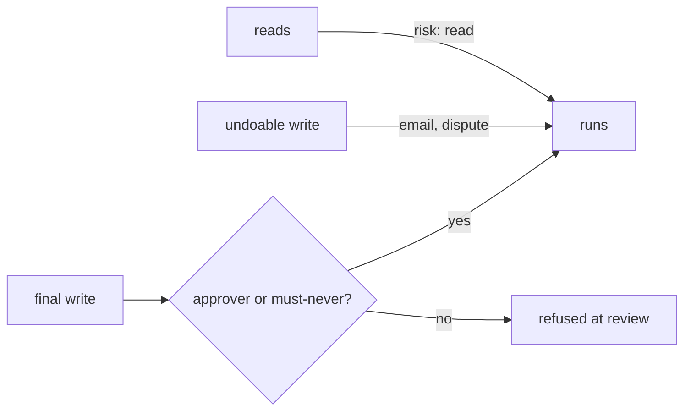

# List tools and permissions

## The problem

An agent can only do what its tools let it do. If `pay_invoice` has no approver, a hidden line in a PDF can move
money. If a search reads every tenant, the freight clerk can see KaaS Dairy's loads. List every tool before Build
writes one, with its risk and who signs off.

Ramp's policy agent reviews expenses. Ramp's engineers set it up so that more than 65% of approvals are handled by
the agent, and anything it is unsure of goes to a person as "Needs review". Ramp says more than 1,000 finance teams
use it, and reviewers spend their time on the 10 to 15% that need judgement.



## Your challenge

Fill in `tools.yaml` in this folder: every tool your employee may call.

Shape of each tool (from `tools.schema.json`): `name`, `does` (reads or writes), `risk` (read, undoable write or
final write), `tenant` (own or any), `approval` (who signs off, or none), and optional `must_never` and `note`.

| Employee                    | The final write to guard          |
| --------------------------- | --------------------------------- |
| Freight clerk               | `pay_invoice`                     |
| Spoiled food claims handler | `decline_claim`                   |
| Work order writer           | `dispatch_crew`                   |
| Referral coordinator        | `book_referral`                   |
| Grant screener              | `award_grant`                     |
| Cover lesson planner        | `publish_cover_plan`              |
| Supplier terms negotiator   | `sign_terms`                      |
| Shift hiring coordinator    | `send_offer`                      |
| Damage assessor             | `charge_deposit`                  |
| Milk pickup planner         | `assign_route`                    |
| Your own job                | The write you could not take back |

## Done when

- A read is `risk: read`, and a write is never `risk: read`.
- Every final write names an approver or a must-never.
- Every tool is `tenant: own`.

```bash
bun run verify list-tools-and-permissions
```

Expect: `Done. All 5 rules pass.`

The freight sample is in [solution/tools.yaml](../solution/tools.yaml).

## If you get stuck

| What you see                                             | Fix                                                                    |
| -------------------------------------------------------- | ---------------------------------------------------------------------- |
| `FAIL every final write has an approver or a must-never` | Name the person and the limit, like `Ravi up to USD 5,000`.            |
| `FAIL no tool reads or writes another tenant`            | Scope the tool to your own tenant; a search across tenants leaks data. |
| `FAIL tools.yaml matches tools.schema.json`              | Quote values that hold a comma, like `"USD 1,000"`.                    |

## Words you will use

- **Undoable write**: a write you can reverse, like opening a dispute.
- **Final write**: a write you cannot take back, like a payment.
- **Tenant**: one customer's data, kept apart from every other customer.
- **Approver**: the named person who signs off before a final write.

Sources: [Ramp engineering, how to build agents users can trust](https://engineering.ramp.com/post/how-to-build-agents-users-can-trust) and [Ramp, policy agent launch, 13 Jan 2026](https://ramp.com/blog/ramp-policy-agent-ga-launch), read 2026-11-12.
