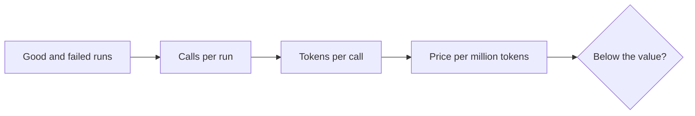
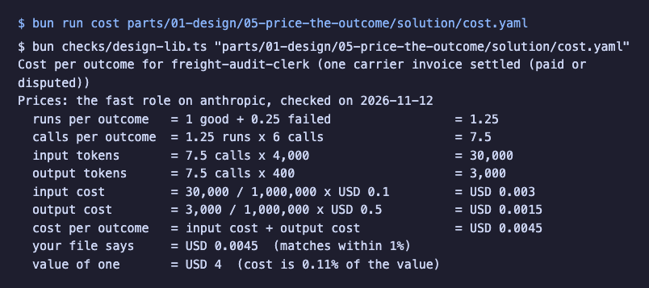

# Price the outcome

## The problem

A clerk that costs more per invoice than the person it helps loses money. So price one outcome, not one call.

To price one outcome:

1. Count the failed runs too.
2. Multiply out the calls and the tokens.
3. Compare the total with the value of one outcome.

For example, Ravi spends about six minutes on a clean invoice. That is about USD 4 of his time. The freight clerk makes 6
calls per run and 1.25 runs per invoice. On the `fast` role, that is $0.0045 per invoice.

The UK government spends about GBP 20 million a year on staff to read consultation replies. Its tool saves that staff cost.
The cost is the model calls.



## Your challenge

Fill in `cost.yaml` in this folder. It follows `cost.schema.json`. Replace each 0 and each TODO with your own value:

- The employee and the one outcome.
- What one outcome is worth, and why.
- Good and failed runs per outcome.
- Calls per run, and tokens per call.
- The role, provider, date, source page and price per million tokens.
- Your cost per outcome.

For the role, write `fast`, `smart` or `judge` from `config/models.ts`. Never write a model name. Copy the price from the
provider's page. Then run the calculator. It prints every sum.

```bash
bun run cost parts/01-design/05-price-the-outcome/problem/cost.yaml
```

Expect: the arithmetic line by line, ending with `(matches within 1%)` and `(cost is ... of the value)`. For the
freight clerk, it looks like this:



| Employee                    | One outcome to price            |
| --------------------------- | ------------------------------- |
| Freight clerk               | One invoice settled             |
| Spoiled food claims handler | One claim decided               |
| Work order writer           | One work order sent             |
| Referral coordinator        | One referral booked             |
| Grant screener              | One application screened        |
| Cover lesson planner        | One cover lesson ready          |
| Supplier terms negotiator   | One set of terms agreed         |
| Shift hiring coordinator    | One shift filled                |
| Damage assessor             | One return assessed             |
| Milk pickup planner         | One pickup route planned        |
| Your own job                | One finished piece of your work |

## Done when

- The price has a date and an `https` source.
- `failed_per_outcome` is above 0.
- Your `cost_per_outcome_usd` matches the calculator within 1%. It must also be below `value_per_outcome_usd`.

```bash
bun run verify price-the-outcome
```

Expect: `Done. All 6 rules pass.`

## If you get stuck

| What you see                                                      | Fix                                                                    |
| ----------------------------------------------------------------- | ---------------------------------------------------------------------- |
| `FAIL failed runs are counted`                                    | Some runs time out or stop. Start with 0.25; fix it once traces exist. |
| `FAIL your cost per outcome matches the recomputed one within 1%` | Copy the "cost per outcome" line from `bun run cost`.                  |
| `FAIL the cost is below the value of one outcome`                 | Use fewer calls, fewer tokens or a cheaper role.                       |

## Words you will use

- **Cost per outcome**: model spend for one finished result. Failed runs are included.
- **Value per outcome**: what one result is worth, such as the staff cost it saves.
- **Role**: `fast`, `smart` or `judge` in `config/models.ts`. That file maps each role to a model.

Sources: [GOV.UK, Humphrey tool reviews consultation responses](https://www.gov.uk/government/news/government-built-humphrey-ai-tool-reviews-responses-to-consultation-for-first-time-in-bid-to-save-millions) and [Claude pricing](https://claude.com/pricing).
