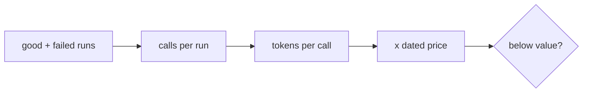
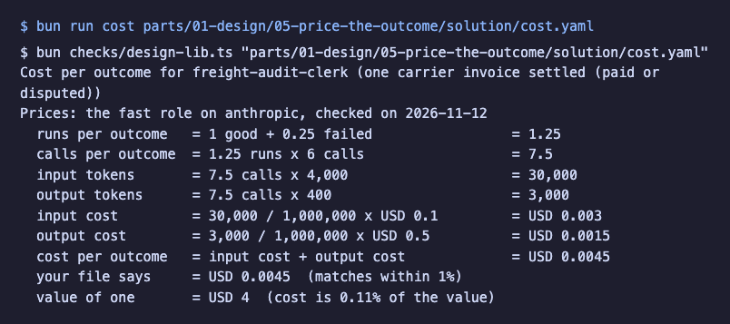

# Price the outcome

## The problem

A clerk that costs more per invoice than the person it helps is a loss, however clever it is. Price one outcome,
not one call: count the runs that fail too, multiply out the calls and tokens, and compare the total with what one
outcome is worth.

The UK government says it runs about 500 consultations a year and spends about GBP 20 million on staff to analyse
the replies. Its tool, Consult, was tested on over 2,000 replies to a Scottish Government consultation. The value of
one outcome is the staff cost it saves; the cost is what the model calls add up to.



## Your challenge

Fill in `cost.yaml` in this folder, then run the calculator on it. It prints each line of the sums.

Shape of `cost.yaml` (from `cost.schema.json`): `employee`, `outcome`, `value_per_outcome_usd`, `value_reason`,
`runs` (`good_per_outcome`, `failed_per_outcome`), `calls_per_run`, `tokens_per_call` (`input`, `output`), `price`
(`role`, `provider`, `checked_on`, `source`, `input_usd_per_million`, `output_usd_per_million`) and
`cost_per_outcome_usd`. Write the role from `config/models.ts` (fast, smart or judge), never a model name. Copy the
price from the provider's pricing page and write the date you read it.

```bash
bun run cost parts/01-design/05-price-the-outcome/problem/cost.yaml
```

Expect: the arithmetic line by line, ending `(matches within 1%)` and `(cost is ... of the value)`. On the freight
clerk it looks like this:



| Employee | One outcome to price |
|---|---|
| Freight clerk | One invoice settled |
| Spoiled food claims handler | One claim decided |
| Work order writer | One work order sent |
| Referral coordinator | One referral booked |
| Grant screener | One application screened |
| Cover lesson planner | One cover lesson ready |
| Supplier terms negotiator | One set of terms agreed |
| Shift hiring coordinator | One shift filled |
| Damage assessor | One return assessed |
| Milk pickup planner | One pickup route planned |
| Your own job | One finished piece of your work |

## Done when

- The price has a date and an `https` source.
- `failed_per_outcome` is above 0.
- Your `cost_per_outcome_usd` matches the calculator within 1% and is below `value_per_outcome_usd`.

```bash
bun run verify price-the-outcome
```

Expect: `Done. All 6 rules pass.`

## If you get stuck

| What you see | Fix |
|---|---|
| `FAIL failed runs are counted` | Some runs time out or get stopped. Start with 0.25 and fix it once traces exist. |
| `FAIL your cost per outcome matches the recomputed one within 1%` | Copy the `cost per outcome` line from `bun run cost`. |
| `FAIL the cost is below the value of one outcome` | Use fewer calls, fewer tokens or a cheaper role. |

## Words you will use

- **Cost per outcome**: model spend for one finished result, failed runs included.
- **Value per outcome**: what one result is worth, such as the staff cost it saves.
- **Role**: `fast`, `smart` or `judge` in `config/models.ts`; the file maps each role to a model.

Sources: [GOV.UK, Humphrey tool reviews consultation responses, 14 May 2025](https://www.gov.uk/government/news/government-built-humphrey-ai-tool-reviews-responses-to-consultation-for-first-time-in-bid-to-save-millions) and [Claude pricing](https://claude.com/pricing), read 2026-11-12.
