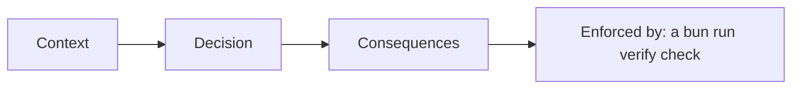

# Record the decisions

## The problem

Three choices shape every AI employee. How is the work split? Which model runs it? What if it crashes during a
payment? If a choice lives only in one head, the next person undoes it. An ADR, an architecture
decision record, writes one choice down, with the check that keeps it true.

For example, the pay tool can pay `INV-2043`, USD 1,580, and then time out. The freight clerk's durability ADR
says to retry with the same `Idempotency-Key`. Its check, `pay-once-after-a-crash`, kills the employee after the
first write and expects one payment.



## Your challenge

Write three ADRs in `adr/`:

| File            | What it decides                                               |
| --------------- | ------------------------------------------------------------- |
| `topology.md`   | One agent, a maker plus a checker, or several agents          |
| `model.md`      | Which role in `config/models.ts` runs it, and when to swap it |
| `durability.md` | What happens when a job dies in the middle                    |

Each ADR has four sections: Context, Decision and Consequences, each with a real sentence, and Enforced by.
Enforced by names a Build check in backticks, such as `` `bun run verify save-progress` ``. Pick from these:

```text
add-a-checker   catch-a-bad-draft        save-progress
run-the-swap-gate   refuse-a-bad-model   pay-once-after-a-crash
```

| Employee                    | The durability question                                        |
| --------------------------- | -------------------------------------------------------------- |
| Freight clerk               | A crash after paying, before saving: does the retry pay again? |
| Spoiled food claims handler | A crash while waiting for the claims officer                   |
| Work order writer           | A crash after the order, before the line check is saved        |
| Referral coordinator        | A crash after booking, before the patient is told              |
| Grant screener              | A crash between the board limit check and the award            |
| Cover lesson planner        | A crash with half a plan written                               |
| Supplier terms negotiator   | A crash with a counter offer on the table                      |
| Shift hiring coordinator    | A crash after the manager signs off, before the offer          |
| Damage assessor             | A crash after the deposit charge, before the photo is linked   |
| Milk pickup planner         | A crash with routes assigned to some drivers only              |
| Your own job                | The step you would hate to repeat by accident                  |

## Done when

- `topology.md`, `model.md` and `durability.md` exist in `adr/`.
- Each section says something real, with no `TODO`.
- Each `## Enforced by` names a `bun run verify` check.

```bash
bun run verify record-the-decisions
```

Expect: `Done. All 4 rules pass.`

The freight sample is in [solution/adr/](../solution/adr/). For a full system written the same way, read the
[Quillon ADRs](https://github.com/learnwithparam/enterprise-agentic-architecture/tree/main/docs/adr), such as
[Temporal owns the life of a case](https://github.com/learnwithparam/enterprise-agentic-architecture/blob/main/docs/adr/0016-temporal-owns-the-life-of-a-case.md).

## If you get stuck

| What you see                                            | Fix                                                                                   |
| ------------------------------------------------------- | ------------------------------------------------------------------------------------- |
| `FAIL each ADR names the check that enforces it`        | "Code review" is not a check. Name a step, like `` `bun run verify save-progress` ``. |
| `FAIL adr/ has topology.md, model.md and durability.md` | Durability is the ADR people often forget. Write it.                                  |
| `FAIL each section says something real`                 | Each section needs at least eight words and no `TODO`.                                |

## Words you will use

- **ADR**: architecture decision record: one choice, why you made it, and what it costs.
- **Topology**: how the work is split between agents.
- **Durability**: the job lives through a crash, and it never does a final write twice.
