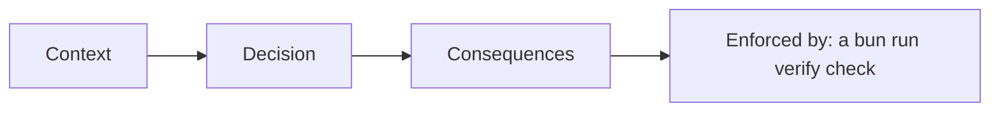

# Record the decisions

## The problem

Three choices shape every AI employee: how the work is split, which model runs it, and what happens when it
crashes halfway through a payment. If they live only in someone's head, the next person undoes them. An ADR writes
the choice down, and the check that enforces it keeps it true.



## Your challenge

Write three ADRs in `adr/` in this folder:

- `topology.md`: one agent, or a maker plus a checker, or several agents;
- `model.md`: which role in `config/models.ts` runs it, and how a swap is allowed;
- `durability.md`: what happens when a job dies halfway through.

Shape of each ADR: `## Context`, `## Decision`, `## Consequences`, each with a real sentence, and `## Enforced by`
naming a check as `` `bun run verify <step-name>` ``. Use the Build checks: `add-a-checker`, `catch-a-bad-draft`,
`save-progress`, `pay-once-after-a-crash`, `run-the-swap-gate`, `refuse-a-bad-model`.

| Employee                    | The durability question                                        |
| --------------------------- | -------------------------------------------------------------- |
| Freight clerk               | A crash after paying, before saving: does the retry pay again? |
| Spoiled food claims handler | A crash while waiting for the claims officer                   |
| Work order writer           | A crash after the order, before the line check is saved        |
| Referral coordinator        | A crash after booking, before the patient is told              |
| Grant screener              | A crash between the board limit check and the award            |
| Cover lesson planner        | A crash with half a plan written                               |
| Supplier terms negotiator   | A crash mid negotiation with a counter offer on the table      |
| Shift hiring coordinator    | A crash after the manager signs off, before the offer          |
| Damage assessor             | A crash after the deposit charge, before the photo is linked   |
| Milk pickup planner         | A crash with routes assigned to some drivers only              |
| Your own job                | The step you would hate to repeat by accident                  |

## Done when

- `topology.md`, `model.md` and `durability.md` exist in `adr/`.
- Each section says something real, with no `TODO`.
- Each `## Enforced by` names a `bun run verify` check.

```bash
bun run verify record-the-decisions
```

Expect: `Done. All 4 rules pass.`

The freight sample is in [solution/adr/](../solution/adr/). For a full system written the same way, read the
[Quillon ADRs](https://github.com/learnwithparam/enterprise-agentic-architecture/tree/main/docs/adr), such as
[Temporal owns the life of a case](https://github.com/learnwithparam/enterprise-agentic-architecture/blob/main/docs/adr/0016-temporal-owns-the-life-of-a-case.md).

## If you get stuck

| What you see                                            | Fix                                                                                   |
| ------------------------------------------------------- | ------------------------------------------------------------------------------------- |
| `FAIL each ADR names the check that enforces it`        | "Code review" is not a check. Name a step, like `` `bun run verify save-progress` ``. |
| `FAIL adr/ has topology.md, model.md and durability.md` | Durability is the ADR people skip. Write it.                                          |
| `FAIL each section says something real`                 | Each section needs at least eight words and no `TODO`.                                |

## Words you will use

- **ADR**: architecture decision record; one choice, why, and what it costs.
- **Topology**: how the work is split between agents.
- **Durability**: the job survives a crash without doing a final write twice.
