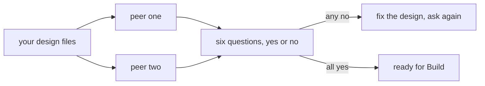

# Pass the design review

## The problem

You wrote every design file yourself, so you read each one the way you meant it. A peer reads only what is
there. Six plain questions find most gaps. They find them before Build turns your files into code that moves
money.

For example, a reviewer reads your `tools.yaml` and writes this line:

`- approver named: yes. Ravi up to USD 5,000 and Lena above, both named on pay_invoice.`

If `pay_invoice` named no approver, the answer would be no. Then you fix the file first.



## Your challenge

Share your design files with two peers. Write their answers in `review.md` in this folder.

In `review.md`, write one `## Reviewer: First Last` heading per person. Under each heading, write six lines:

- `- outcome checkable:` can a query tell whether the outcome happened?
- `- must-never checkable:` does a query and a trap case catch the must-never?
- `- approver named:` does every final write name a person?
- `- cost below value:` does `bun run cost` agree, and is it below the value?
- `- tenant safe:` is every tool limited to its own tenant?
- `- stop rule:` does every job end, and does a crash avoid a second final write?

Each answer starts with yes or no. Then one line says why.

| Employee                    | A good question to push on                                           |
| --------------------------- | -------------------------------------------------------------------- |
| Freight clerk               | Does the duplicate trap use a new invoice number?                    |
| Spoiled food claims handler | Is a lapsed policy a trap case?                                      |
| Work order writer           | Is the de-energised flag read from the grid record, not the request? |
| Referral coordinator        | Does the opt-out stop the booking?                                   |
| Grant screener              | Is "funded under another name" a trap case?                          |
| Cover lesson planner        | Is the approved list the only source?                                |
| Supplier terms negotiator   | Are the buyer's limits in the tool, not the prompt?                  |
| Shift hiring coordinator    | Is the minimum age checked before the offer?                         |
| Damage assessor             | Is the photo date compared with the rental start?                    |
| Milk pickup planner         | Is the legal limit checked per driver?                               |
| Your own job                | What would your manager ask first?                                   |

## Done when

- Two different named reviewers each answer all six questions.
- Every answer is yes, with a reason.

```bash
bun run verify pass-the-design-review
```

Expect: `Done. All 5 rules pass.`

## If you get stuck

| What you see                                            | Fix                                                                |
| ------------------------------------------------------- | ------------------------------------------------------------------ |
| `FAIL two named peer reviewers`                         | Use each reviewer's real name, and two different people.           |
| `FAIL each answer is yes or no with one line of reason` | Scores like `4/5` do not say what to fix. Write yes or no and why. |
| `FAIL every answer is yes`                              | Fix the file behind each no, then ask that reviewer again.         |

## Words you will use

- **Design review**: a peer reads the design before any code is written.
- **Stop rule**: what ends a job, so it never runs forever.
