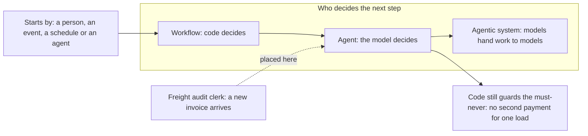

# Design

KaaS Freight paid one carrier invoice twice: USD 3,140 for a single load, and many rounds of emails to get it
back. Two clerks match about 40 carriers' invoices by hand, and when they fall behind, carriers charge late fees.
Before anyone writes agent code, this part pins down what the AI employee is for, what it must never do, what it
may touch, what it costs, and who signs off on the design. Every answer is a file a check can read.



The same picture is in `design-map.mmd`.

## Steps

| Step | What you write | Minutes |
|---|---|---|
| [place-it-on-the-map](01-place-it-on-the-map/problem/README.md) | `map.md`: workflow, agent or agentic system, and who decides | 20 |
| [write-the-hire-letter](02-write-the-hire-letter/problem/README.md) | `employee.toml`: outcome, metric, must-never | 30 |
| [turn-the-hire-into-tests](03-turn-the-hire-into-tests/problem/README.md) | `acceptance.yaml`: cases that check rows, not replies | 30 |
| [list-tools-and-permissions](04-list-tools-and-permissions/problem/README.md) | `tools.yaml`: every tool, its risk and its approver | 30 |
| [price-the-outcome](05-price-the-outcome/problem/README.md) | `cost.yaml`: cost per outcome against its value | 30 |
| [record-the-decisions](06-record-the-decisions/problem/README.md) | three ADRs, each with the check that enforces it | 30 |
| [pass-the-design-review](07-pass-the-design-review/problem/README.md) | `review.md`: two peers answer six questions | 30 |

You work in each step's `problem/` folder. Pick the freight clerk or one of the other employees on the menu in each
step; keep the same one for the whole part.

## Walkthrough

Place the employee on the map. Fill in `01-place-it-on-the-map/problem/map.md`, then run:

```bash
bun run verify place-it-on-the-map
```

Expect: `Done. All 6 rules pass.`

Write the hire letter in `02-write-the-hire-letter/problem/employee.toml`.

```bash
bun run verify write-the-hire-letter
```

Expect: `Done. All 6 rules pass.`

Write the acceptance cases in `03-turn-the-hire-into-tests/problem/acceptance.yaml`. The check reads your hire
letter to find the write your must-never case forbids.

```bash
bun run verify turn-the-hire-into-tests
```

Expect: `Done. All 7 rules pass.`

List every tool in `04-list-tools-and-permissions/problem/tools.yaml`.

```bash
bun run verify list-tools-and-permissions
```

Expect: `Done. All 5 rules pass.`

Price one outcome in `05-price-the-outcome/problem/cost.yaml`, then let the calculator show the sums.

```bash
bun run cost parts/01-design/05-price-the-outcome/problem/cost.yaml
bun run verify price-the-outcome
```

Expect: the cost lines end with `(matches within 1%)`, then `Done. All 6 rules pass.`

Write three ADRs in `06-record-the-decisions/problem/adr/`.

```bash
bun run verify record-the-decisions
```

Expect: `Done. All 4 rules pass.`

Share your files with two peers and write their answers in `07-pass-the-design-review/problem/review.md`.

```bash
bun run verify pass-the-design-review
```

Expect: `Done. All 5 rules pass.`

Check the whole part.

```bash
bun run verify part design
```

Expect:

```text
Part design:
  PASS   place-it-on-the-map  (6/6 rules)
  PASS   write-the-hire-letter  (6/6 rules)
  PASS   turn-the-hire-into-tests  (7/7 rules)
  PASS   list-tools-and-permissions  (5/5 rules)
  PASS   price-the-outcome  (6/6 rules)
  PASS   record-the-decisions  (4/4 rules)
  PASS   pass-the-design-review  (5/5 rules)
Part design is done: 7/7 steps pass.
```

## Finished

You now have a design pack for one AI employee: where it sits on the map, a hire letter with a metric and a
must-never a query can see, acceptance cases that check rows in the system of record, a tool list with risks and
approvers, a dated cost per outcome below its value, three ADRs that each name their check, and a review signed by
two peers.

Build turns each file into running code. The hire letter becomes the contract the agent is held to. The acceptance
cases become the tests the agent must pass. The tool list becomes the policy that gates every write
(`gate-writes-with-a-policy`). The must-never becomes `hold-the-must-never`. The ADRs become the checks they name:
`add-a-checker`, `catch-a-bad-draft`, `save-progress`, `pay-once-after-a-crash`, `run-the-swap-gate` and
`refuse-a-bad-model`.
