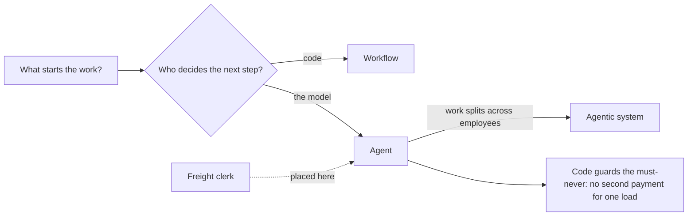

# Design

## After this part you can

- Place an employee on the map.
- Write a hire letter with a must-never that a query can check.
- Turn the hire into tests on ledger rows, not replies.
- List every tool with its risk and its approver.
- Price one outcome and record three decisions.

## You leave with

A design pack for one AI employee, signed off by two peers.

## The problem

KaaS Freight paid one carrier invoice twice. That was USD 3,140 for one load. It took many emails to get the money back.

Two clerks match the invoices of about 40 carriers by hand. When they fall behind, carriers charge late fees.

This part comes before any agent code. You make five decisions:

1. What is the AI employee for?
2. What must it never do?
3. What may it touch?
4. What does it cost?
5. Who approves the design?

Each decision is a file. A check can read every file.

For example, your hire letter names the must-never: "Pay the same load twice". It also names a SQL query that finds that
mistake in the ledger. Today `INV-2012` and `INV-2017` both bill load `L-1012`, for USD 2,675 each. If both are paid, the
query returns load `L-1012`. Anyone can see the rule broke.



Notice: The freight clerk is an agent. Code, not the model, guards the must-never.

The same picture is in `design-map.mmd`.

## Watch and read

| Kind  | Title                                       | Who made it                              | Why                                                                | Link                                                            |
| ----- | ------------------------------------------- | ---------------------------------------- | ------------------------------------------------------------------ | --------------------------------------------------------------- |
| video | How We Build Effective Agents               | Barry Zhang, Anthropic                   | The maker of the method says when an agent is worth its cost.      | https://www.youtube.com/watch?v=D7_ipDqhtwk                     |
| read  | Building effective agents                   | Erik Schluntz and Barry Zhang, Anthropic | Start simple and add parts only when you must.                     | https://www.anthropic.com/engineering/building-effective-agents |
| video | Building the future of agents with Claude   | Anthropic                                | Anthropic staff show how they think about agents and their limits. | https://www.youtube.com/watch?v=XuvKFsktX0Q                     |
| read  | How AI agents shape experts' judgment calls | Anthropic research                       | Shows why a click on approve is not proof that a person decided.   | https://www.anthropic.com/research/agents-judgment-calls        |

## Steps

| Step                                                                          | What you write                                               | Minutes |
| ----------------------------------------------------------------------------- | ------------------------------------------------------------ | ------- |
| [place-it-on-the-map](01-place-it-on-the-map/problem/README.md)               | `map.md`: workflow, agent or agentic system, and who decides | 20      |
| [write-the-hire-letter](02-write-the-hire-letter/problem/README.md)           | `employee.toml`: outcome, metric, must-never                 | 30      |
| [turn-the-hire-into-tests](03-turn-the-hire-into-tests/problem/README.md)     | `acceptance.yaml`: cases that check rows, not replies        | 30      |
| [list-tools-and-permissions](04-list-tools-and-permissions/problem/README.md) | `tools.yaml`: every tool, its risk and its approver          | 30      |
| [price-the-outcome](05-price-the-outcome/problem/README.md)                   | `cost.yaml`: cost per outcome against its value              | 30      |
| [record-the-decisions](06-record-the-decisions/problem/README.md)             | three ADRs, each with the check that enforces it             | 30      |
| [pass-the-design-review](07-pass-the-design-review/problem/README.md)         | `review.md`: two peers answer six questions                  | 30      |

Work in each step's `problem/` folder. Pick the freight clerk, or one of the other employees on the menu. Keep the same
employee for the whole part.

From Build on, everyone builds the freight clerk. It is the only employee with a world to run in.

## Walkthrough

Place the employee on the map. Fill in `01-place-it-on-the-map/problem/map.md`. Then run the check.

```bash
bun run verify place-it-on-the-map
```

Expect: `Done. All 6 rules pass.`

Write the hire letter in `02-write-the-hire-letter/problem/employee.toml`.

```bash
bun run verify write-the-hire-letter
```

Expect: `Done. All 6 rules pass.`

Write the acceptance cases in `03-turn-the-hire-into-tests/problem/acceptance.yaml`. The check reads your hire letter. It
finds the write that your must-never case forbids.

```bash
bun run verify turn-the-hire-into-tests
```

Expect: `Done. All 7 rules pass.`

List every tool in `04-list-tools-and-permissions/problem/tools.yaml`.

```bash
bun run verify list-tools-and-permissions
```

Expect: `Done. All 5 rules pass.`

Price one outcome in `05-price-the-outcome/problem/cost.yaml`. Then let the calculator show the sums.

```bash
bun run cost parts/01-design/05-price-the-outcome/problem/cost.yaml
bun run verify price-the-outcome
```

Expect: the cost lines end with `(matches within 1%)`, then `Done. All 6 rules pass.`

Write three ADRs in `06-record-the-decisions/problem/adr/`. An ADR, or architecture decision record, is a short note. It names
one design choice and says why you made it.

```bash
bun run verify record-the-decisions
```

Expect: `Done. All 4 rules pass.`

Share your files with two peers. Write their answers in `07-pass-the-design-review/problem/review.md`.

```bash
bun run verify pass-the-design-review
```

Expect: `Done. All 5 rules pass.`

Check the whole part.

```bash
bun run verify part design
```

Expect:

```text
Part design:
  PASS   place-it-on-the-map  (6/6 rules)
  PASS   write-the-hire-letter  (6/6 rules)
  PASS   turn-the-hire-into-tests  (7/7 rules)
  PASS   list-tools-and-permissions  (5/5 rules)
  PASS   price-the-outcome  (6/6 rules)
  PASS   record-the-decisions  (4/4 rules)
  PASS   pass-the-design-review  (5/5 rules)
Part design is done: 7/7 steps pass.
```

## Project

Your design pack is the project. Two peers read it and answer six yes-or-no questions. Fix every no, then ask again.

## What comes next

In Build, each file becomes running code:

- The hire letter becomes the contract the agent must keep.
- The acceptance cases become the tests the agent must pass.
- The tool list becomes the policy that guards every write, in `gate-writes-with-a-policy`.
- The must-never becomes `hold-the-must-never`.

The ADRs become the checks they name: `add-a-checker`, `catch-a-bad-draft`, `save-progress`, `pay-once-after-a-crash`,
`run-the-swap-gate` and `refuse-a-bad-model`.
