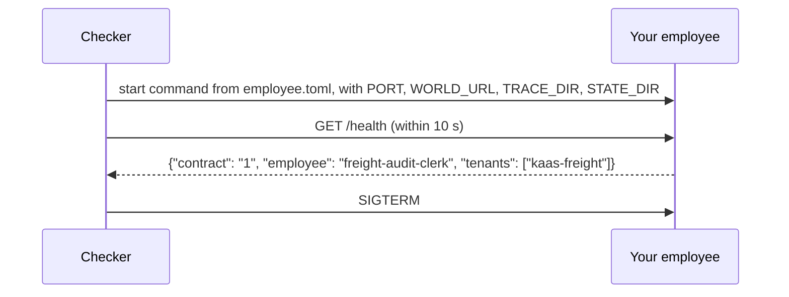
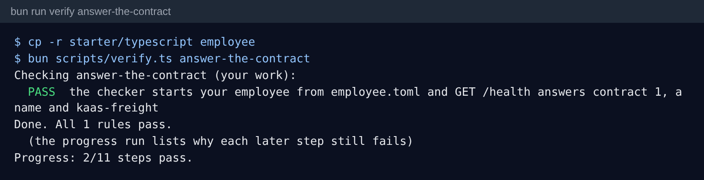

# Answer the contract

## The problem

The checker cannot read your mind or your code. It needs three things from your employee:

1. One way to start it.
2. One address to send jobs to.
3. One answer that says "I am here, and I speak contract 1".

An agent that lives in a notebook cannot be checked. A script that runs and then exits cannot be checked either. Nobody can
prove that such an agent did any work.

For example, the reference employee is called `freight-audit-clerk`. When the checker sends `GET /health`, the answer lists
the contract, the name and the company. KaaS Freight is the one company this part works for.



## Your challenge

Make your employee a service that the checker can start and stop. A service is a program that stays up and answers
requests.

1. Copy a starter kit to `employee/` at the repo root. Or start from your own framework. For example:
   `cp -r starter/typescript employee`, or `starter/python`.
2. Open `employee/employee.toml`. Its `[contract]` table names the `start` command. The checker runs that command from that
   folder. Keep `version = "1"`.
3. Read `PORT` from the environment. Listen on that port. The checker picks a free port for every trial.
4. Answer `GET /health` with JSON that has these three fields:

```json
{ "contract": "1", "employee": "<your name>", "tenants": ["kaas-freight"] }
```

Keep the same six routes. Only the `employee` name and the `tenants` change.

## Done when

- The checker starts your employee from `employee.toml`. `GET /health` answers within 10 s, on 3 fresh starts.
- The answer says contract `"1"`, names the employee, and lists `kaas-freight` in `tenants`.

```bash
bun run verify answer-the-contract
```

Expect: `PASS` and `Done. All 1 rules pass.`



## If you get stuck

- `did not answer GET /health within 10 s on the port in PORT`: you listen on a fixed port. Use `PORT` from the environment.
- `exited before it answered GET /health`: your start command runs a script that ends. It must stay up and serve.
- `No employee.toml`: the file must sit in `employee/`, next to your code. Or set `EMPLOYEE_DIR` to its folder.
- The full contract is in [CONTRACT.md](../../../../reference/CONTRACT.md). It also has the command-line form, for scripts
  that read stdin and write stdout.

## Words you will use

- **Contract**: the six routes that the checker and your employee agree on. Any language passes.
- **employee.toml**: the file that says how to start your employee and where its traces go.
- **Health check**: a small, fast route. It proves the service is up and says which contract it speaks.
