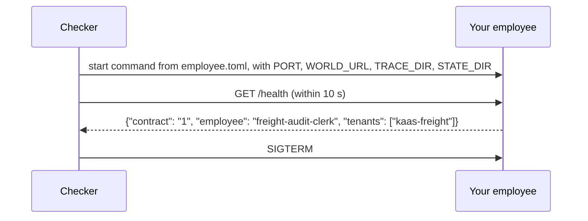
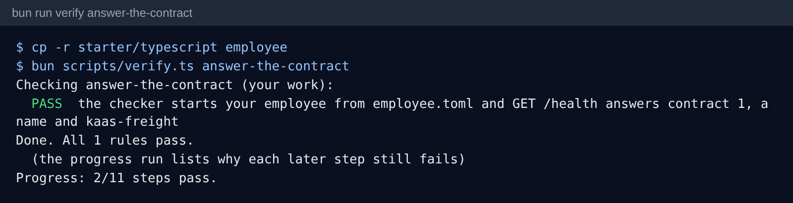

# Answer the contract

## The problem

The checker cannot read your mind or your code. It needs three things from your employee. It needs one way to
start it, one address to send jobs to, and one answer that says "I am here, and I speak contract 1".

An agent that lives in a notebook cannot be checked. A script that runs and then exits cannot be checked either.
So nobody can prove that it did any work.

## Your challenge

Make your employee a service that the checker can start and stop. A service is a program that stays up and answers
requests.

1. Copy a starter kit to `employee/` at the repo root, or start from your own framework:
   `cp -r starter/typescript employee` (or `starter/python`).
2. Open `employee/employee.toml`. Its `[contract]` table names the `start` command. The checker runs it from that
   folder. Keep `version = "1"`.
3. Read `PORT` from the environment and listen on it. The checker picks a free port for every trial.
4. Answer `GET /health` with {"contract": "1", "employee": "<your name>", "tenants": ["kaas-freight"]}.

For example, the reference employee is called `freight-audit-clerk`. When the checker sends `GET /health`, it
answers {"contract": "1", "employee": "freight-audit-clerk", "tenants": ["kaas-freight"]}. KaaS Freight is the
one company it works for in this part.



Are you building your own employee, from the menu or for your own job? Keep the same six routes. Only the
`employee` name and the `tenants` change.

## Done when

- The checker starts your employee from `employee.toml`, and `GET /health` answers within 10 s, on 3 fresh starts.
- The answer says contract `"1"`, names the employee, and lists `kaas-freight` in `tenants`.

```bash
bun run verify answer-the-contract
```

Expect: `PASS` and `Done. All 1 rules pass.`



## If you get stuck

- `did not answer GET /health within 10 s on the port in PORT`: you listen on a fixed port. Use `PORT` from the
  environment.
- `exited before it answered GET /health`: your start command runs a script that ends. It must stay up and serve.
- `No employee.toml`: the file must sit in `employee/` next to your code. Or set `EMPLOYEE_DIR` to its folder.
- The full contract is in [CONTRACT.md](../../../../reference/CONTRACT.md). It also has the CLI form, for scripts
  that read stdin and write stdout.

## Words you will use

- **Contract**: the six routes the checker and your employee agree on. Any language passes.
- **employee.toml**: the file that says how to start your employee and where its traces go.
- **Health check**: a small, fast route. It proves the service is up and says which contract it speaks.
