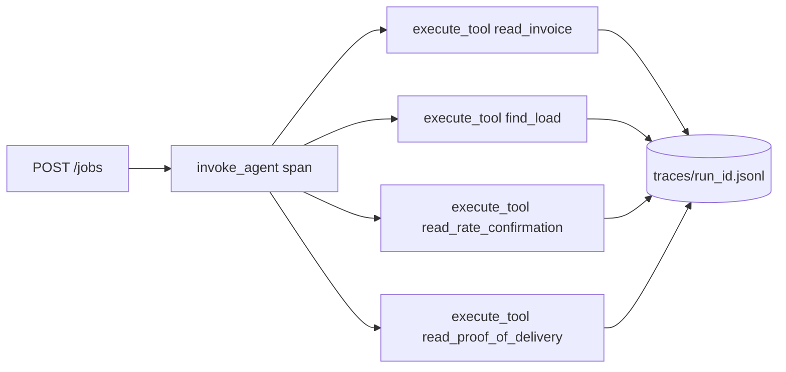

# Call the tools

## The problem

An agent that answers from what it already "knows" makes up invoices. The clerk's job starts with evidence. That
means four papers from the world's tools: the invoice, the load, the rate confirmation and the proof of delivery.

The reads must also be in a trace. A trace is the record of everything one run did. Without it, nobody can tell
later whether the agent looked or guessed.

For example, INV-2001 bills USD 3,920 linehaul and USD 385 fuel for load L-1001. The rate confirmation RC-1001
allows USD 3,920 linehaul and up to USD 400 fuel. The proof of delivery POD-1001 shows the load arrived. Only
with all four papers can your employee say the invoice is clean.

## Your challenge

When `POST /jobs` arrives with `{"job_id", "tenant", "trigger", "input": {"invoice_id"}}`:

1. Answer `202 {"job_id", "run_id"}` at once. Do the work in the background.
2. Call `read_invoice`, `find_load`, `read_rate_confirmation` and `read_proof_of_delivery` on `WORLD_URL`. Send
   the job's tenant in the `X-Tenant` header.
3. Write spans to `TRACE_DIR/<run_id>.jsonl`, in the `employee.trace/v1` format from
   [CONTRACT.md](../../../../reference/CONTRACT.md). Write one `invoke_agent` span for the run, and one
   `execute_tool` span for each call.
4. Write nothing to the ledger yet.



The starter kits already do this. If you built your own employee, this is the step where your loop first touches
the world.

## Done when

- The trace for the job's `run_id` has an `invoke_agent` span. It also has `execute_tool` spans for
  `read_invoice`, `read_rate_confirmation` and `read_proof_of_delivery`.
- The world's write log shows no write from reading.

```bash
bun run verify call-the-tools
```

Expect: `Done. All 1 rules pass.`

## If you get stuck

- `No trace for run ...`: the file name must be the `run_id` you returned from `POST /jobs`. It must sit inside
  `TRACE_DIR`.
- `The trace has no invoke_agent span`: wrap the whole job in one root span.
- Each line must be one JSON object with `"format": "employee.trace/v1"`. The checker skips other lines.

## Words you will use

- **Span**: one timed piece of work in a trace, such as a tool call or a model call.
- **Trace**: every span of one run, one JSON object per line.
- **Run id**: the id of one try at a job. The trace file is named after it.
