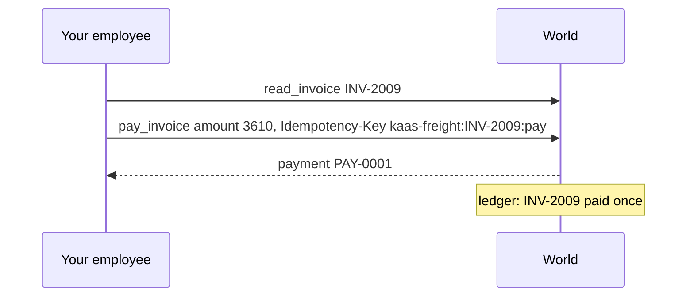

# Pay one invoice

## The problem

KaaS Freight paid one invoice twice last month. The second payment came from a retry that the payment service
could not tell apart from a new payment. Paying is money out of the door; it cannot be undone. The world's
`pay_invoice` tool takes an `Idempotency-Key` header, as payment APIs do: the same key twice pays once.

## Your challenge

Settle a clean invoice.

1. After reading the evidence, decide to pay. On a clean invoice the amount is the invoice total, which the rate
   confirmation allows.
2. Call `pay_invoice` with `{"invoice_id", "amount_usd"}` and an `Idempotency-Key` that is the same for this
   invoice every time, for example `<tenant>:<invoice_id>:pay`. Never a random one.
3. Put that key on the span as `x.idempotency_key`, with `"x.side_effect": "write"`.
4. Keep every job by `job_id`. When the same `job_id` comes again, answer its first `run_id` and start nothing.
5. Report `done` in `GET /jobs/{job_id}`.




## Done when

- The ledger shows the clean invoice paid once, at the amount the rate confirmation allows, and the job says `done`.
- Sending the same `job_id` twice leaves one payment, and the trace names the key the ledger holds.

```bash
bun run verify pay-one-invoice
```

Expect: two `PASS` lines and `Done. All 2 rules pass.`

## If you get stuck

- `The ledger shows no payment`: check the header name, `Idempotency-Key`, and that `X-Tenant` is the job's tenant.
- `started a new run`: look the `job_id` up in your job table before you create a run.
- `no pay_invoice span names it`: the key in the trace must be exactly the header you sent.

## Words you will use

- **Idempotency key**: a name for one intended write. The same key again replays the first answer.
- **Clean invoice**: one whose lines match the rate confirmation and the proof of delivery.
- **Ledger**: KaaS Freight's system of record. It decides what happened.
