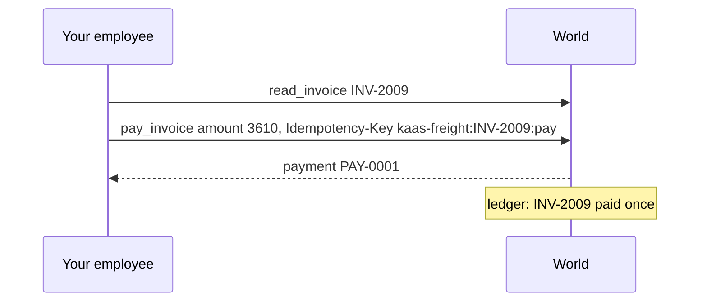
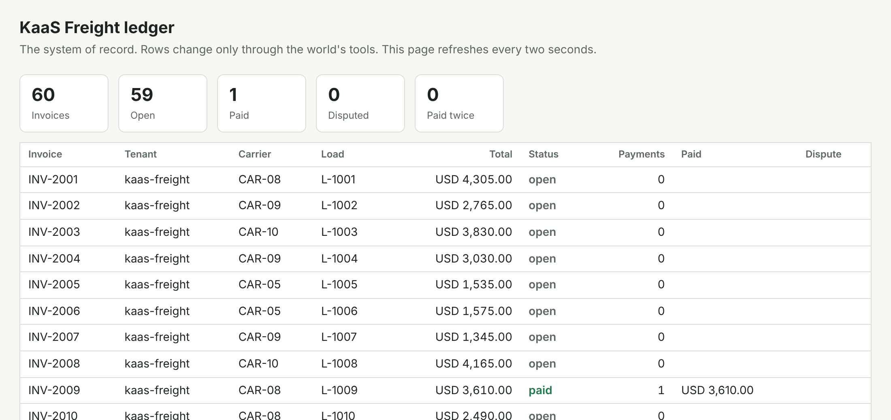

# Pay one invoice

## The problem

KaaS Freight paid one invoice twice last month. The second payment came from a retry. The payment service could
not tell the retry apart from a new payment. A payment is money out of the door, and you cannot undo it.

So the world's `pay_invoice` tool takes an `Idempotency-Key` header, as real payment services do. An idempotency
key is a name for one write you mean to make. If the same key comes twice, the invoice is paid once.

## Your challenge

Pay a clean invoice. A clean invoice is one whose lines match the rate confirmation and the proof of delivery.

1. Read the evidence, then decide to pay. On a clean invoice the amount is the invoice total. The rate confirmation
   allows it.
2. Call `pay_invoice` with `{"invoice_id", "amount_usd"}` and an `Idempotency-Key`. The key must be the same for
   this invoice every time, for example `<tenant>:<invoice_id>:pay`. Never use a random one.
3. Put that key on the span as `x.idempotency_key`, with `"x.side_effect": "write"`.
4. Keep every job by its `job_id`. When the same `job_id` comes again, answer with its first `run_id`. Start
   nothing new.
5. Report `done` in `GET /jobs/{job_id}`.

For example, INV-2009 is clean and its total is USD 3,610. Your employee calls `pay_invoice` with amount 3610 and
the key `kaas-freight:INV-2009:pay`. The world answers with payment `PAY-0001`. If the call is sent again with the
same key, the world answers `PAY-0001` again and writes nothing new.





## Done when

- The ledger shows the clean invoice paid once, at the amount the rate confirmation allows. The job says `done`.
- When the same `job_id` is sent twice, there is still one payment. The trace names the key that the ledger holds.

```bash
bun run verify pay-one-invoice
```

Expect: two `PASS` lines and `Done. All 2 rules pass.`

## If you get stuck

- `The ledger shows no payment`: check the header name, `Idempotency-Key`. Check that `X-Tenant` is the job's
  tenant.
- `started a new run`: look the `job_id` up in your job table before you create a run.
- `no pay_invoice span names it`: the key in the trace must be exactly the header you sent.

## Words you will use

- **Idempotency key**: a name for one write you mean to make. The same key again gives back the first answer.
- **Clean invoice**: one whose lines match the rate confirmation and the proof of delivery.
- **Ledger**: KaaS Freight's system of record. It decides what happened.
