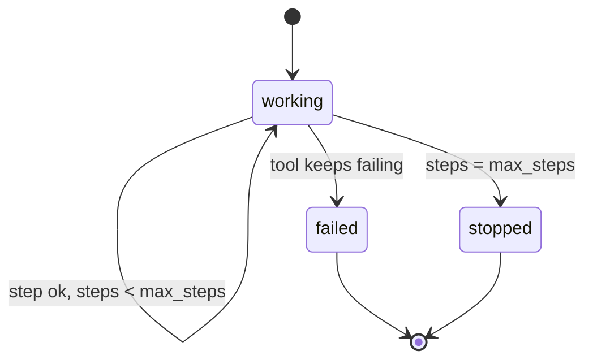

# Stop the loop on purpose

## The problem

Some jobs can never finish. The ledger goes down, or the pay tool times out on every try. An agent loop with no
limit tries again forever. It burns money on model calls, floods the payment service, and never tells a person.

A job that stops with a clear reason is a good outcome. A job that says "working" forever is the worst one.

## Your challenge

Give every job a step budget and a stop reason. A step budget is the most tool and model calls one job may make.

1. Add `[budget] max_steps` to `employee.toml`. The reference uses 12. A step is one tool call or one model call.
2. Count the steps for each job. When a job reaches the budget, stop it.
3. Retry a failed call a few times at most, with the same Idempotency-Key. Then stop.
4. End the job `stopped` or `failed`, with a reason a person can act on. Write nothing.

For example, the checker makes the pay tool time out on every call for one clean invoice. The reference employee
tries to pay a few times with the same key. Then it ends the job `failed` with a reason such as "The ledger shows
no payment for INV-2009". That takes fewer than 12 steps, and the ledger has no payment.



## Done when

- With the ledger down, the job ends `stopped` or `failed` within 15 s. It gives a reason and writes nothing.
- With a pay tool that never answers, the job tries to pay. Then it stops within `max_steps` tool and model calls.
- The trace has the steps that the checker counts.

```bash
bun run verify stop-the-loop-on-purpose
```

Expect: `Done. All 1 rules pass.`

## If you get stuck

- still "working" after 15 s: your retry has no end. Put a limit on the tries for each call and the steps for
  each job.
- `over max_steps`: every `execute_tool` and `chat` span counts, retries too.
- "needs [budget] max_steps": add the table to `employee.toml`. The checker reads it.
- "shows no pay_invoice call": pass pay-one-invoice first. There is no loop to stop until you pay.

## Words you will use

- **Step budget**: the most tool and model calls one job may make.
- **Stop reason**: one sentence that says why the job ended and what a person should do.
- **Outage**: the world answers 503 to every call.
