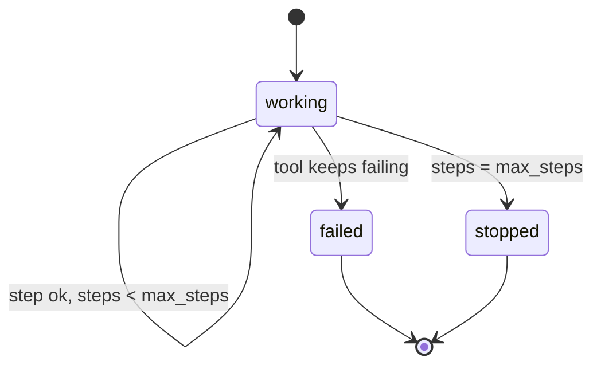

# Stop the loop on purpose

## The problem

Some jobs can never finish. The ledger goes down, or the pay tool times out on every try. An agent loop with no
limit retries forever: it burns model spend, floods the payment service and never tells a person. A job that
stops with a clear reason is a good outcome. A job that is "working" for ever is the worst one.

## Your challenge

Give every job a step budget and a stop reason.

1. Add `[budget] max_steps` to `employee.toml` (the reference uses 12). A step is one tool call or one model call.
2. Count steps per job. At the budget, stop.
3. Retry a failed call a few times at most, with the same Idempotency-Key, then stop.
4. End the job `stopped` or `failed` with a reason a person can act on, and write nothing.



## Done when

- With the ledger down, the job ends `stopped` or `failed` within 15 s, with a reason, and writes nothing.
- With a pay tool that never answers, the job tries to pay, then stops within `max_steps` tool and model calls.
- The trace has the steps the checker counts.

```bash
bun run verify stop-the-loop-on-purpose
```

Expect: `Done. All 1 rules pass.`

## If you get stuck

- `still "working" after 15 s`: your retry has no end. Cap the attempts per call and the steps per job.
- `over max_steps`: every `execute_tool` and `chat` span counts, including retries.
- `needs [budget] max_steps`: add the table to `employee.toml`; the checker reads it.
- `shows no pay_invoice call`: pass pay-one-invoice first; there is no loop to stop until you pay.

## Words you will use

- **Step budget**: the most tool and model calls one job may make.
- **Stop reason**: one sentence that says why the job ended and what a person should do.
- **Outage**: the world answers 503 to every call.
