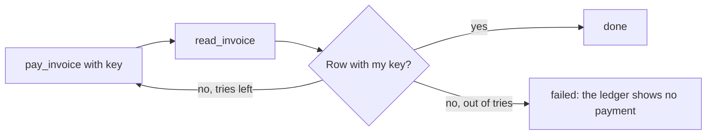

# Close on the record

## The problem

The naive clerk trusts the answer to its call, not the ledger. That one habit causes two mistakes.

For example, the pay tool for INV-2043 (USD 1,580) writes the payment and then times out. The naive clerk sees an
error. It tries again with a new key, and pays twice. On another invoice, the checker makes the pay tool time out
every time and write nothing. The naive clerk says "done" anyway.

## Your challenge

After every write, read the ledger back. The ledger decides what happened.

1. Call the write tool with your stable Idempotency-Key.
2. It may answer with success, an error or a timeout. In every case, call `read_invoice` next. Look for a row with
   your key in `payments` or `disputes`.
3. The row is there: report `done`. No row: try again with the same key, a few times at most.
4. Still no row: report `failed` with the ledger's reason, for example "The ledger shows no payment for INV-2009".




## Done when

- INV-2043's pay call times out after it wrote. The ledger shows one payment, and the job is `done`.
- An invoice whose pay call never writes ends `failed` with a reason. It never ends `done`.
- No job says `done` when the ledger disagrees.

```bash
bun run verify close-on-the-record
```

Expect: `Done. All 1 rules pass.`

## If you get stuck

- `The ledger shows 2 payments`: your retry used a new key. Build the key from the tenant and the invoice id.
- `Your employee said done. The ledger shows nothing`: you returned `done` from the write call. Read the invoice
  first.
- The timeout takes a moment on purpose. Give each call at least 2 s before you give up on it.

## Words you will use

- **Settle check**: reading the system of record after a write to see whether it landed.
- **Claim**: what the agent reports. It is useful, but it is never proof.
- **Timeout after write**: the write happened, but the answer never came back.
