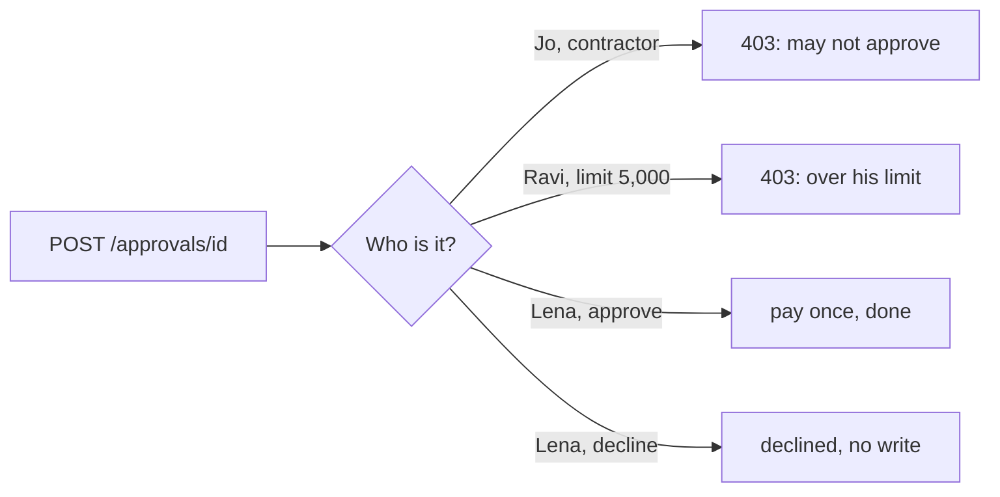

# Check who approves

## The problem

An approval button that anyone can press is decoration. Jo Park is a contractor who may read but not approve.
Ravi may approve up to USD 5,000. Only Lena may approve INV-2045's USD 6,200. People also follow an agent's lean
most of the time, so the check on who decides has to live in code, not in good intentions.

## Your challenge

Handle `POST /approvals/{approval_id}` with `{"decision": "approve" or "decline", "by": "<person id>"}`.

1. Look the person up in `GET {WORLD_URL}/people`: role, `may_approve`, `pay_limit_usd`, tenant.
2. Answer `403 {"reason"}` when they may not approve, or the amount is over their limit, or they work for
   another tenant.
3. On Lena's approve: carry on from the saved step, write once, read the ledger, report `done`.
4. On decline: write nothing and end the job `declined`.



## Done when

- Jo gets 403. Ravi gets 403 for USD 6,200. Nothing is paid before Lena decides.
- After Lena approves, the ledger shows INV-2045 paid once and the job is `done`.
- After Lena declines INV-2049, the write log shows no write for it and the job is `declined`.

```bash
bun run verify check-who-approves
```

Expect: `Done. All 1 rules pass.`

## If you get stuck

- `answered 200` for Jo: read `may_approve` from the world, do not trust the id alone.
- `shows 2 payments` after Lena: approving must resume the saved job, not start a second one.
- `the job must end "declined"`: a decline is an outcome, not a failure.

## Words you will use

- **Limit**: the largest amount a person may approve.
- **Decline**: a person's no. It writes nothing to the ledger.
- **Resume**: carry on a job from its last saved step.
