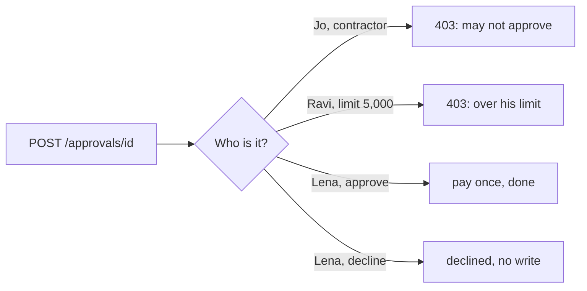

# Check who approves

## The problem

An approve button that anyone can press does nothing useful. People also follow what an agent leans towards most of
the time. So the check on who decides must live in code, not in good intentions.

For example, three people at KaaS Freight might answer the approval for INV-2045 (USD 6,200). Jo Park is a
contractor. Jo may read the ledger but may not approve anything. Ravi Shah may approve up to USD 5,000, so USD 6,200
is over his limit. Only Lena Ortiz, the finance lead, may approve it.

## Your challenge

Handle `POST /approvals/{approval_id}` with `{"decision": "approve" or "decline", "by": "<person id>"}`.

1. Look the person up in `GET {WORLD_URL}/people`. Read their role, `may_approve`, `pay_limit_usd` and tenant.
2. Answer `403 {"reason"}` in three cases: they may not approve, the amount is over their limit, or they work for
   another tenant.
3. When Lena approves: carry on from the saved step, write once, read the ledger, and report `done`.
4. When someone declines: write nothing, and end the job `declined`.



## Done when

- Jo gets 403. Ravi gets 403 for USD 6,200. Nothing is paid before Lena decides.
- After Lena approves, the ledger shows INV-2045 paid once, and the job is `done`.
- After Lena declines INV-2049 (USD 5,400), the write log shows no write for it, and the job is `declined`.

```bash
bun run verify check-who-approves
```

Expect: `Done. All 1 rules pass.`

## If you get stuck

- `answered 200` for Jo: read `may_approve` from the world. Do not trust the id alone.
- `shows 2 payments` after Lena: approving must resume the saved job, not start a second one.
- `the job must end "declined"`: a decline is an outcome, not a failure.

## Words you will use

- **Limit**: the largest amount a person may approve.
- **Decline**: a person's no. It writes nothing to the ledger.
- **Resume**: carry on a job from its last saved step.
