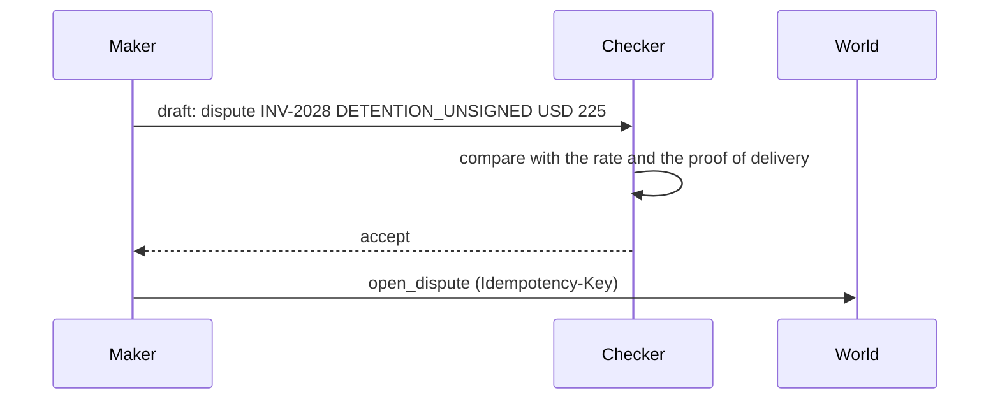

# Add a checker

## The problem

The model that drafts a decision is the worst judge of that draft: it already believes it. A second step that only
asks "does the evidence allow this?" catches what the maker missed, before money moves. Anthropic reports that its
multi-agent research system used about 15 times the tokens of a chat
([How we built our multi-agent research system](https://www.anthropic.com/engineering/multi-agent-research-system)),
so a checker has to earn its cost. On a final write it does.

## Your challenge

Split the maker from the checker.

1. The maker drafts `{"action", "amount_usd", "reason_code", "note"}` from the evidence.
2. The checker gets the draft and the evidence and answers accept or reject. Plain code is a fine checker; a
   second model call with another role is too.
3. Give the checker its own span: `"name": "invoke_agent"`, `"x.role": "checker"`, and say its verdict.
4. Only an accepted draft reaches the write. Every write gets an `execute_tool` span with
   `"x.side_effect": "write"`.



## Done when

- For a clean invoice, INV-2028 and INV-2031, every write in the world's write log has a write span in the trace.
- A checker span ends before each write span starts.
- Each invoice is settled the way the evidence allows.

```bash
bun run verify add-a-checker
```

Expect: `Done. All 1 rules pass.`

## If you get stuck

- `the trace has no checker span`: set `"x.role": "checker"` on the checker's span.
- `has no checker span that ended before it`: finish the check, then write. Spans compare by `end_time` and
  `start_time`.
- `shows 1 write(s) but the trace has 0 write span(s)`: trace the write itself, not only the decision.

## Words you will use

- **Maker**: the step that drafts the decision.
- **Checker**: the step that accepts or rejects the draft against the evidence.
- **Final write**: a write that cannot be undone, such as a payment.
