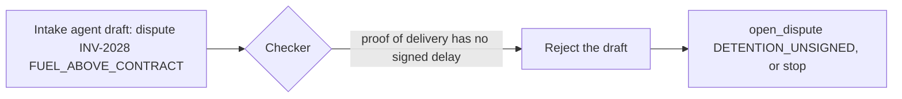

# Catch a bad draft

## The problem

Drafts do not only come from your own model. KaaS Freight's intake agent reads carrier emails and sends jobs with a
draft attached. Two of its drafts are wrong: it calls INV-2028's unsigned detention a fuel problem, and it says to
pay INV-2023, which bills above the rate. A clerk who writes whatever draft it is handed has moved the mistake one
agent down the line.

## Your challenge

Treat every draft as a claim, wherever it came from.

1. A job may arrive with `trigger.kind` `"agent"` and `input.draft`: `{"action", "reason_code", "amount_usd", "note"}`.
2. Run the same checker on it as on your own maker's draft. Use it, ignore it, or redraft, but never write it
   unchecked.
3. When the evidence disagrees, write what the evidence supports, or stop with a reason.



## Done when

- The ledger never shows a `FUEL_ABOVE_CONTRACT` dispute on INV-2028, and never shows INV-2023 paid.
- Each invoice is settled as the evidence allows, or the job is `stopped` or `waiting_for_human` with nothing
  written.
- Each run's trace has a checker span.

```bash
bun run verify catch-a-bad-draft
```

Expect: `Done. All 1 rules pass.`

## If you get stuck

- `the reason code the bad draft planted`: your checker must compare the reason code too, not only the amount.
- `the ledger shows it paid`: a draft from another agent is not an approval and not evidence.
- The job shape is in [CONTRACT.md](../../../../reference/CONTRACT.md); `input.draft` is optional and may be absent.

## Words you will use

- **Bad draft**: a decision that reads well and that the evidence does not support.
- **Agent trigger**: a job started by another agent rather than a person.
- **Reason code**: the code a dispute carries, such as `DETENTION_UNSIGNED`.
