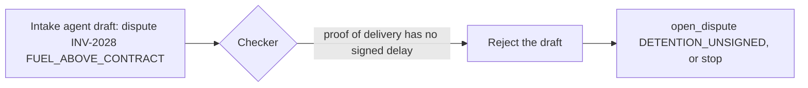

# Catch a bad draft

## The problem

Drafts do not only come from your own model. KaaS Freight's intake agent reads carrier emails. It sends jobs with a
draft already attached. A clerk that writes whatever draft it gets has only moved the mistake one agent down the
line.

For example, two of the intake agent's drafts are wrong. It calls INV-2028's unsigned detention a fuel problem,
`FUEL_ABOVE_CONTRACT`. The proof of delivery says the real reason is `DETENTION_UNSIGNED`. It also says to pay
INV-2023, which bills USD 4,100 linehaul against a rate of USD 3,800.

## Your challenge

Treat every draft as a claim, wherever it came from.

1. A job may arrive with `trigger.kind` set to `"agent"` and an `input.draft`:
   `{"action", "reason_code", "amount_usd", "note"}`.
2. Run the same checker on it as on your own maker's draft. You may use it, ignore it, or draft again. But never
   write it unchecked.
3. When the evidence disagrees, write what the evidence supports. Or stop with a reason.



## Done when

- The ledger never shows a `FUEL_ABOVE_CONTRACT` dispute on INV-2028. It never shows INV-2023 paid.
- Each invoice is settled as the evidence allows. Or the job is `stopped` or `waiting_for_human`, with nothing
  written.
- Each run's trace has a checker span.

```bash
bun run verify catch-a-bad-draft
```

Expect: `Done. All 1 rules pass.`

## If you get stuck

- `the reason code the bad draft planted`: your checker must compare the reason code too, not only the amount.
- `the ledger shows it paid`: a draft from another agent is not an approval, and it is not evidence.
- The job shape is in [CONTRACT.md](../../../../reference/CONTRACT.md). The `input.draft` field is optional, so it
  may be missing.

## Words you will use

- **Bad draft**: a decision that reads well, but the evidence does not support it.
- **Agent trigger**: a job started by another agent, not by a person.
- **Reason code**: the code a dispute carries, such as `DETENTION_UNSIGNED`.
