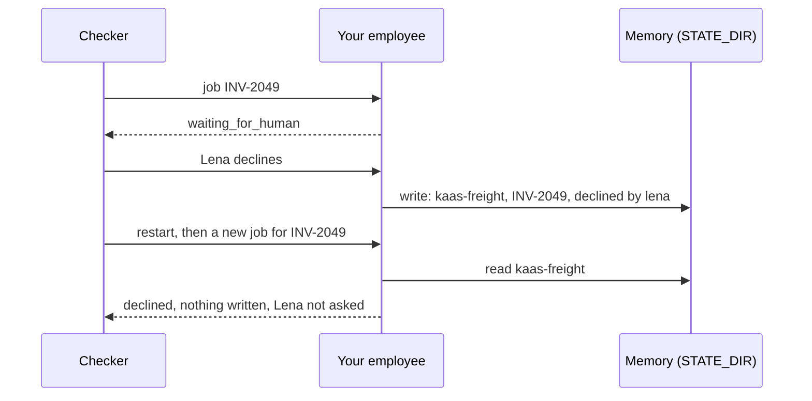

# Remember what matters

## The problem

Lena declined INV-2049. A decline writes nothing, so the ledger has no row for it. The carrier sends the invoice
again, a new job starts, and an employee with no memory asks Lena the same question a second time. Memory is for
facts like this one: things your employee learned that it cannot read back from the world. Keep it small and
exact: Anthropic's write-up on agent memory warns that a note that is wrong, or drifts, "can be read, and trusted"
in a later session ([The components of agent memory](https://www.anthropic.com/engineering/components-of-agent-memory)).

## Your challenge

Keep a small memory, per tenant, that survives a restart.

1. When a person declines, save a fact `{"tenant", "invoice_id", "fact": "declined", "by", "job_id"}` in `STATE_DIR`.
2. At the start of every job, read memory for the job's tenant only. Log a span named `x.memory` with
   `"x.memory.op": "read"` and `"x.tenant"` set to the job's tenant; log writes with `"x.memory.op": "write"`.
3. If the invoice was declined, end the job `declined`, say who declined it, and do not ask again.



## Done when

- After Lena declines INV-2049 and your employee restarts, a new job for INV-2049 ends `declined`, is not in
  `GET /approvals`, and writes nothing.
- The new job's trace shows an `x.memory` read.
- Every `x.memory` span names the job's own tenant, KaaS Dairy jobs included.

```bash
bun run verify remember-what-matters
```

Expect: `Done. All 1 rules pass.`

## If you get stuck

- `asked her again`: memory in a variable dies with the process. Write it to a file or table in `STATE_DIR`.
- `shows no memory read`: log the read even when memory has nothing for the job.
- `a memory read has x.tenant`: filter by the job's tenant before you look; never read the whole store.

## Words you will use

- **Memory**: facts your employee keeps between jobs that the world cannot give back.
- **Tenant scope**: a job reads and writes only its own tenant's memory.
- **Restart**: a new process with the same `STATE_DIR`.
