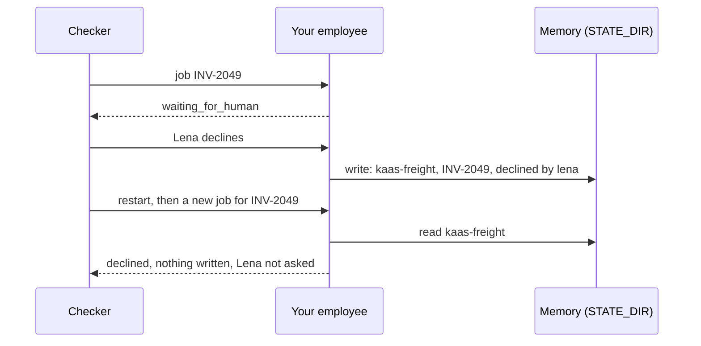

# Remember what matters

## The problem

Some facts never reach the ledger. Your employee must remember them itself.

For example, Lena declined INV-2049, a USD 5,400 invoice. A decline writes nothing, so the ledger has no row for
it. Then the carrier sends the invoice again, and a new job starts. An employee with no memory asks Lena the same
question a second time.

Memory is for facts like this one: things your employee learned that it cannot read back from the world. Keep it
small and exact. Anthropic's write-up on agent memory gives a warning. A note that is wrong, or drifts, "can be read,
and trusted" in a later session
([The components of agent memory](https://www.anthropic.com/engineering/components-of-agent-memory)).

## Your challenge

Keep a small memory for each tenant that lasts through a restart. A tenant is one customer company, such as KaaS
Freight.

1. When a person declines, save a fact in `STATE_DIR`:
   {"tenant", "invoice_id", "fact": "declined", "by", "job_id"}.
2. At the start of every job, read memory for the job's tenant only. Log a span named `x.memory` with
   `"x.memory.op": "read"`, and with `"x.tenant"` set to the job's tenant. Log writes with `"x.memory.op": "write"`.
3. If the invoice was declined, end the job `declined`. Say who declined it, and do not ask again.



## Done when

- Lena declines INV-2049, and your employee restarts. Then a new job for INV-2049 ends `declined`. It is not in
  `GET /approvals`, and it writes nothing.
- The new job's trace shows an `x.memory` read.
- Every `x.memory` span names the job's own tenant. That includes KaaS Dairy jobs.

```bash
bun run verify remember-what-matters
```

Expect: `Done. All 1 rules pass.`

## If you get stuck

- "asked her again": memory in a variable is lost when the process ends. Write it to a file or table in
  `STATE_DIR`.
- "shows no memory read": log the read even when memory has nothing for the job.
- `a memory read has x.tenant`: filter by the job's tenant before you look. Never read the whole store.

## Words you will use

- **Memory**: facts your employee keeps between jobs that the world cannot give back.
- **Tenant scope**: a job reads and writes only its own tenant's memory.
- **Restart**: a new process with the same `STATE_DIR`.
