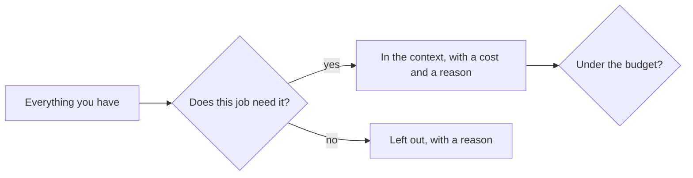

# Engineer the context

## The problem

The model only knows what you put in front of it. A clerk that gets all 200 old invoices pays more, slows down and
can lose the one rule that matters. Pick what goes in. One job, one invoice, one rule, a small budget.

For example, for invoice `INV-2041` the clerk needs the one invoice, about 400 tokens, and not the 200 old ones.



## Your challenge

Fill in `context.yaml` for one job of your employee:

1. Set `budget_tokens`. A token is a small piece of a word. The model has a limit, and you pay for each one.
2. List every `item`: its `name`, its `source`, its `tokens`, why it is there (`why`), and `keep` (`always` or `per job`).
3. Include the must-never rule as its own item, marked `keep: always`.
4. List at least two things you chose to leave out under `left_out`, each with a `why`.

No single item may take more than 40 percent of the budget. Big files get cut down first.

## Done when

- The items add up to the budget or less.
- Every item has a source, a cost and a reason.
- The must-never rule is its own item that is always kept.
- Two things are left out on purpose, with reasons.

```bash
bun run verify engineer-the-context
```

Expect: `Done. All 6 rules pass.`

The freight sample is in [solution/context.yaml](../solution/context.yaml).

## If you get stuck

| What you see                                                   | Fix                                                                 |
| -------------------------------------------------------------- | ------------------------------------------------------------------- |
| `FAIL the items fit inside the budget`                         | Cut the biggest item down, or drop one that this job does not need. |
| `FAIL the must-never rule is its own item that is always kept` | Add an item named "must-never rule" with `keep: always`.            |

## Words you will use

- **Context**: everything the model reads before it answers.
- **Token**: a small piece of a word. Cost and limits are counted in tokens.
- **Budget**: the most tokens you let one job use.
