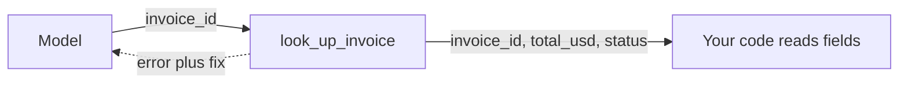

# Design the tool and its output

## The problem

A tool called `invoices` with the note "Gets invoices" makes the model guess when to call it. A tool that hands back
a friendly sentence makes your code guess what it meant. Name the tool for its job, say when to use it and when not,
and hand back fields your code can read.

For example, `look_up_invoice` takes `INV-2041` and hands back `total_usd: 1910` and `status: open`.



## Your challenge

Fill in `tool.yaml` for one tool of your employee:

1. `name`: a verb and a thing in snake case, such as `look_up_invoice`.
2. `description`: it must say "Use when" and "Do not use".
3. `input`: each field has a `type` and a `description`.
4. `output_schema`: an object whose every field is `required`, with an `enum` for any choice, such as a status.
5. `example_output`: one real answer that fits your schema.
6. `error_example`: an `error` that says what went wrong and a `fix` that says what to try next.

## Done when

- The name says the job and the description says when to use it and when not.
- The output has fixed fields, and the example fits them.
- A mistake returns an error with a fix.

```bash
bun run verify design-the-tool-and-its-output
```

Expect: `Done. All 6 rules pass.`

The freight sample is in [solution/tool.yaml](../solution/tool.yaml).

## If you get stuck

| What you see                                            | Fix                                                                     |
| ------------------------------------------------------- | ----------------------------------------------------------------------- |
| `FAIL the example output fits the output schema`        | Make every required field appear in the example, with the right type.   |
| `FAIL the description says when to use it and when not` | Add a sentence that starts "Use when" and one that starts "Do not use". |

## Words you will use

- **Schema**: a list of fields and their types that an answer must follow.
- **Enum**: a short list of allowed words, such as open, paid or disputed.
- **Structured output**: an answer in fixed fields, not a sentence.
