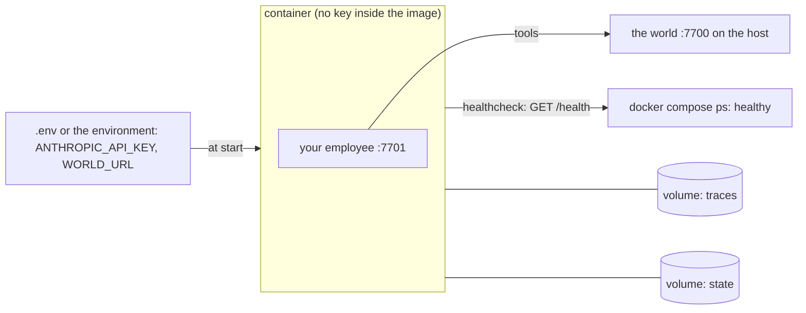
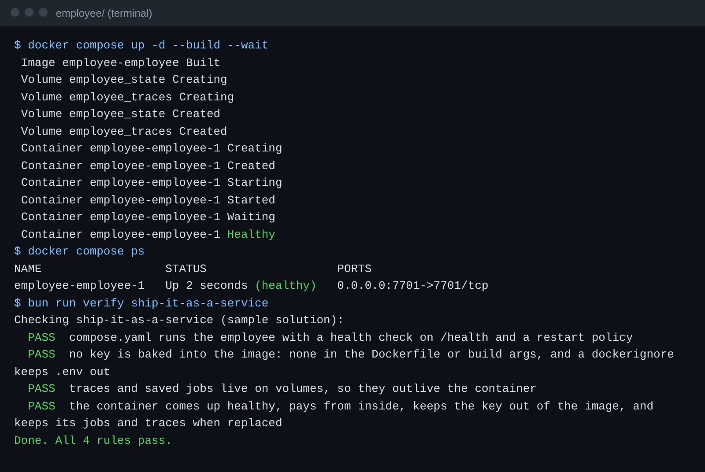

# Ship it as a service

## The problem

Your employee runs only while your terminal is open. Close the laptop, and KaaS Freight's invoices stop. Ravi asks
"is it up?", and nobody can answer without logging in. And if someone builds an image with the key inside, everyone
who pulls that image can read the key.

A real employee runs as a container: a running copy of an image. A good container says whether it is healthy and
restarts itself. It gets its secrets from the environment when it starts. It keeps saved jobs and traces on
volumes that outlive it.

For example, the finished sample runs on port 7701. `docker compose ps` shows the `employee` service as
`(healthy)`. `curl -s localhost:7701/health` answers with contract `"1"`. The API key is in the container's
environment, but not in its image.



## Your challenge

Copy the three starter files in this folder into your `employee/` folder. Fill in every `TODO`:

| File                      | What it holds                                                                                                                                                                                        |
| ------------------------- | ---------------------------------------------------------------------------------------------------------------------------------------------------------------------------------------------------- |
| `Dockerfile`              | Bun's image, your code and `config/`, `PORT`, `TRACE_DIR`, `STATE_DIR`. No key                                                                                                                       |
| `Dockerfile.dockerignore` | Keeps `.env` and local state out of the build                                                                                                                                                        |
| `compose.yaml`            | One service: build, port `${PORT:-7701}`, `WORLD_URL` and the key from the environment, a health check on `/health`, `restart: unless-stopped`, a named volume on `TRACE_DIR` and one on `STATE_DIR` |

The checker sets `PORT`, `WORLD_URL` and `ANTHROPIC_API_KEY` in the environment when it runs `docker compose up`.
So your compose file must read them with `${NAME}`. On Linux, `host.docker.internal` needs
`extra_hosts: ["host.docker.internal:host-gateway"]`.

## Done when

- `compose.yaml` has a health check on `/health` and a restart policy.
- No key is in the Dockerfile or in a build arg. A dockerignore lists `.env`.
- `TRACE_DIR` and `STATE_DIR` sit on volumes.
- The container comes up healthy and pays a clean invoice from inside. It has the key in its environment, but not
  in its image. It still knows the job after `docker compose down` and `up`.

```bash
bun run verify ship-it-as-a-service
```

Expect: `Done. All 4 rules pass.`



When Docker is not running, the last rule prints `SKIPPED: Docker is not running here`. The three file rules still
decide. Start Docker to check the container itself.

## If you get stuck

| What you see                                                        | Fix                                                                                                                     |
| ------------------------------------------------------------------- | ----------------------------------------------------------------------------------------------------------------------- |
| `docker compose up --wait did not finish healthy`                   | Run `docker compose up --build` without `-d` and read the log                                                           |
| `the ledger shows no payment`                                       | The container cannot reach the world. Use `WORLD_URL: ${WORLD_URL:-http://host.docker.internal:7700}` and `extra_hosts` |
| `The Dockerfile says "ARG ANTHROPIC_API_KEY"`                       | Delete it. The key goes in `environment:` in compose                                                                    |
| `GET /jobs/... answered {"error": "no such job"}` after down and up | `STATE_DIR` is not on a named volume                                                                                    |

## Words you will use

- **Image**: the frozen files a container starts from. Anyone who pulls it can read what is inside.
- **Health check**: a command Docker runs to ask the service if it works, not only if it started.
- **Named volume**: storage that Docker keeps when a container is removed.
- **Secret**: a value, like an API key, that is given at start and never written into the image.
