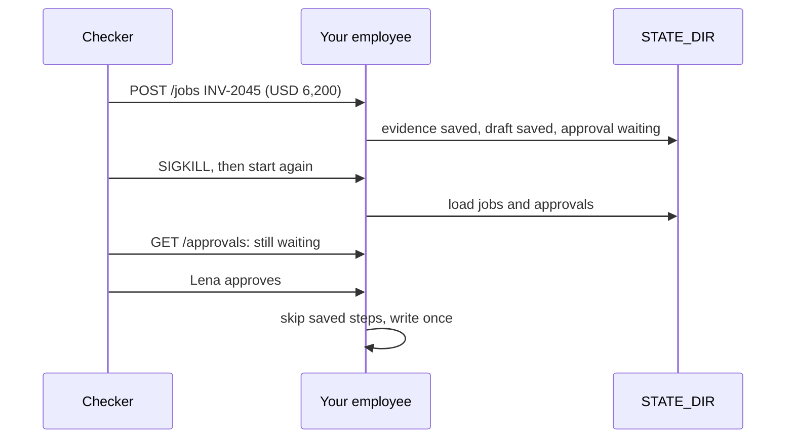

# Save progress

## The problem

A container can be replaced at any time, for example for a new release. Your employee must not forget its work
when that happens.

For example, INV-2045 is for USD 6,200, so it waits for Lena. She is in a meeting. Meanwhile the container is
replaced. If the employee kept its jobs only in memory, Lena comes back to an empty Needs you column. The job is
lost. If it kept the job but not its steps, it reads every paper again. It also pays the model again for a draft it
already had.

So save progress at the end of each unit of work. When you start, carry on from the last saved step.



## Your challenge

In your employee, keep three things in `STATE_DIR`. A SQLite file is enough.

1. Each job and its status.
2. Each approval and its status.
3. Each finished step of a job: the evidence you read and the model's draft.

When your employee starts, load them. A job that was `working` carries on from its last saved step. A job that was
`waiting_for_human` keeps waiting, and its approval is still in `GET /approvals`. When Lena approves after a
restart, the job skips the steps it already finished.

## Done when

- After a SIGKILL and a restart, `GET /jobs/{id}` still says `waiting_for_human`, and the approval is listed.
- Lena's approval pays INV-2045 once.
- The world's access log shows `find_load`, `read_rate_confirmation` and `read_proof_of_delivery` once for the job.
- The traces show one model call for the job.

```bash
bun run verify save-progress
```

Expect: `Done. All 1 rules pass.`

## If you get stuck

| What you see                 | Fix                                                                 |
| ---------------------------- | ------------------------------------------------------------------- |
| `GET /jobs/... answered 404` | Jobs live in memory. Write them to `STATE_DIR`                      |
| `no longer lists job`        | Save approvals with the job, not in a list in memory                |
| `find_load 2 times`          | Save the evidence with the job and skip reading when it is there    |
| `2 model calls`              | Save the draft too. A resume never asks the model for a step it has |

## Words you will use

- **Unit of work**: a step whose result you save, such as "evidence read" or "draft made".
- **Resume**: start again and carry on from the last saved step, not from the top.
- **STATE_DIR**: the folder the checker gives your employee for saved state. It is empty at each fresh trial.
- **SIGKILL**: a signal that stops a process at once, with no warning and no clean up.

Reading: [Effective harnesses for long-running agents](https://www.anthropic.com/engineering/effective-harnesses-for-long-running-agents) (Anthropic).
