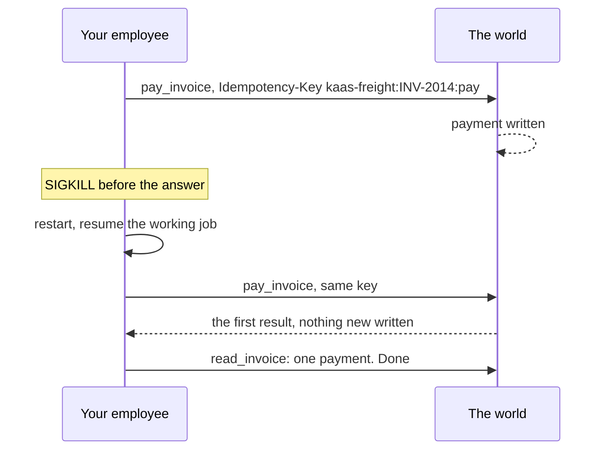
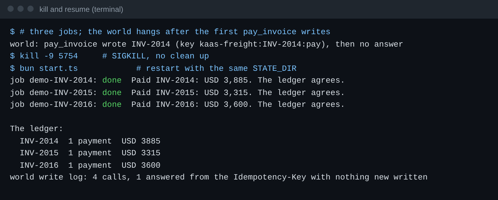

# Pay once after a crash

## The problem

The pay tool writes the payment, and then the process dies before the answer comes back. On restart the employee
sees a job that is still `working` with no recorded result, so it pays again. KaaS Freight paid one invoice twice
last month and spent a long time getting the money back. A crash at the worst moment is not rare: it is a matter of
time.

Saved progress alone does not fix this, because the crash happened between the write and the save. The fix is an
Idempotency-Key that is the same on every try, before and after a restart, so the ledger answers the second call
with the first result and writes nothing new.



## Your challenge

1. Build the key from what does not change: tenant, invoice and action. Never a random id or a timestamp.
2. Send it on every try, and again after a restart.
3. After any doubtful write, read the ledger before you report: it decides.

The checker makes the world hang after the first `pay_invoice` writes, kills your employee with SIGKILL, starts it
again, and reads the ledger. Your employee must use `mode = "http"` for this step.

## Done when

- Every job finishes `done` after the restart.
- The ledger shows each invoice paid exactly once, in 3 of 3 fresh trials.

```bash
bun run verify pay-once-after-a-crash
```

Expect: `Done. All 1 rules pass.`



## If you get stuck

| What you see | Fix |
|---|---|
| `does not know job` | Save progress first: pass `save-progress` |
| `the ledger shows 2 payments after the crash` | Your key changes between tries. Print it before each call and compare |
| `is "working"` after the restart | On start, carry on with every job whose saved status is `working` |

## Words you will use

- **Idempotency-Key**: a name for one intended write. The same key twice writes once.
- **SIGKILL**: a stop with no warning and no clean up, like a power cut.
- **pass^3**: the step passes only when all 3 fresh trials pass, not on average.

Reading: [Scaling Managed Agents: decoupling the brain from the hands](https://www.anthropic.com/engineering/managed-agents) (Anthropic).
