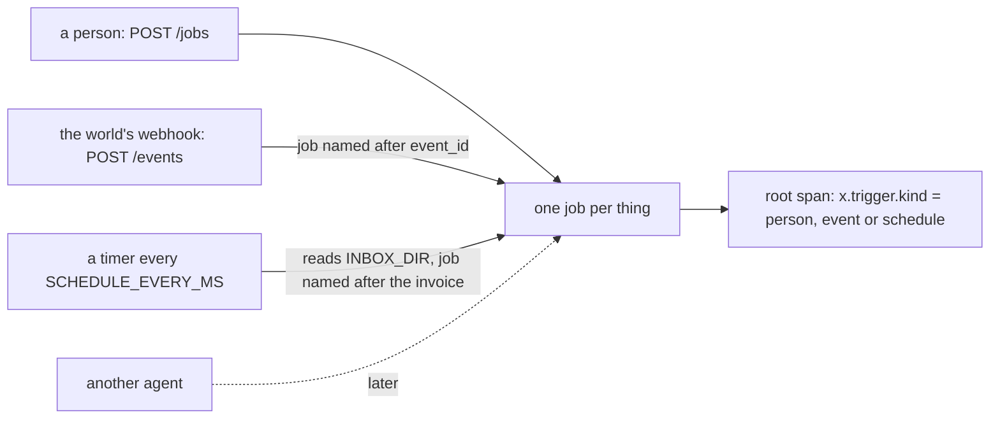

# Start on an event and a schedule

## The problem

Ravi does not want to type a job for every invoice. Carriers upload invoices to the portal, which sends a webhook,
and others email them, which land in a mailbox that is read on a timer. Two new ways to start a job, and two new
ways to pay twice: a webhook is delivered at least once, so the same event can arrive twice, and a timer that
starts a job for every file it sees starts the same invoice again on the next tick.



## Your challenge

1. Add `"event"` and `"schedule"` to `starts_by` in the `[hire]` block of `employee.toml`.
2. Add `POST /events`. The world sends `{"event_id", "type": "invoice.received", "tenant", "invoice_id"}`. Start a
   job named after `event_id` and answer `202`. The same `event_id` again answers `200` and starts nothing new.
3. Add a timer. Every `SCHEDULE_EVERY_MS` milliseconds (the checker sets it short), read each `*.json` file in
   `INBOX_DIR` (`{"tenant", "invoice_id"}`) and start a job named after the tenant and invoice, so the next tick
   finds it and starts nothing.
4. Put the trigger kind in `x.trigger.kind` on each run's root `invoke_agent` span.

## Done when

- `employee.toml` says `starts_by = ["person", "event", "schedule"]`.
- A webhook sent twice pays its invoice once, with one job in the world's access log.
- An inbox file pays its invoice once over several ticks, with one job in the access log.
- The root span says `event` or `schedule` for each.

```bash
bun run verify start-on-an-event-and-a-schedule
```

Expect: `Done. All 2 rules pass.`

## If you get stuck

| What you see                         | Fix                                                               |
| ------------------------------------ | ----------------------------------------------------------------- |
| `POST /events answered 404`          | Add the route next to `POST /jobs`; both start a job the same way |
| `2 jobs on INV-...` from the webhook | Use `event_id` in the job id, never a fresh random id             |
| `jobs on INV-...` from the timer     | The job id must not include the tick count or the time            |
| `says x.trigger.kind = "person"`     | Pass the trigger into the job and copy it onto the root span      |

## Words you will use

- **Webhook**: an HTTP call another system makes to you when something happens.
- **At least once**: a delivery promise that may repeat a message, never lose it.
- **Trigger**: what started a job: a person, an event, a schedule or another agent.
